# QICOM — Benutzerhandbuch

**Schauen Sie zuerst die Bilder an. Lesen Sie den Text nur, wenn Sie ihn brauchen.**

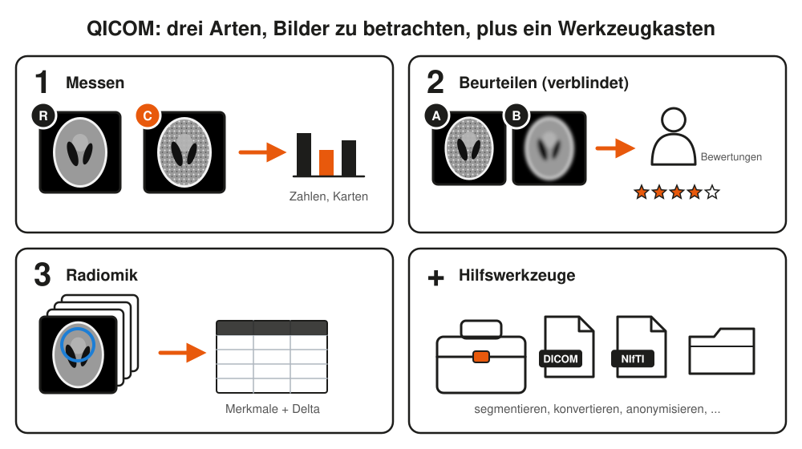

> **Nur für Forschung und Qualitätskontrolle.** QICOM ist kein Medizinprodukt.
> Verwenden Sie es nicht für Diagnosen oder für Entscheidungen über die Behandlung von Patienten.

---

## Inhalt

1. [Bevor Sie beginnen](#1-bevor-sie-beginnen)
2. [Installieren und öffnen](#2-installieren-und-öffnen)
3. [Die Grundlagen (einmal lesen)](#3-die-grundlagen-einmal-lesen)
4. [Quantitative Analyse: zwei Bilder messen](#4-quantitative-analyse-zwei-bilder-messen)
5. [Qualitative Analyse: Menschen bewerten Bilder](#5-qualitative-analyse-menschen-bewerten-bilder)
6. [Radiomik: Merkmale in einer Region vergleichen](#6-radiomik-merkmale-in-einer-region-vergleichen)
7. [Hilfswerkzeuge](#7-hilfswerkzeuge)
8. [Einstellungen](#8-einstellungen)
9. [Datenschutz und Sicherheit](#9-datenschutz-und-sicherheit)
10. [Wenn etwas nicht klappt](#10-wenn-etwas-nicht-klappt)
11. [Begriffe in QICOM](#11-begriffe-in-qicom)

---

## 1. Bevor Sie beginnen

**Was QICOM tut:** Es vergleicht medizinische Bilder und sagt Ihnen, wie verschieden sie sind.

| Sie möchten... | Verwenden Sie |
|---|---|
| **Zahlen** erhalten, die sagen, wie nah ein Bild einem anderen ist | **Quantitativ** |
| Bilder von **Menschen** bewerten lassen, ohne dass sie wissen, welches welches ist | **Qualitativ** |
| **Textur- und Formmerkmale** in einer Region vergleichen | **Radiomik** |
| Konvertieren, anonymisieren, segmentieren, neu abtasten, DICOM-Tags lesen... | **Hilfswerkzeuge** |

**Was Sie brauchen**

- Einen Computer mit Windows 10/11 (64 Bit), macOS 14 auf Apple Silicon oder Linux 64 Bit.
- 8 GB Arbeitsspeicher reichen. 16 GB sind besser. 32 GB für große 3D-Volumen.
- Ihre Bilder: **DICOM** (eine Datei oder ein Ordner mit einer Serie), **NIfTI** (`.nii`, `.nii.gz`)
  oder **PNG / JPG / BMP**. Die Radiomik akzeptiert nur DICOM und NIfTI.

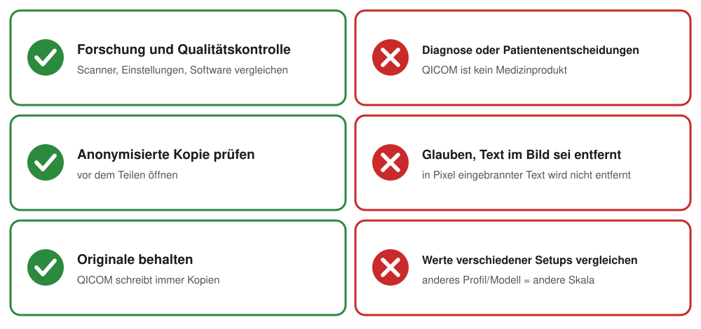

---

## 2. Installieren und öffnen

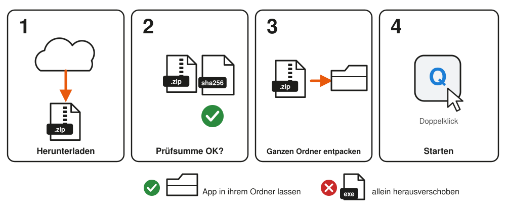

1. **Laden** Sie die Datei für Ihr System herunter, zusammen mit der Datei `.sha256`.
2. **Prüfen** Sie den Download. Das Ergebnis muss `True` (Windows) oder `OK` (macOS/Linux) sein:
   - Windows (PowerShell): `Get-FileHash QICOM-windows-x64.zip` mit der Datei `.sha256` vergleichen
   - macOS: `shasum -a 256 -c QICOM-macos-arm64.zip.sha256`
   - Linux: `sha256sum -c QICOM-linux-x64.tar.gz.sha256`
3. **Entpacken** Sie in einen echten Ordner (nicht im Zip-Fenster). Lassen Sie den Ordner vollständig.
4. **Starten** Sie QICOM:
   - Windows: Doppelklick auf `qicom.exe`. Erscheint „Der Computer wurde durch Windows geschützt“
     und die Prüfsumme ist OK, klicken Sie *Weitere Informationen* → *Trotzdem ausführen*
     (nur wenn Ihre Organisation es erlaubt).
   - macOS: Doppelklick auf `QICOM.app`. Blockiert macOS die App: *Systemeinstellungen →
     Datenschutz & Sicherheit → Dennoch öffnen*.
   - Debian/Ubuntu: `sudo apt install ./QICOM-linux-x64.deb`, dann **QICOM** im Anwendungsmenü
     öffnen oder `qicom` eingeben.
   - Aus dem Quellcode: `qicom-gui`.

> ✗ Ein Virenscanner, der eine echte Bedrohung nennt, ist **nicht** dasselbe wie die Warnung
> „unbekannte App“. Umgehen Sie ihn nicht. Informieren Sie Ihre IT-Abteilung.

### Der Startbildschirm

QICOM öffnet immer diesen Bildschirm. Wählen Sie, was Sie tun möchten.

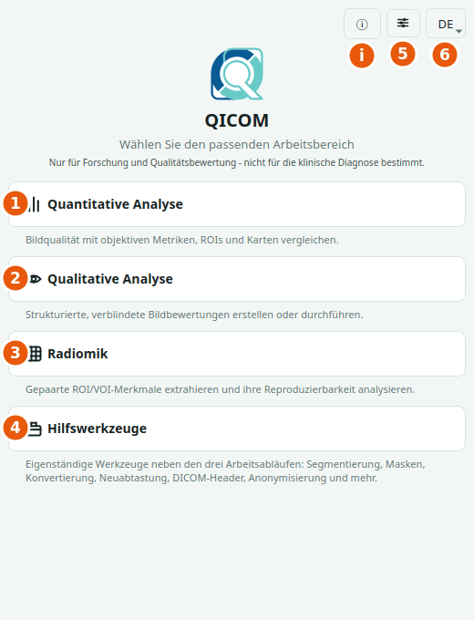
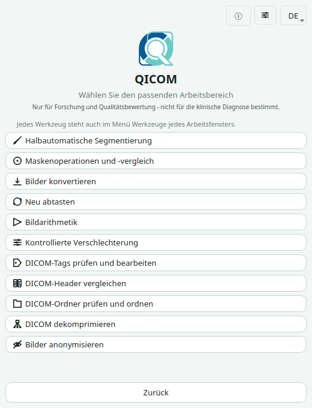

| | Schaltfläche | Was sie öffnet |
|---|---|---|
| 1 | Quantitative Analyse | Bilder mit Zahlen und Karten messen |
| 2 | Qualitative Analyse | verblindete Bewertungen erstellen, durchführen oder sammeln |
| 3 | Radiomik | Merkmale in einer Region vergleichen |
| 4 | Hilfswerkzeuge | der Werkzeugkasten (rechtes Bild) |
| i / 5 / 6 | ⓘ, Einstellungen, Sprache | über QICOM, Einstellungen, Sprache |

Jede Schaltfläche öffnet eine kleine zweite Seite:

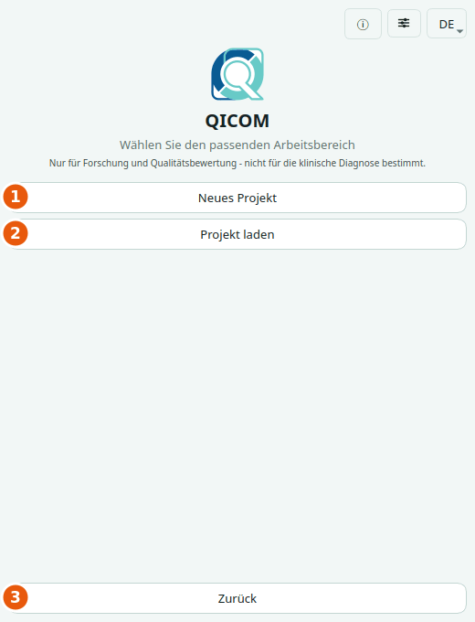
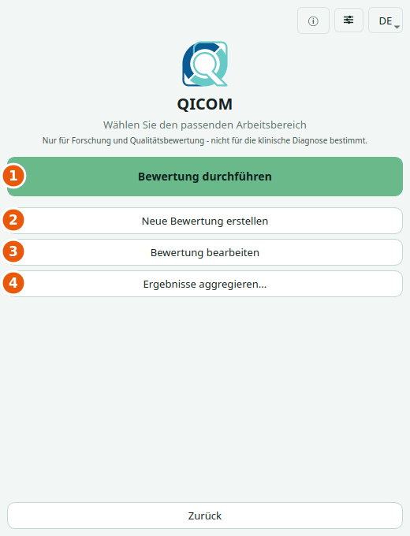
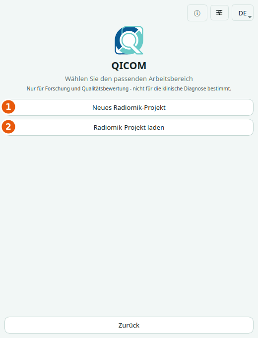

- **Quantitativ:** 1 Neues Projekt · 2 Gespeichertes Projekt laden (`.zip`) · 3 Zurück.
  Darunter erscheinen die letzten Projekte: ein Klick zum Wiederöffnen.
- **Qualitativ:** 1 **Bewertung durchführen** (grün: man hat Ihnen eine geschickt) ·
  2 Neu erstellen · 3 Bearbeiten · 4 Ergebnisse aggregieren.
- **Radiomik:** 1 Neues Projekt · 2 Gespeichertes Projekt laden.

Um später hierher zurückzukehren: **Datei → Projekt schließen**.

---

## 3. Die Grundlagen (einmal lesen)

### Schritte sind Reiter

Jeder Arbeitsbereich ist eine Reihe nummerierter Reiter. **Gehen Sie von links nach rechts.**
Sie können jederzeit zurück.

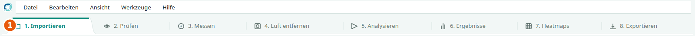

### Maus und Tastatur auf einem Bild

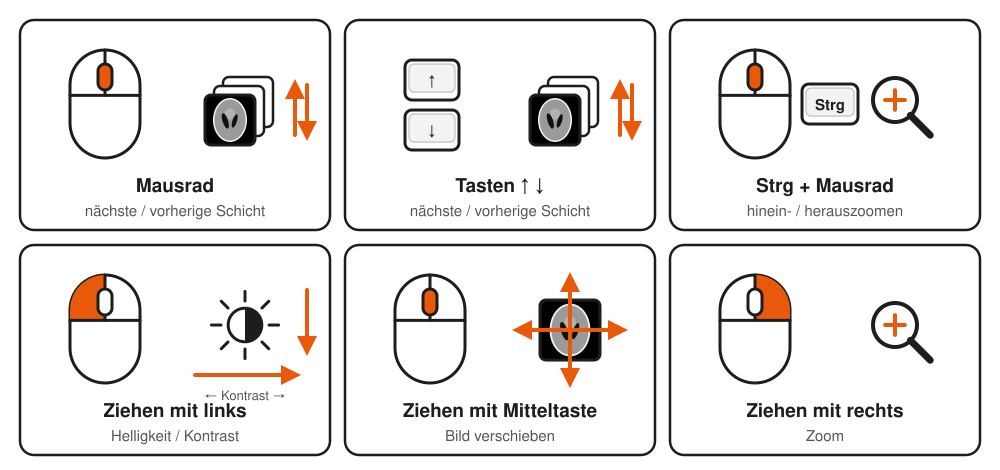

- **Bild laden:** auf ein leeres Bildfeld klicken oder eine Datei darauf ziehen.
- **Rückgängig / Wiederholen:** `Strg+Z` / `Strg+Y` (Quantitativ).
- Schaltflächen über jedem Bild: drehen, spiegeln, zurücksetzen, **Bilder laden**.

### Referenz und Vergleich

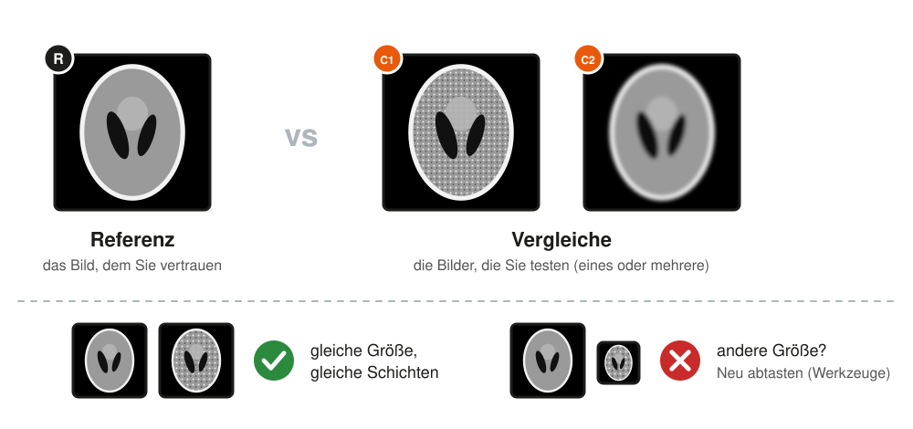

- **R — Referenz:** das Bild, dem Sie vertrauen (zum Beispiel volle Dosis, Original).
- **C1, C2, ... — Vergleiche:** die Bilder, die Sie testen. Fügen Sie beliebig viele mit
  **+ Vergleich hinzufügen** hinzu.
- Die Bilder müssen **gleich groß sein und gleich viele Schichten haben**.
  Ist das nicht so? Verwenden Sie zuerst **Werkzeuge → Neu abtasten**.

### Was QICOM schreibt

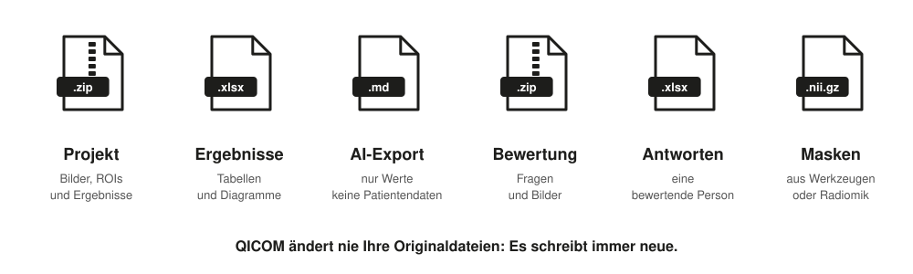

### Menüs (in jedem Fenster gleich)

| Menü | Inhalt |
|---|---|
| **Datei** | öffnen, speichern, exportieren, Projekt schließen |
| **Bearbeiten** | rückgängig, wiederholen (Quantitativ) |
| **Ansicht** | Thema (hell/grau/dunkel), **Bereiche** (Verlauf, Protokoll, Fehler) |
| **Werkzeuge** | die Hilfswerkzeuge, Zahlenformat, Sprache, **Einstellungen** |
| **Hilfe** | Fehler melden, über QICOM (Lizenz, Zitierweise) |

---

## 4. Quantitative Analyse: zwei Bilder messen

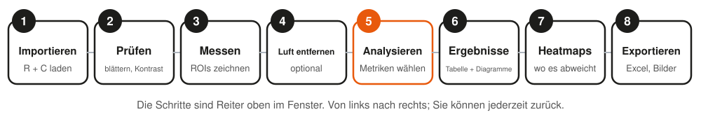

### Schritt 1 — Importieren

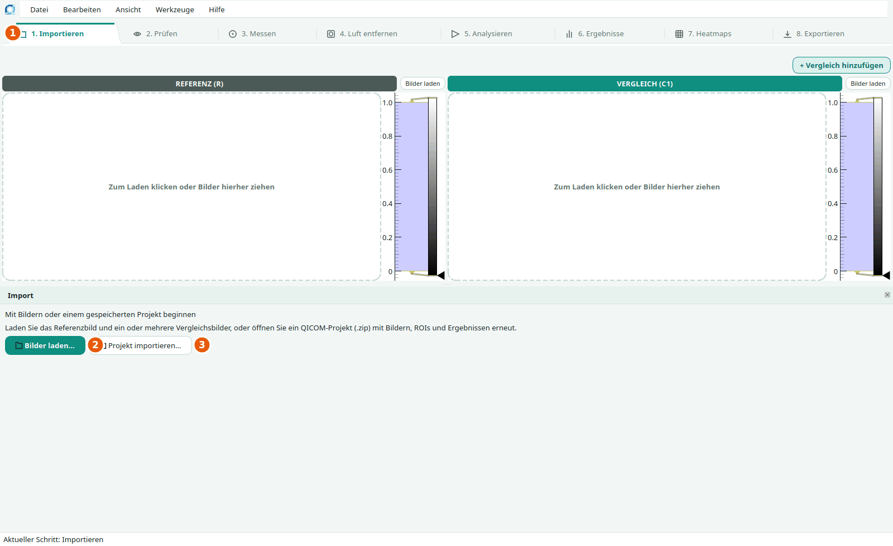

1. Die Schritt-Reiter.
2. **Bilder laden:** eine Datei oder einen Ordner wählen, dann das Feld (Referenz oder Vergleich).
3. **Projekt importieren:** ein gespeichertes QICOM-Projekt (`.zip`) mit Bildern, ROIs und
   Ergebnissen wieder öffnen.

Schneller: auf ein leeres Feld klicken oder eine Datei darauf ziehen.

### Schritt 2 — Prüfen

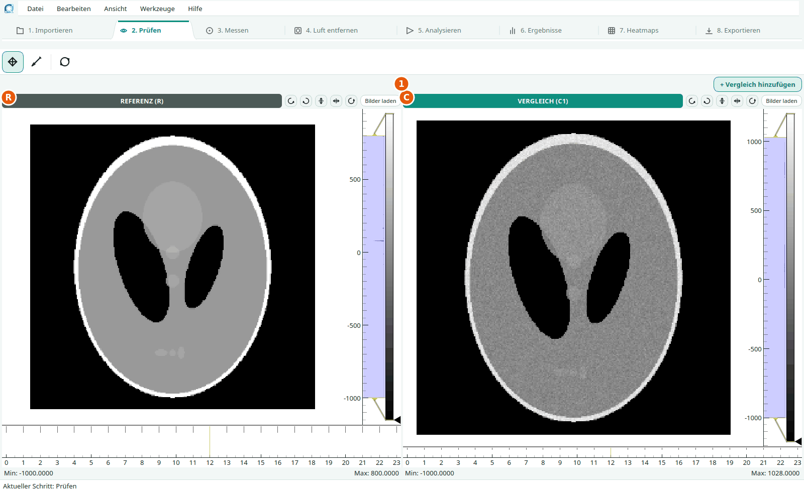

- **R** ist die Referenz, **C** der Vergleich. Jedes Bild hat rechts seinen eigenen Kontrastbalken.
- 1 Ansichtswerkzeuge: **Zoom / Verschieben**, **Anmerkung** (eine Textnotiz auf dem Bild),
  **Fensterung synchronisieren** (Kontrast an einem Bild ändern → alle Bilder folgen).
- Mit dem Mausrad durch die Schichten blättern. Mit links ziehen für Helligkeit und Kontrast.

Mehr als ein Vergleich? Jeder bekommt sein eigenes Feld:

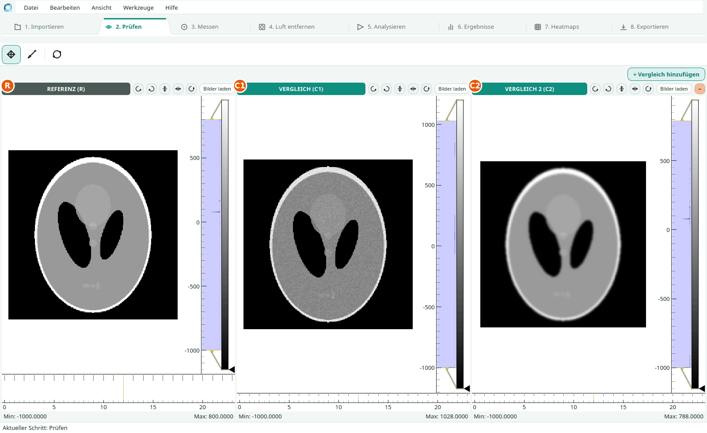

> Vor der Berechnung prüft QICOM Pixelgröße, Ausrichtung und Schichtabstand.
> Probleme erscheinen unter **Ansicht → Bereiche → Fehler**. QICOM ändert Ihre Pixel nie von sich aus.

### Schritt 3 — Messen (optional)

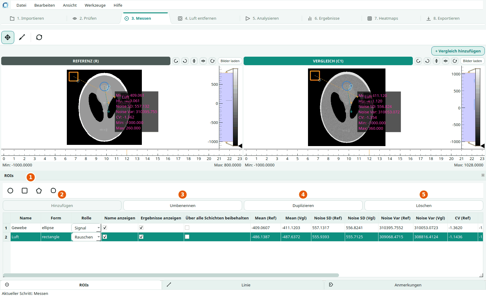

1. Eine Form wählen: **Kreis**, **Rechteck**, **Polygon**, **Freihand**.
2. **Hinzufügen** — dieselbe ROI erscheint auf jedem Bild, an derselben Stelle.
3. **Umbenennen** · 4 **Duplizieren** · 5 **Löschen**.

In der Tabelle die **Rolle** jeder ROI festlegen:

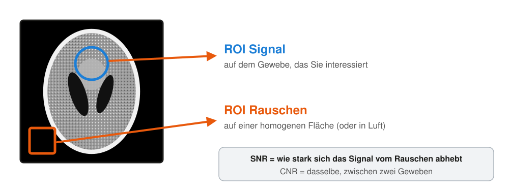

- **Signal:** auf dem Gewebe, das Sie interessiert. **Rauschen:** auf einer homogenen Fläche oder in Luft.
- Mit beiden liefert QICOM **SNR** und **CNR**.
- Die Werte aktualisieren sich live in der Tabelle: Mittelwert, Rausch-SD, CV, Min, Max.
- Reiter unten: **Linie** (eine Linie ziehen, Intensitätsprofil sehen) und **Anmerkungen**.
- **Über alle Schichten beibehalten:** die ROI bleibt auf jeder Schicht, nicht nur auf der aktuellen.

### Schritt 4 — Luft entfernen (optional)

Der größte Teil einer Schicht ist Luft. Luft gleicht Luft, deshalb wirken Bilder ähnlicher, als sie sind.
Dieser Schritt entfernt die Luft **um** den Körper (Luft im Körper bleibt).

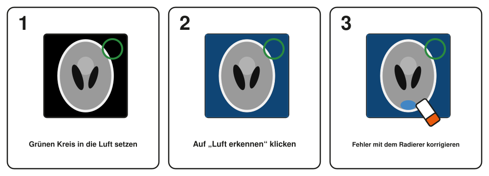

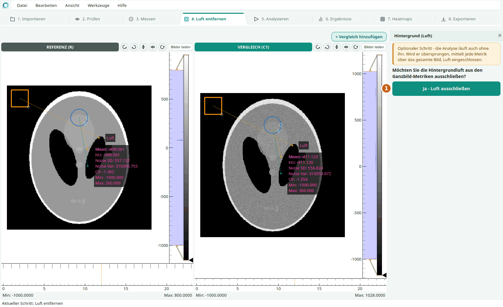
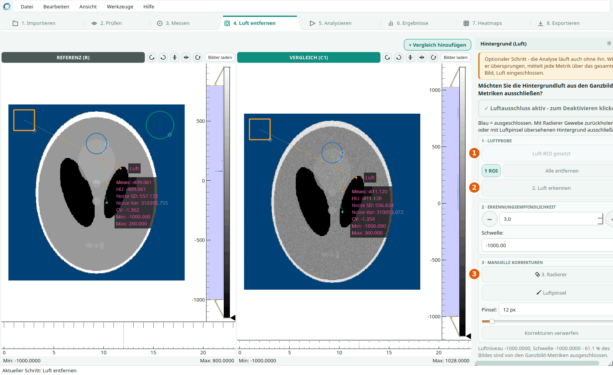

1. Auf die große Schaltfläche klicken, um den Ausschluss **einzuschalten**. **Luft-ROI hinzufügen**
   klicken: ein grüner Kreis erscheint. Ziehen Sie ihn auf eine Stelle mit reiner Luft.
2. **Luft erkennen.** Alles Blaue wird aus den Metriken über das ganze Bild ausgeschlossen.
   Zu viel oder zu wenig? Empfindlichkeit **−/+** verwenden oder die Schwelle eingeben.
3. **Radierer** gibt versehentlich erfasstes Gewebe zurück. **Luftpinsel** fügt übersehene Luft hinzu.
   **Korrekturen verwerfen** kehrt zum erkannten Ergebnis zurück.

> Diesen Schritt zu überspringen ist in Ordnung. Dann mitteln die Metriken über das ganze Bild,
> Luft eingeschlossen. ROI-Messungen ändern sich nie.

### Schritt 5 — Analysieren

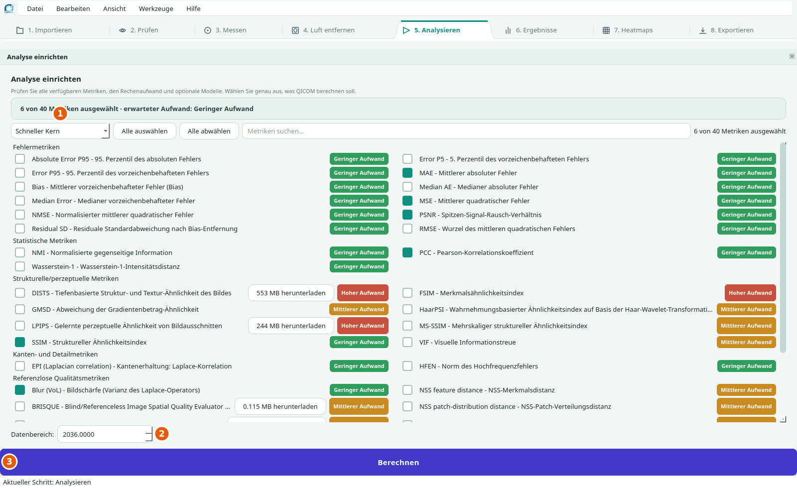

1. **Profil:** ein fertiger Satz von Metriken. Beginnen Sie mit **Schneller Kern**.
   Wer Kästchen von Hand ankreuzt, macht daraus ein eigenes Profil.
2. **Datenbereich:** die Spanne der möglichen Pixelwerte. QICOM füllt ihn aus;
   lassen Sie ihn, wenn Sie es nicht besser wissen.
3. **Berechnen.** Ein Fortschrittsbalken ersetzt die Schaltfläche. Sie können abbrechen.

- Etiketten: **Geringer / Mittlerer / Hoher Aufwand** = wie lange eine Metrik dauert.
- **Herunterladen** neben einer Metrik (LPIPS, DISTS, BRISQUE...): ihr Modell ist nicht enthalten.
  Es wird nur auf Ihren Klick heruntergeladen und vor der Verwendung geprüft. Ohne Modell wird die
  Metrik übersprungen.
- Mit dem Suchfeld finden Sie eine Metrik nach Namen. Fahren Sie mit der Maus darüber, um zu lesen,
  was sie bedeutet.

### Schritt 6 — Ergebnisse

QICOM springt von selbst hierher, wenn die Berechnung fertig ist.

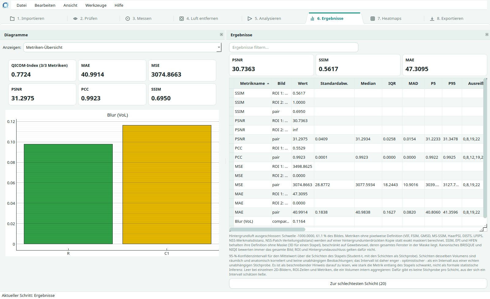

- **Links:** Diagramme. Wählen Sie eine Ansicht unter **Anzeigen** und ein Paar
  (`R vs C1`, `R vs C2`, `R vs All`).
- **Rechts:** große Karten mit den wichtigsten Zahlen, dann die vollständige Tabelle.
  In **Ergebnisse filtern** tippen, um zu suchen.
- Zeilen: **pair** = ganzes Bild; **ROI 1, ROI 2** = innerhalb jeder ROI.
- Bei Volumen: Median, IQR, P5/P95 und Ausreißer-Schichten.
  **Zur schlechtesten Schicht** springt zur Schicht mit der größten Abweichung.

So lesen Sie eine Zahl:

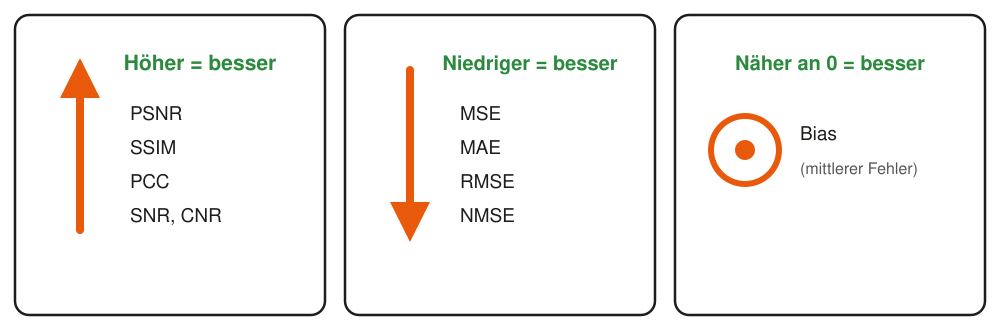

> Der **QICOM-Index** (0 bis 1, 1 = identisch) ist experimentell. Vergleichen Sie ihn nur zwischen
> Ergebnissen mit **demselben Profil und derselben Version**.

### Schritt 7 — Heatmaps

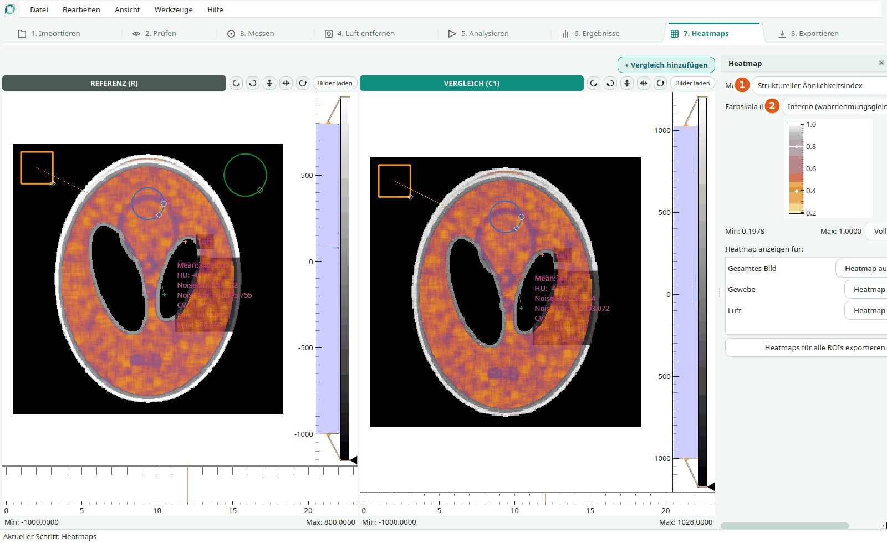

1. Eine Metrik wählen (SSIM, MSE, MAE, NMSE, Bias).
2. Eine Farbskala wählen.

- Die Karte zeigt **wo** sich die Bilder unterscheiden, über dem Bild.
- **Heatmap anzeigen für:** ganzes Bild oder eine ROI.
  **Heatmaps für alle ROIs exportieren...** speichert sie als Bilder.
- Bei SSIM ist die Skala umgekehrt, damit beschädigte Bereiche trotzdem hervortreten.

### Schritt 8 — Exportieren

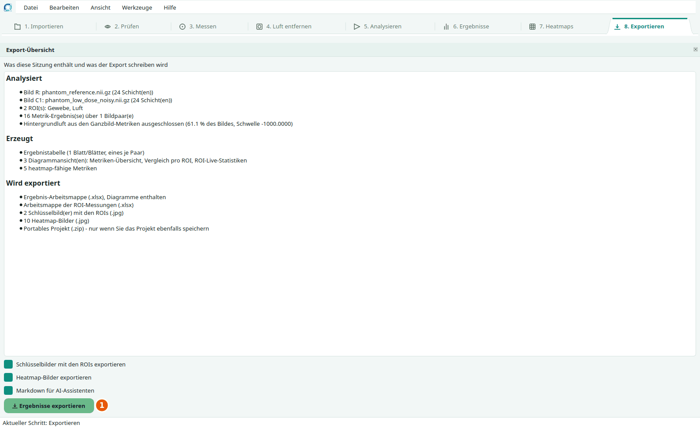

- Die Seite listet, was analysiert wurde, was erzeugt wurde und **was geschrieben wird**.
- Entfernen Sie das Häkchen bei allem, was Sie nicht wollen (Schlüsselbilder, Heatmaps, AI-Markdown).
- 1 **Ergebnisse exportieren** → Excel-Arbeitsmappe (mit Diagrammen), ROI-Arbeitsmappe, Bilder.
- Um später weiterzuarbeiten: **Datei → Speichern / Exportieren...** speichert ein portables Projekt (`.zip`).

> **Markdown für AI-Assistenten** (`*_ai_assistant.md`): nur Zahlen und Metrik-Definitionen —
> keine Dateinamen, keine Patientendaten, kein DICOM-Header. QICOM sendet ihn nirgendwohin.
> Öffnen und lesen Sie ihn, bevor Sie ihn in einen Chat einfügen.

---

## 5. Qualitative Analyse: Menschen bewerten Bilder

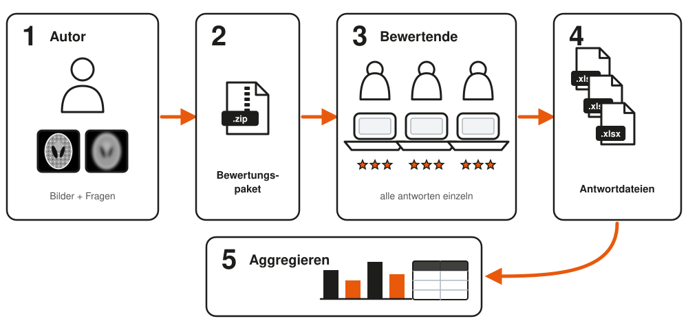

Es gibt drei Rollen. Jede hat ihre eigene Schaltfläche auf dem Startbildschirm.

| Rolle | Schaltfläche auf dem Startbildschirm | Schritte |
|---|---|---|
| **Autor** — erstellt den Test | Neue Bewertung erstellen / Bewertung bearbeiten | Einstellungen → Bilder → Fragen → Alle Seiten → Vorschau → Speichern |
| **Bewertende** — beantworten ihn | **Bewertung durchführen** (grün) | Bewerten → Antworten prüfen → Abschließen und speichern |
| **Sammelnde** — führen die Antworten zusammen | Ergebnisse aggregieren | Fragen → Antworten → Analyse → Exportieren |

### 5A. Autor: die Bewertung erstellen

**Schritt 1 — Einstellungen.** Legen Sie fest, wie sich der ganze Test verhält, bevor Sie ihn aufbauen.

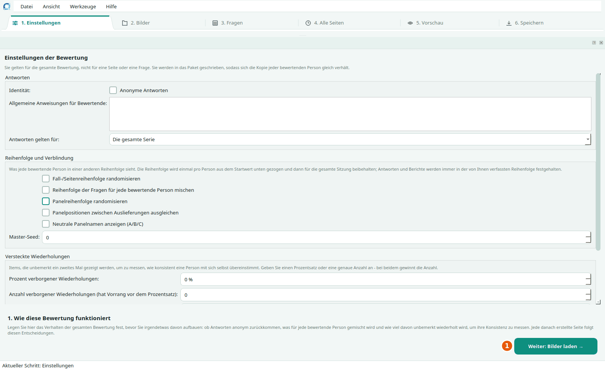

- **Anonyme Antworten:** es werden keine Namen abgefragt oder gespeichert.
- **Anleitung** für die Bewertenden. **Antworten gelten für:** die ganze Serie oder jede Schicht.
- **Reihenfolge und Verblindung:** Seiten, Fragen oder Bildfelder mischen; neutrale Labels A/B/C;
  ein **Seed** macht das Mischen wiederholbar.
- **Versteckte Wiederholungen:** manche Elemente zweimal zeigen, um zu sehen, ob Personen mit sich selbst
  übereinstimmen.
- 1 **Weiter: Bilder laden.**

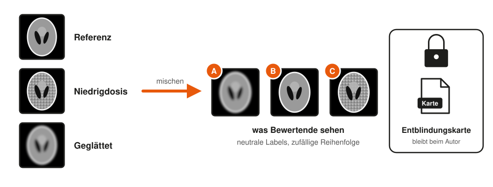

**Schritt 2 — Bilder.** Laden Sie die Bilder **dieser Seite**.

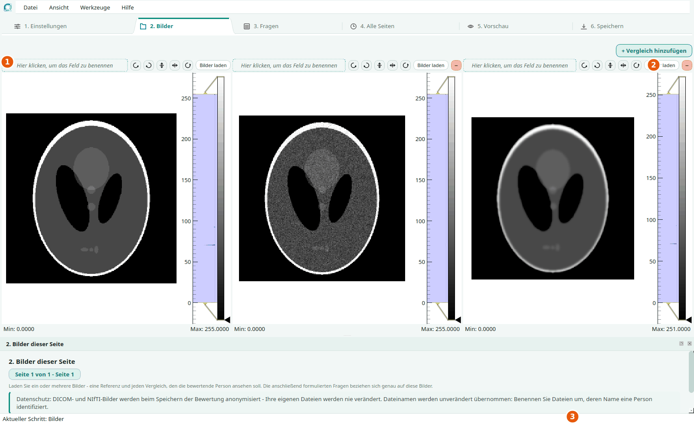

1. Auf ein Feld klicken (oder eine Datei darauf ziehen). Auf die Namensleiste klicken, um es umzubenennen.
2. **+ Vergleich hinzufügen** für weitere Felder. 3 **Weiter.**

> DICOM und NIfTI werden beim Speichern de-identifiziert. Dateinamen werden unverändert kopiert:
> Benennen Sie jede Datei um, deren Name einen Patienten identifiziert.

**Schritt 3 — Fragen.** Schreiben Sie, was die Bewertenden zu diesen Bildern beantworten sollen.

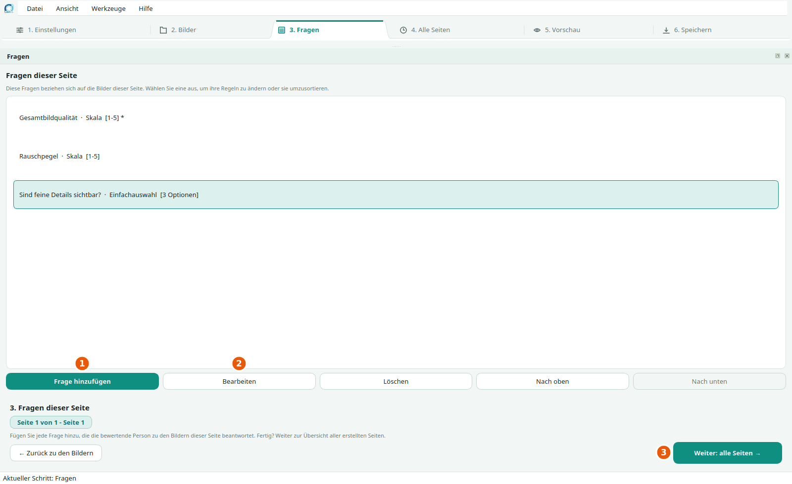

1. **Frage hinzufügen** · 2 **Bearbeiten** (auch Löschen, Nach oben/unten) · 3 **Weiter: alle Seiten.**

Antwortformate: numerische Skala (mit Wörtern an den Enden, z. B. 1 = Schlecht, 5 = Ausgezeichnet),
Einfachauswahl, Mehrfachauswahl, Dropdown-Liste, freier Text, Rangfolge, A oder B (2-AFC),
A / B / kein Unterschied. Jede Frage kann **Nicht beurteilbar** zulassen.

**Schritt 4 — Alle Seiten.** Eine Zeile pro Seite: ihre Bilder und Fragen.

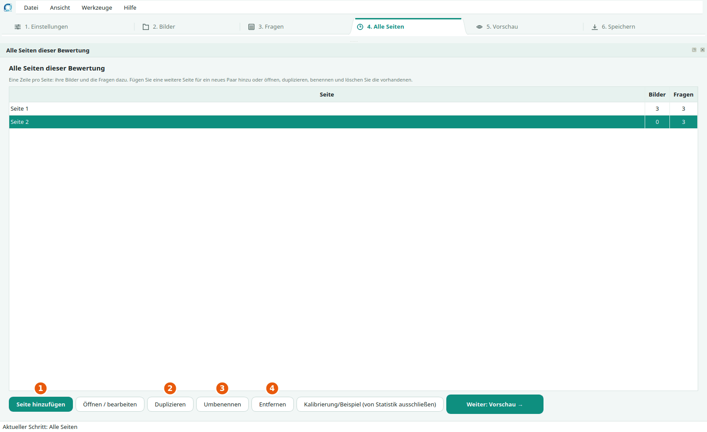

1. **Seite hinzufügen** (zurück zu Schritt 2 für die neue Seite) · 2 **Duplizieren** (kopiert die Fragen) ·
   3 **Umbenennen** · 4 **Entfernen**.
- **Kalibrierung/Beispiel:** eine Übungsseite, von der Statistik ausgeschlossen.

**Schritt 5 — Vorschau.** Sehen Sie genau, was Bewertende sehen werden. Probieren Sie die Antworten aus.

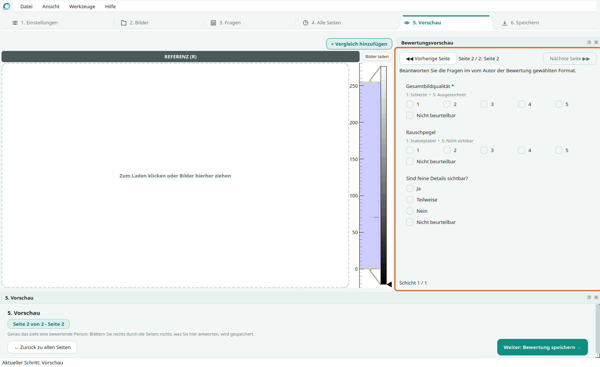

**Schritt 6 — Speichern.**

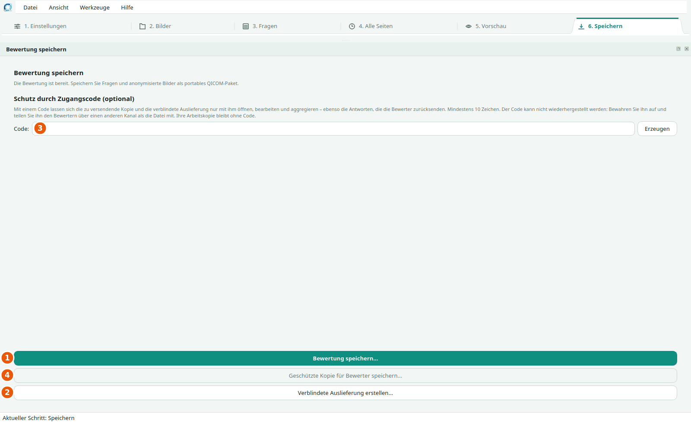

1. **Bewertung speichern...** → eine einzige `.zip`-Datei. Schicken Sie diese Datei an die Bewertenden.
2. **Verblindete Auslieferung erstellen...** → ein ZIP mit neutralen Namen + eine separate
   **Entblindungskarte** (die Karte behalten Sie selbst).
3. **Zugangscode** (optional, mindestens 10 Zeichen, **nicht wiederherstellbar**).
   Geben Sie einen ein oder klicken Sie **Erzeugen**.
4. **Geschützte Kopie für Bewerter speichern...** → nur wer den Code hat, kann sie öffnen.
   Schicken Sie den Code über einen anderen Weg als die Datei.

### 5B. Bewertende: die Bewertung beantworten

1. Startbildschirm → **Qualitative Analyse** → **Bewertung durchführen** → die `.zip` wählen.
2. Anmelden, oder **Ohne Anmeldung fortfahren**.

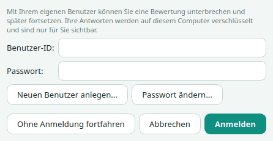

| | Mit eigenem Benutzer | Ohne Anmeldung |
|---|---|---|
| Pausieren und später weitermachen | ✓ | ✗ (eine Sitzung) |
| Antworten auf diesem Computer gespeichert | ✓ verschlüsselt, nur Sie sehen sie | ✗ nichts wird gespeichert |

**Schritt 1 — Bewerten.**

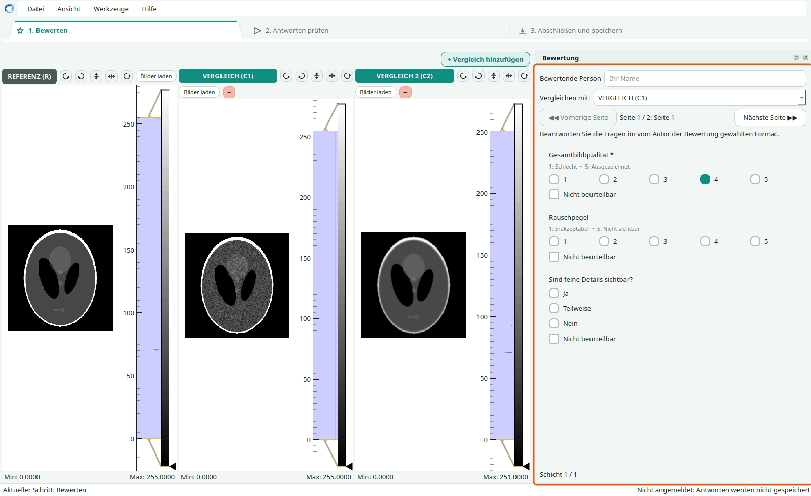

- Geben Sie Ihren Namen ein (außer der Test ist anonym).
- **Vergleichen mit:** welches Bild Sie bewerten.
- Beantworten Sie jede Frage. Pflichtfragen haben ein `*`.
- **Vorherige / Nächste Seite** zum Weitergehen. Mausrad für andere Schichten.

**Schritt 2 — Antworten prüfen.** Eine Tabelle mit allem, was Sie beantwortet haben. Gehen Sie zurück,
um etwas zu korrigieren.

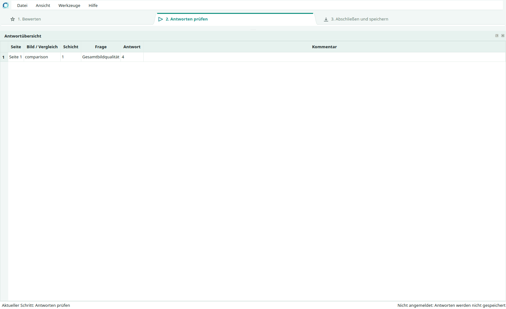

**Schritt 3 — Abschließen und speichern.**

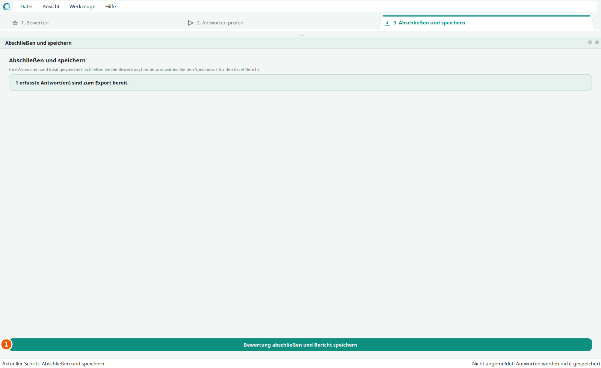

1. **Bewertung abschließen und Bericht speichern** → eine Excel-Datei mit Ihren Antworten
   (eine verschlüsselte Antwortdatei, wenn der Test mit einem Code geschützt ist). Schicken Sie sie
   an den Autor zurück.

### 5C. Sammelnde: die Antworten aggregieren

**1 — Fragen.** Laden Sie die `.zip` der Bewertung, die Sie verschickt haben. Verblindete Auslieferung?
Laden Sie auch ihre Entblindungskarte.

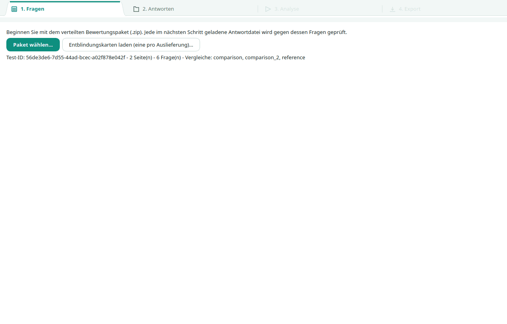

**2 — Antworten.** **Antwortdateien hinzufügen...** — `.json`, die Excel-Dateien der Bewertenden oder CSV.

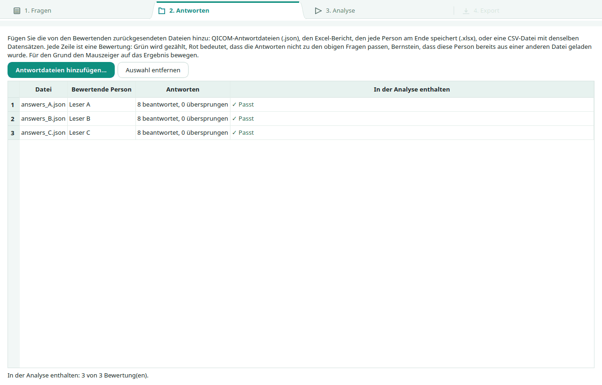

- **Grün** = gezählt. **Rot** = passt nicht zu diesen Fragen (mit der Maus darüberfahren, um den Grund
  zu sehen). **Gelb** = diese Person wurde schon aus einer anderen Datei geladen.
- 10 erwartet und 20 bekommen? Jemand hat zweimal geantwortet. Sie entscheiden.

**3 — Analyse.** **Analyse ausführen.**

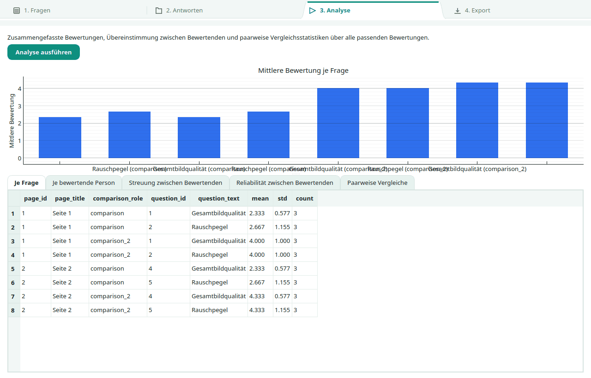

Reiter: je Frage, je bewertende Person, Streuung zwischen Bewertenden, Reliabilität zwischen Bewertenden,
paarweise Vergleiche. Details: [QUALITATIVE_METHODOLOGY.md](../../QUALITATIVE_METHODOLOGY.md) (auf Englisch).

**4 — Exportieren.** Excel (mit Diagrammen) oder ein Ordner mit CSV-Dateien.

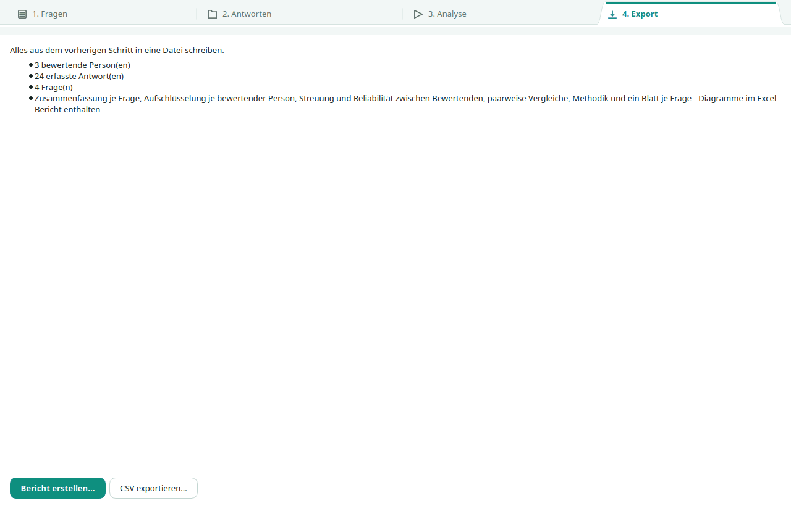

---

## 6. Radiomik: Merkmale in einer Region vergleichen

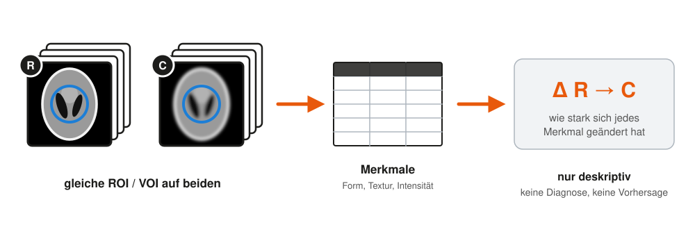

Die Radiomik verwandelt das Innere einer Region in Zahlen (Form, Intensität, Textur) und zeigt dann,
wie stark sich jede Zahl von **R** zu **C** verändert hat. Nur DICOM und NIfTI.

**Schritt 1 — Bilder.** Laden Sie die Referenz (1) und den Vergleich (2): auf das Feld klicken,
**Bilder laden** verwenden oder das Menü **Datei** (Datei oder DICOM-Ordner).

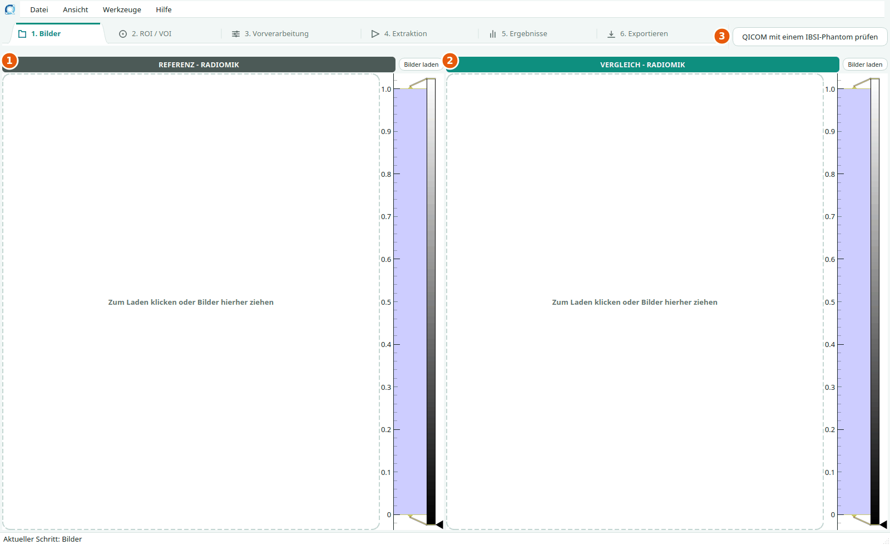

3. **QICOM mit einem IBSI-Phantom prüfen** — optionale Selbstprüfung (siehe unten).

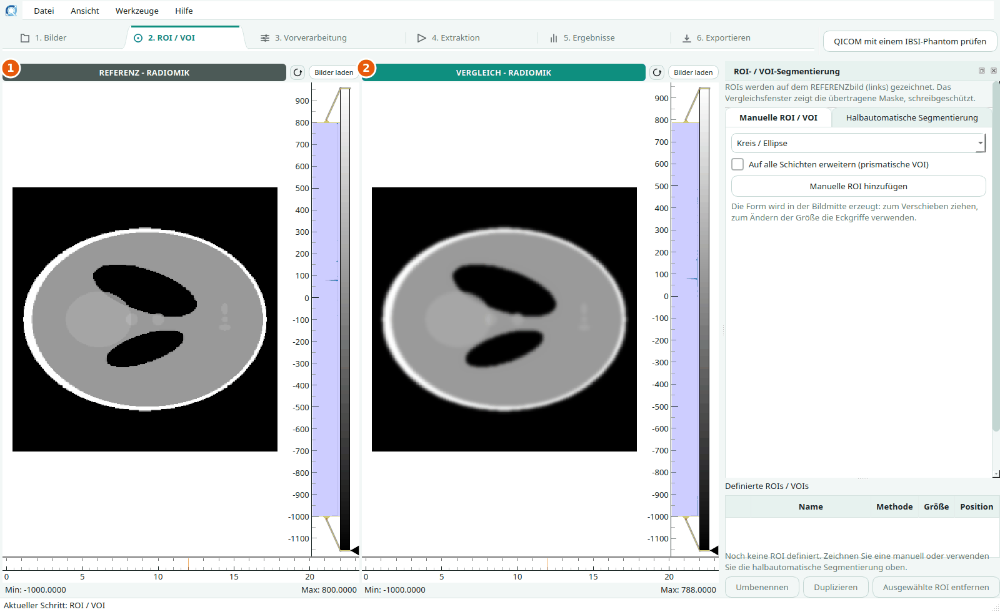

**Schritt 2 — ROI / VOI.** Zeichnen Sie auf der **Referenz** (links). Der Vergleich erhält dieselbe Region.

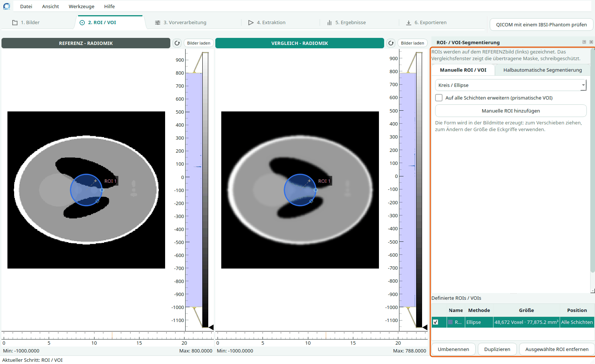

- **Manuelle ROI / VOI:** eine Form wählen → **Manuelle ROI hinzufügen** → verschieben und Größe ändern.
  **Auf alle Schichten erweitern** ankreuzen für eine 3D-Region (VOI).
- **Halbautomatische Segmentierung:** Schwelle oder Regionenwachstum ab einem Klick.
- Eine Segmentierung aus einem anderen Programm: **Datei → NIfTI-Labelmap importieren…**
- Die Liste unten zeigt jede Region: Größe in Voxeln und mm³, abgedeckte Schichten.

**Schritt 3 — Vorverarbeitung.** Das Rezept, das vor der Extraktion angewendet wird.

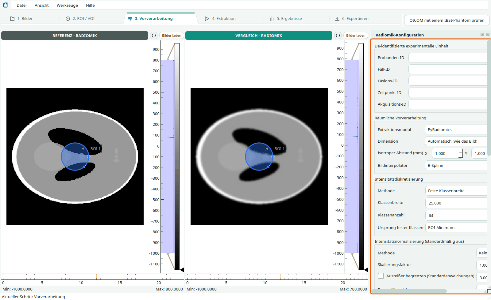

- **Identitäts**-Felder (Proband, Fall, Läsion, Zeitpunkt): Codes verwenden, niemals Namen.
- **Engine** (PyRadiomics, oder MIRP falls installiert), **Voxelabstand**, **Interpolation**.
- **Diskretisierung:** feste Bin-Breite oder feste Bin-Anzahl.
- **Normalisierung / Clipping:** standardmäßig aus. Nichts ändert sich, wenn Sie es nicht verlangen.

**Schritt 4 — Extraktion.** Zusammenfassung prüfen, dann 1 **Alle Merkmale extrahieren**.

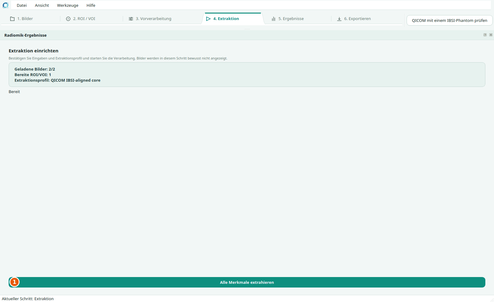

**Schritt 5 — Ergebnisse.**

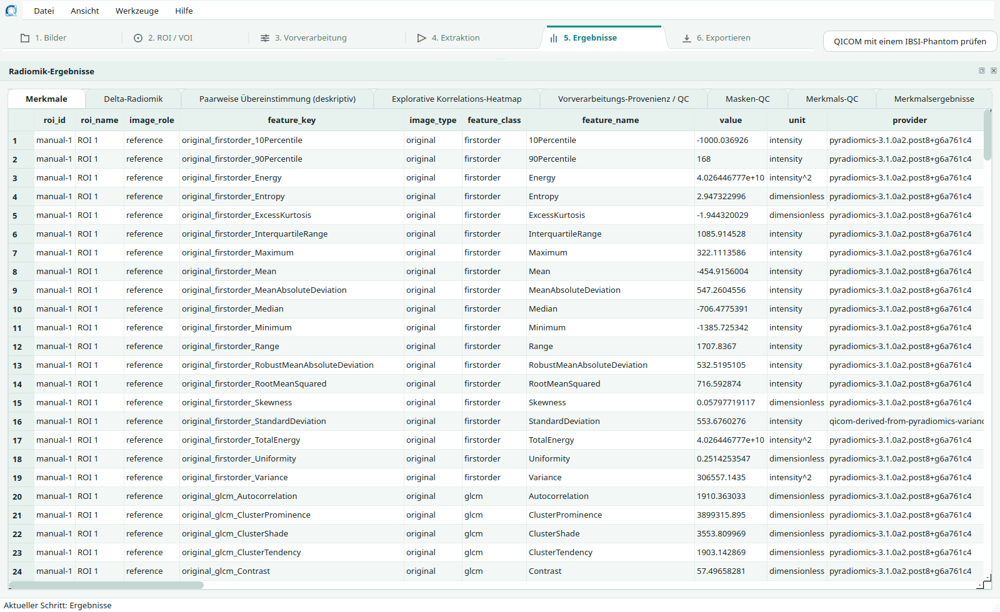

| Reiter | Zeigt |
|---|---|
| Merkmale | jedes Merkmal, für R und für C |
| Delta-Radiomik | Änderung R → C (absolut und in %) |
| Paarweise Übereinstimmung | wie nah R und C sind, nur deskriptiv |
| Explorative Korrelations-Heatmap | welche Merkmale sich gemeinsam bewegen |
| Vorverarbeitungs-Provenienz / QC | genau, was mit den Bildern gemacht wurde |
| Masken-QC | Dice, Jaccard, Volumendifferenz, Hausdorff... zwischen den beiden Masken |
| Merkmals-QC / -ergebnisse | Warnungen, und was berechnet oder übersprungen wurde, und warum |

**Schritt 6 — Exportieren.** 1 **Excel** · 2 **CSV-Satz** · 3 **eigenständiges HTML**.
Speichern Sie das Projekt mit **Datei → Radiomik-Projekt speichern** (`.zip`).

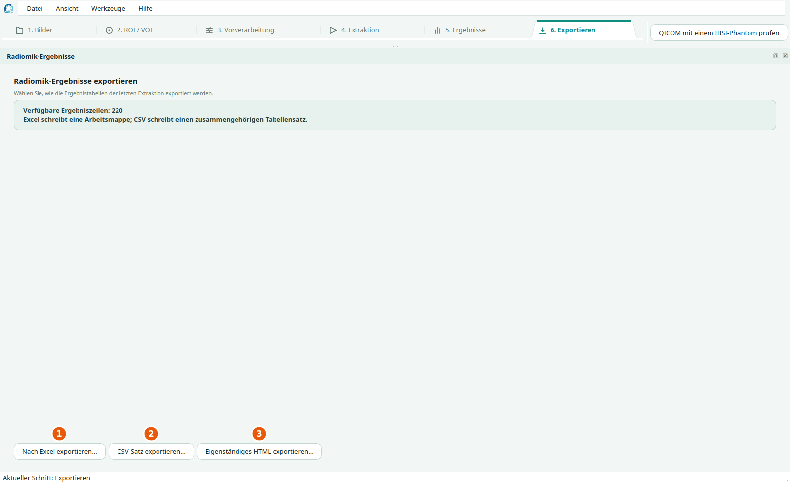

> Statistiken wie ICC brauchen mindestens **drei unabhängige Probanden**. Verwenden Sie
> **Werkzeuge → Radiomik-Kohorte aggregieren...** über mehrere gespeicherte Radiomik-Projekte.
> Keine Vorhersagemodelle, keine klinischen Schwellen: außerhalb des Umfangs.

### IBSI-Selbstprüfung

- Vergleicht QICOM mit dem offiziellen digitalen IBSI-Phantom (104 Merkmale).
- **IBSI-Prüfung ausführen** lädt die offiziellen Dateien **erst nach Ihrer Zustimmung** herunter,
  prüft sie und behält sie für die Offline-Nutzung.
- **PASS** = jedes geforderte Merkmal liegt in der Toleranz. **INCOMPLETE** = einige fehlen.
- Es ist eine Prüfung der Formeln, keine Zertifizierung.

---

## 7. Hilfswerkzeuge

Öffnen Sie sie vom Startbildschirm (**Hilfswerkzeuge**) oder über **Werkzeuge** in jedem Fenster.
Die Liste ist links, das Werkzeug rechts.

**Jedes Werkzeug folgt denselben Regeln:**

- ✓ Es ändert nie Ihre Originaldateien. Es schreibt **Kopien**, in einen **neuen** Ordner.
- ✓ Ein Ergebnis erscheint ganz oder gar nicht — nie halb geschrieben.
- ✓ Eine farbige Schaltfläche zeigt immer den nächsten Schritt.
- ✓ Überall dieselbe Maussteuerung (Mausrad = Schichten, links ziehen = Kontrast).

| Werkzeug | Wofür... |
|---|---|
| Halbautomatische Segmentierung | eine Labelkarte aufbauen, eine Region nach der anderen |
| Maskenoperationen und -vergleich | Vereinigung, Schnittmenge, Differenz; Dice, Jaccard, Volumen, Hausdorff |
| Bilder konvertieren | DICOM / NIfTI / Bitmap-Stapel → NIfTI, PNG-Schichten oder TIFF-Schichten |
| Neu abtasten | Voxelgröße ändern oder an das Raster eines anderen Bildes anpassen |
| Bildarithmetik | Differenz, absolute Differenz, Summe, Mittelwert, Verhältnis |
| Kontrollierte Verschlechterung | Rauschen, Unschärfe, Auflösungsverlust, JPEG hinzufügen — wiederholbar mit einem Seed |
| DICOM-Tags prüfen und bearbeiten | jeden Tag lesen; bearbeitete Kopien schreiben |
| DICOM-Header vergleichen | zwei Header nebeneinander; nur die Unterschiede |
| DICOM-Ordner prüfen und ordnen | fehlende oder gemischte Schichten finden; in einen geordneten Baum kopieren |
| DICOM dekomprimieren | komprimierte DICOM-Dateien unkomprimiert neu schreiben, für ältere Software |
| Bilder anonymisieren | de-identifizierte Kopie eines ganzen Ordners |

### Halbautomatische Segmentierung

- Sie trennt **Intensitätsklassen** (Luft, Fett, Weichgewebe, Knochen), keine Organe.
- CT-Voreinstellungen geben HU-Bereiche als **Ausgangspunkt**. Passen Sie sie an.
- **Anwenden** kann: aus dem Bild entfernen, nur dies behalten oder einem Label zuordnen.
- Speichert eine NIfTI-Labelkarte + eine JSON-Tabelle mit Namen und Farben.
  Rückgängig/Wiederholen bei jedem Schritt.

### Maskenoperationen und -vergleich

Maske **A** öffnen, dann Maske **B** (gleiches Raster). Kombinieren, leere Schichten füllen
oder **A und B vergleichen** → Dice, Jaccard, Volumen, Hausdorff (mm). CSV-Export.

### Bilder konvertieren

Datei oder Ordner öffnen → **NIfTI-Volumen**, **PNG-Schichten** (wie am Bildschirm, 8 oder 16 Bit)
oder **TIFF-Schichten** (echte Werte) wählen → **Konvertieren...** Ein neuer Ordner
`<Name>_<Format>` wird angelegt.

### Neu abtasten

**Auf einen Voxelabstand** (mm eingeben oder **Isotrop** klicken) oder
**auf das Raster eines Referenzbildes**. Platziert Bilder nach ihren Koordinaten — es **registriert**
(richtet aus) sie **nicht**.

### Bildarithmetik

Zwei oder mehr Bilder auf demselben Raster öffnen (A, B, ...) → eine Operation wählen → **Berechnen** →
**Ergebnis speichern...**

### Kontrollierte Verschlechterung

1. Einen Effekt wählen (Gauß-/Poisson-Rauschen, Gauß-Unschärfe, Auflösungsverlust, JPEG).
2. Stärke und **Seed** einstellen → **Anwenden**. Weitere Effekte hinzufügen; beliebige aus der Liste entfernen.
3. **Verschlechtertes Bild speichern...** Das Rezept wird mitgespeichert, damit jeder dasselbe Bild
   erneut erzeugen kann.

Nützlich, um zu testen, welche Metrik welche Art von Schaden bemerkt.

### DICOM-Tags prüfen und bearbeiten

- Eine Datei oder einen Ordner öffnen. Serie und Datei wählen.
- Jeden Tag **suchen**. **Private Tags ausblenden**. **CSV exportieren**.
- Doppelklick auf **Neuer Wert** zum Bearbeiten. Pixel-Tags sind gesperrt; Tags, die Messungen ändern,
  fragen vorher nach.
- **Kopien in einen Ordner schreiben...** Die Originale werden nie angefasst.

> Die Werte werden so angezeigt, wie sie gespeichert sind, Patientendaten eingeschlossen. Auch ein
> CSV-Export enthält sie.

### DICOM-Header vergleichen

Zwei Dateien öffnen. **Nur Unterschiede** und **UIDs ausblenden** ankreuzen, um zu sehen, was sich
zwischen zwei Aufnahmen wirklich geändert hat.

### DICOM-Ordner prüfen und ordnen

**Ordner wählen...** → eine Zeile pro Studie und Serie, mit gefundenen Problemen
(fehlende Schichten, unregelmäßiger Abstand, gemischte Ausrichtung). **Bericht exportieren (CSV)...**
oder **Geordnet in einen Ordner kopieren...** (Ordner nach Studie und Serie benannt, nie nach Patient).

### DICOM dekomprimieren

Eine komprimierte DICOM-Datei öffnen (JPEG lossless, JPEG-LS, JPEG 2000, RLE...) → sie wird
unkomprimiert neu geschrieben, eine Datei pro Frame, in einen neuen Ordner.

### Bilder anonymisieren

1. **Dateien wählen...** oder **Ordner wählen...** (bei Bedarf **Unterordner einbeziehen** ankreuzen).
2. Die Liste lesen: **was mit jeder Datei passiert**. Dateien, die nicht geprüft werden können,
   werden hier genannt.
3. Optional: **Ordner- und Dateinamen durch generische ersetzen.**
4. **Anonymisieren.** Die Kopien kommen nach `<Ordner>_anonymized`.

> ✗ In die Pixel **eingebrannter Text** wird weder erkannt noch entfernt.
> ✓ Öffnen und prüfen Sie die Kopie, bevor Sie sie weitergeben.

---

## 8. Einstellungen

Öffnen Sie sie vom Startbildschirm (Einstellungs-Schaltfläche) oder über **Werkzeuge → Einstellungen**.
Änderungen werden automatisch gespeichert.

| Reiter | Was Sie einstellen |
|---|---|
| Allgemein | Sprache (8 Sprachen, wechselt sofort), Thema, Zahlenformat, Dezimalstellen |
| Standardmetriken | welche Metriken zu Beginn einer neuen Analyse angekreuzt sind; NSS-Referenzmodell |
| Identität | Ihr Name, eingetragen, wenn Sie eine nicht anonyme Bewertung durchführen |
| Diagnose | eine synthetische Demo / ein Fehlerbericht-Paket erstellen (keine Patientendaten) |

**Standardeinstellungen wiederherstellen** setzt alles zurück.

---

## 9. Datenschutz und Sicherheit

- ✓ Bilder werden **nur auf Ihrem Computer** verarbeitet. Kein Upload. Keine Telemetrie.
- ✓ Projekte und Bewertungspakete **anonymisieren DICOM standardmäßig**.
  Kann eine Datei nicht sicher anonymisiert werden, **hält QICOM an und sagt es Ihnen**. Ein Export
  trotzdem braucht Ihr ausdrückliches OK, und diese Dateien werden als nicht geprüft markiert.
- ✓ Importierte ZIP-Dateien werden geprüft, bevor sie geöffnet werden.
- ✓ Text, der wie eine Tabellenformel aussieht, wird in Excel/CSV-Exporten entschärft.
- ✗ QICOM liest und entfernt keinen in die Pixel eingebrannten Text.
- ✗ ZIPs quantitativer Projekte behalten NIfTI-Header und ursprüngliche Dateinamen unverändert.

Alle Details: [SECURITY.md](../../SECURITY.md) (auf Englisch).

---

## 10. Wenn etwas nicht klappt

| Problem | Versuchen Sie |
|---|---|
| Die App startet nicht (Windows) | Zuerst in einen echten Ordner entpacken. Nicht aus dem Zip heraus starten. |
| macOS meldet, die App sei beschädigt / unbekannt | Prüfsumme kontrollieren, dann *Datenschutz & Sicherheit → Dennoch öffnen*. |
| „Unterschiedliche Schichtanzahl“ vor der Berechnung | *Nur die aktuell angezeigte Schicht verwenden* oder *Vollständige Stapel verwenden (auf den kürzesten kürzen)* wählen — oder passende Serien laden. |
| Die Bilder sind unterschiedlich groß | **Werkzeuge → Neu abtasten**: den Vergleich auf das Raster der Referenz bringen. |
| Eine Metrik fehlt in den Ergebnissen | Sie braucht ein Modell (**Herunterladen** in Analysieren klicken) oder das Bild ist zu klein. Spalte/Register der Ergebnisse prüfen. |
| LPIPS / DISTS erscheinen nie | Ihre Modelle sind nicht enthalten. Einmal in **Analysieren** herunterladen (oder Einstellungen → Standardmetriken). |
| Die Radiomik lehnt mein PNG/JPG ab | Die Radiomik braucht DICOM oder NIfTI (echte Geometrie). Zuerst konvertieren. |
| Eine Antwortdatei ist in der Aggregation rot | Sie gehört zu einem anderen Fragebogen. Mit der Maus über das Urteil fahren, um den Grund zu lesen. |
| „Die Antworten konnten nicht aggregiert werden“ | Detail lesen, z. B. fehlt in einer Datei ein Pflichtkommentar. |
| Zugangscode vergessen | Er kann nicht wiederhergestellt werden. Die ungeschützte Arbeitskopie verwenden. |
| Der Bildschirm sieht falsch aus / ist zu klein | Thema unter **Ansicht** wechseln; auf kleinen Bildschirmen scrollen die Fenster. |

### Fehler und Protokolle

- Eine Anzeige in der Statusleiste meldet ungelesene Fehler. Klicken Sie darauf oder öffnen Sie
  **Ansicht → Bereiche → Fehler**.
- **Hilfe → Fehler melden...** → **Fehlerbericht speichern…** (Version, System, aktuelles Protokoll,
  keine Bilder) und an Ihre E-Mail anhängen. Sie können auch das synthetische Demo-Paket beilegen.

Die Protokolldatei:

| System | Protokolldatei |
|---|---|
| Windows | `%LOCALAPPDATA%\qicom\Logs\qicom.log` |
| macOS | `~/Library/Logs/qicom/qicom.log` |
| Linux | `~/.local/state/qicom/log/qicom.log` |

**Hilfe → Über QICOM** zeigt die Version, die Lizenz und wie man QICOM zitiert.

---

## 11. Begriffe in QICOM

| Begriff | In einfachen Worten |
|---|---|
| **Referenz (R)** | das Bild, dem Sie vertrauen |
| **Vergleich (C)** | ein Bild, das Sie gegen die Referenz testen |
| **Schicht** | ein 2D-Bild in einem 3D-Volumen |
| **ROI / VOI** | eine Region, die Sie zeichnen: 2D (ROI) oder durch die Schichten (VOI) |
| **Fenster / Level** | Kontrast und Helligkeit der Anzeige; ändert nie die Daten |
| **Metrik** | eine Formel, die zwei Bilder (oder eines) in eine Zahl verwandelt |
| **Profil** | ein gespeicherter Satz von Metriken (z. B. Schneller Kern) |
| **Datenbereich** | die Spanne der möglichen Pixelwerte, verwendet von PSNR und SSIM |
| **Heatmap** | eine farbige Karte, wo sich zwei Bilder unterscheiden |
| **SNR / CNR** | Signal-Rausch- / Kontrast-Rausch-Verhältnis: wie stark ein Gewebe hervortritt |
| **HU** | Hounsfield-Einheiten, die Intensitätsskala der CT (Luft ≈ −1000, Wasser = 0) |
| **Verblindet** | Bewertende wissen nicht, welches Bild welches ist |
| **Seed** | eine Zahl, die ein „zufälliges“ Mischen oder Rauschen wiederholbar macht |
| **Paket** | die `.zip`, die eine Bewertung enthält (Bilder + Fragen) |
| **Entblindungskarte** | die Datei, die sagt, welches neutrale Label (A, B, C) welches Bild ist |
| **Merkmal** | eine Radiomik-Zahl: Form, Intensität oder Textur in einer Region |
| **Delta (Δ)** | wie stark sich ein Merkmal von R zu C verändert hat |
| **IBSI** | der internationale Standard für die Definitionen radiomischer Merkmale |
| **Beleg** | der mit den Ergebnissen gespeicherte Nachweis: Versionen, Einstellungen und Fingerabdrücke (Hashes) jeder Eingabe |
| **Anonymisieren** | aus einer Kopie der Datei die Daten entfernen, die eine Person identifizieren |

---

*Mehr dazu (auf Englisch):* [README](../../README.md) ·
[Qualitative Methodik](../../QUALITATIVE_METHODOLOGY.md) ·
[Radiomik-Methodik](../../RADIOMICS_METHODOLOGY.md) ·
[Sicherheit](../../SECURITY.md)

*Die Screenshots verwenden ein synthetisches Phantom und erfundene DICOM-Daten. Keine Patientenbilder.*
