# QICOM — User Manual

**Look at the pictures first. Read the words only if you need them.**

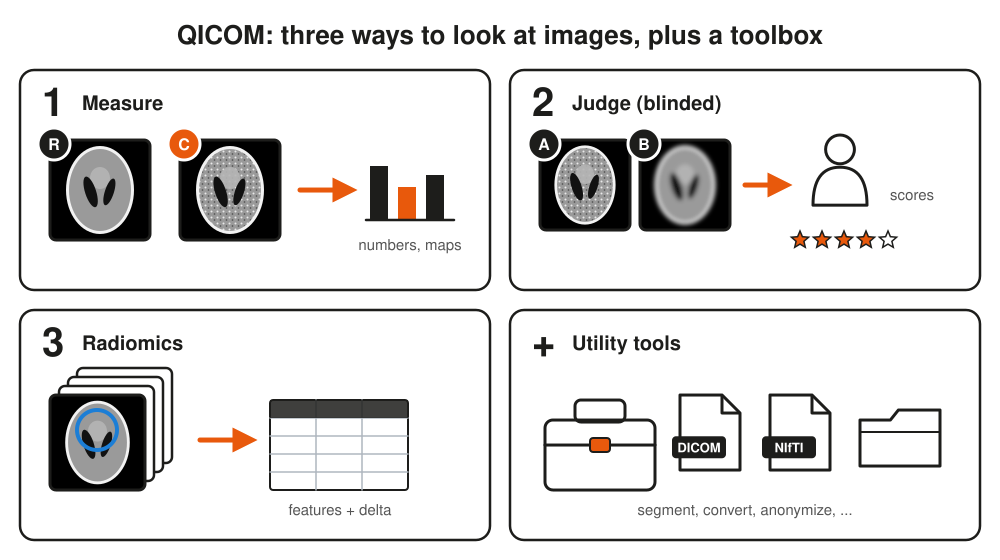

> **Research and quality control only.** QICOM is not a medical device.
> Do not use it to diagnose, or to make any decision about a patient's care.

---

## Contents

1. [Before you start](#1-before-you-start)
2. [Install and open](#2-install-and-open)
3. [The basics (read once)](#3-the-basics-read-once)
4. [Quantitative analysis: measure two images](#4-quantitative-analysis-measure-two-images)
5. [Qualitative analysis: people score images](#5-qualitative-analysis-people-score-images)
6. [Radiomics: compare features inside a region](#6-radiomics-compare-features-inside-a-region)
7. [Utility tools](#7-utility-tools)
8. [Settings](#8-settings)
9. [Privacy and safety](#9-privacy-and-safety)
10. [When something goes wrong](#10-when-something-goes-wrong)
11. [Words used in QICOM](#11-words-used-in-qicom)

---

## 1. Before you start

**What QICOM does:** it compares medical images and tells you how different they are.

| You want to... | Use |
|---|---|
| Get **numbers** that say how close one image is to another | **Quantitative** |
| Let **people** score images, without knowing which is which | **Qualitative** |
| Compare **texture and shape features** inside a region | **Radiomics** |
| Convert, anonymize, segment, resample, inspect DICOM tags... | **Utility tools** |

**What you need**

- A computer with Windows 10/11 (64-bit), macOS 14 on Apple Silicon, or Linux 64-bit.
- 8 GB of memory works. 16 GB is better. 32 GB for big 3D volumes.
- Your images: **DICOM** (one file or a folder with a series), **NIfTI** (`.nii`, `.nii.gz`),
  or **PNG / JPG / BMP**. Radiomics accepts only DICOM and NIfTI.

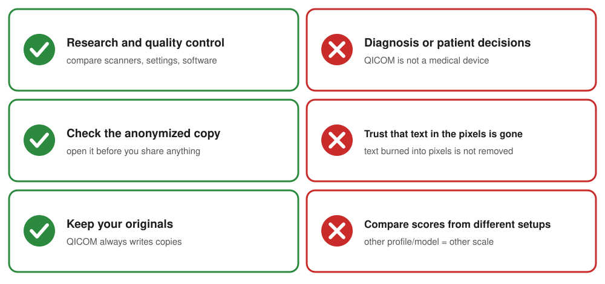

---

## 2. Install and open

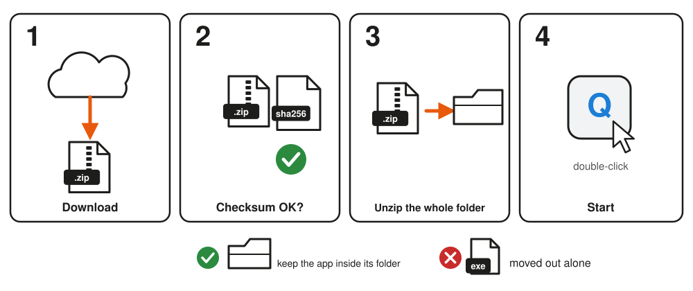

1. **Download** the file for your system, with its `.sha256` file next to it.
2. **Check** the download. The result must be `True` (Windows) or `OK` (macOS/Linux):
   - Windows (PowerShell): compare `Get-FileHash QICOM-windows-x64.zip` with the `.sha256` file
   - macOS: `shasum -a 256 -c QICOM-macos-arm64.zip.sha256`
   - Linux: `sha256sum -c QICOM-linux-x64.tar.gz.sha256`
3. **Unzip** to a real folder (not inside the zip window). Keep the folder whole.
4. **Start** QICOM:
   - Windows: double-click `qicom.exe`. If "Windows protected your PC" appears and the
     checksum is OK, click *More info* → *Run anyway* (only if your organisation allows it).
   - macOS: double-click `QICOM.app`. If macOS blocks it: *System Settings → Privacy & Security
     → Open Anyway*.
   - Debian/Ubuntu: `sudo apt install ./QICOM-linux-x64.deb`, then open **QICOM** from the
     applications menu or type `qicom`.
   - From source code: `qicom-gui`.

> ✗ An antivirus that names a real threat is **not** the same as the "unknown app" warning.
> Do not bypass it. Tell your IT team.

### The start screen

QICOM always opens on this screen. Pick what you want to do.

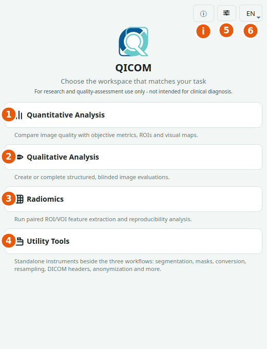
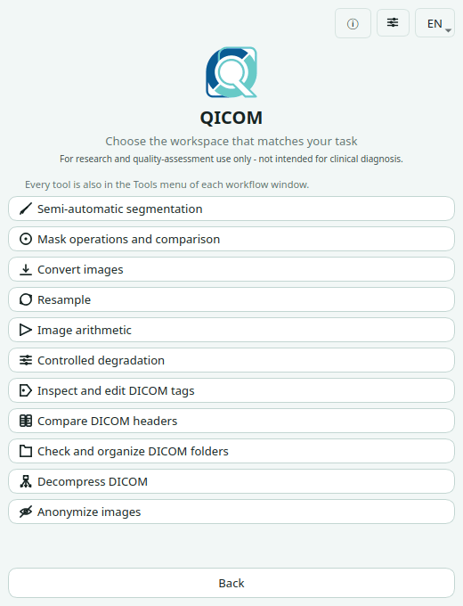

| | Button | What it opens |
|---|---|---|
| 1 | Quantitative Analysis | measure images with numbers and maps |
| 2 | Qualitative Analysis | build, take or collect blinded evaluations |
| 3 | Radiomics | compare features inside a region |
| 4 | Utility Tools | the toolbox (right picture) |
| i / 5 / 6 | ⓘ, settings, language | about QICOM, preferences, language |

Each button opens a small second page:

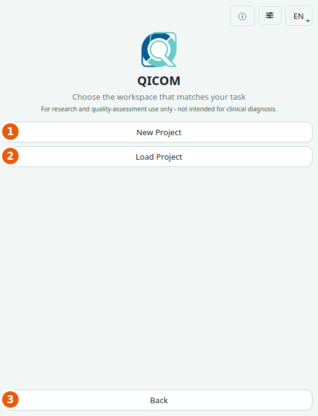
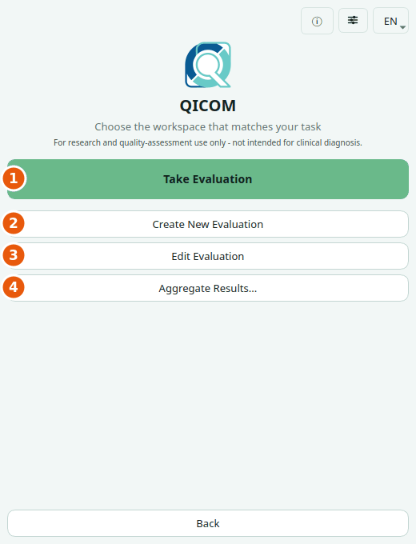
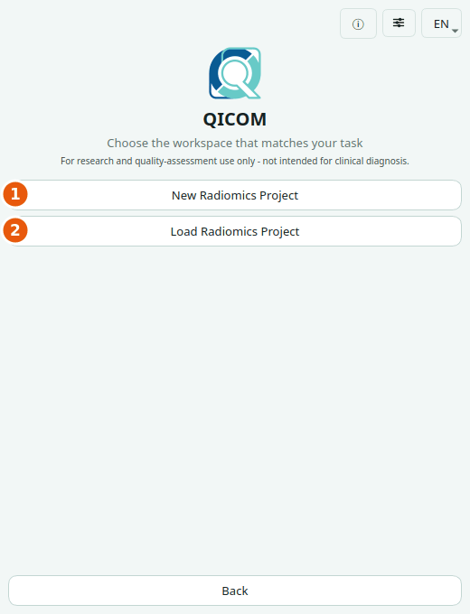

- **Quantitative:** 1 New project · 2 Load a saved project (`.zip`) · 3 Back.
  Recent projects appear below, one click to reopen.
- **Qualitative:** 1 **Take Evaluation** (green: you were sent one) · 2 New · 3 Edit · 4 Aggregate results.
- **Radiomics:** 1 New project · 2 Load a saved project.

To come back here later: **File → Close Project**.

---

## 3. The basics (read once)

### Steps are tabs

Every workspace is a row of numbered tabs. **Go from left to right.** You can always go back.

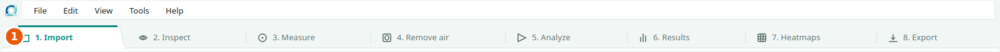

### Mouse and keyboard on an image

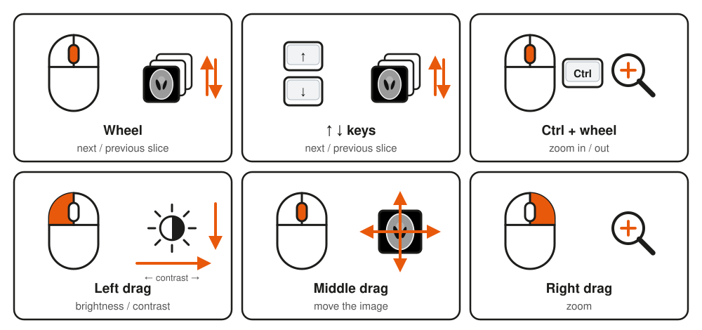

- **Load an image:** click an empty image box, or drag a file onto it.
- **Undo / redo:** `Ctrl+Z` / `Ctrl+Y` (Quantitative).
- Panel buttons above each image: rotate, flip, reset, **Load Images**.

### Reference and comparison

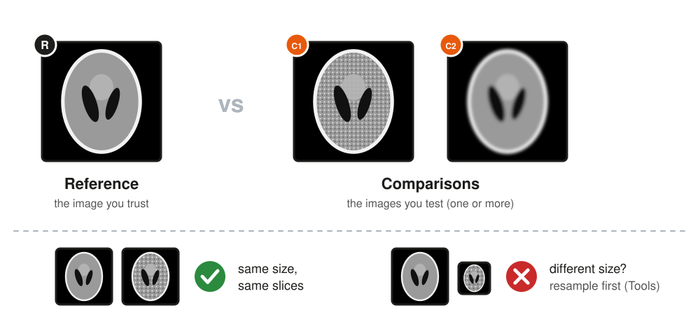

- **R — Reference:** the image you trust (for example, full dose, original).
- **C1, C2, ... — Comparisons:** the images you test. Add as many as you want with **+ Add Comparison**.
- The images must have the **same size and the same number of slices**.
  Not the same? Use **Tools → Resample** first.

### What QICOM writes

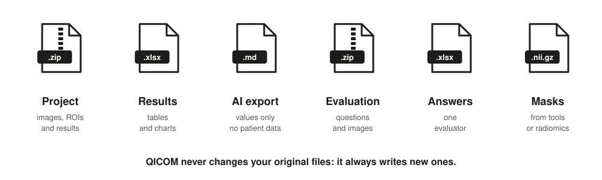

### Menus (same in every window)

| Menu | What is inside |
|---|---|
| **File** | open, save, export, close project |
| **Edit** | undo, redo (Quantitative) |
| **View** | theme (light/gray/dark), **Panels** (history, log, errors) |
| **Tools** | the Utility Tools, number format, language, **Settings** |
| **Help** | report a bug, about QICOM (licence, citation) |

---

## 4. Quantitative analysis: measure two images

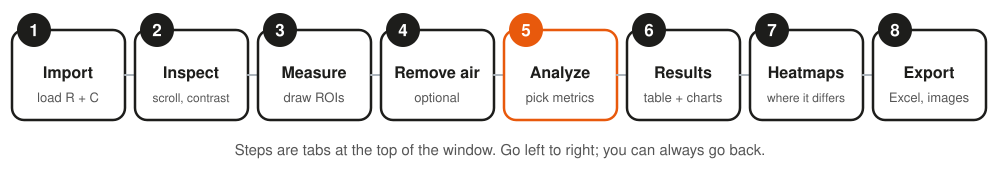

### Step 1 — Import

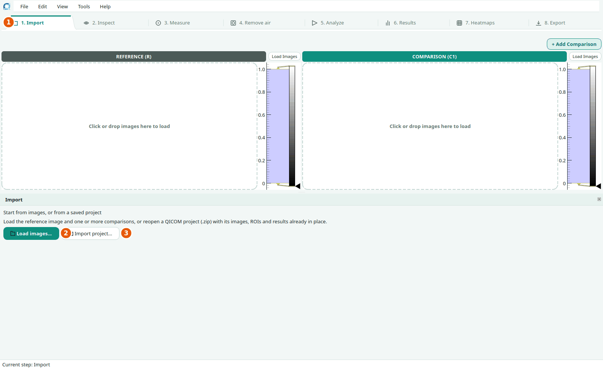

1. The step tabs.
2. **Load images:** choose a file or a folder, then choose the box (Reference or Comparison).
3. **Import project:** reopen a saved QICOM project (`.zip`) with images, ROIs and results.

Faster: click an empty box, or drag a file onto it.

### Step 2 — Inspect

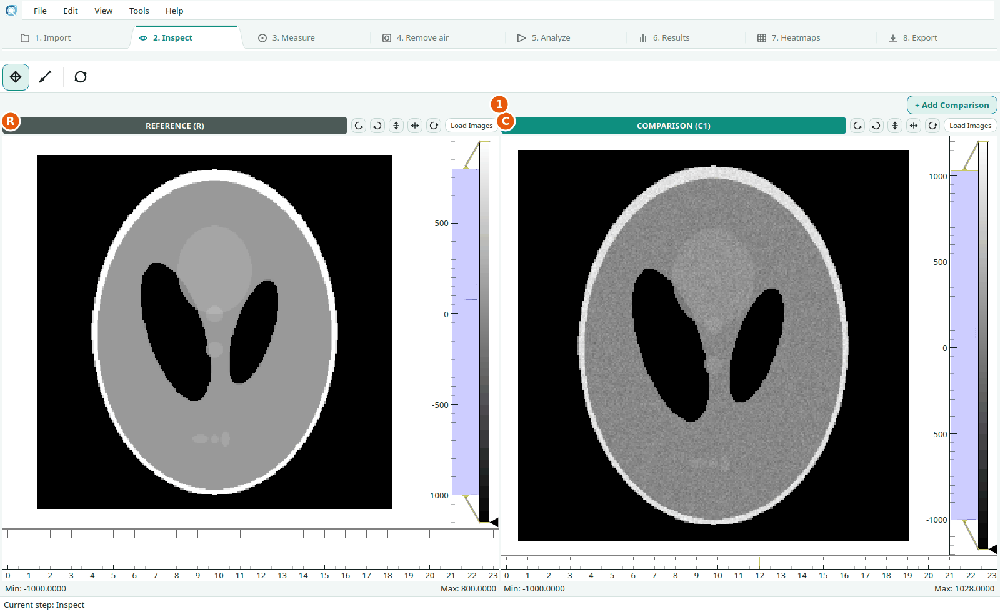

- **R** is the reference, **C** the comparison. Each has its own contrast bar on the right.
- 1 View tools: **Zoom/Pan**, **Annotation** (a text note on the image), **Sync Levels**
  (change contrast on one image → all images follow).
- Scroll to move through slices. Left-drag to change brightness and contrast.

More than one comparison? Each one gets its own box:

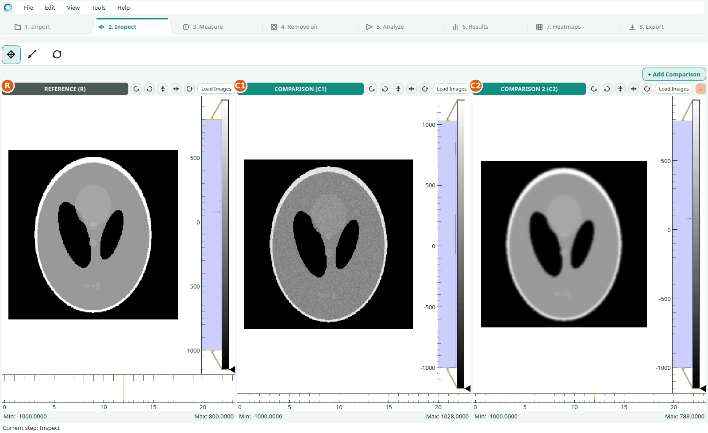

> QICOM checks pixel size, orientation and slice spacing before it calculates.
> Problems appear in **View → Panels → Errors**. It never changes your pixels by itself.

### Step 3 — Measure (optional)

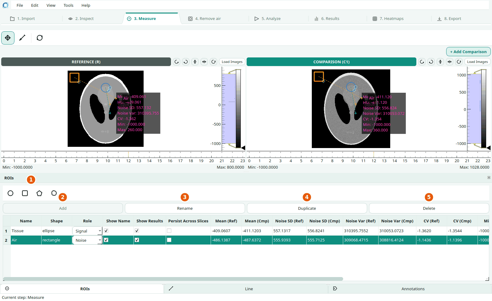

1. Pick a shape: **circle**, **rectangle**, **polygon**, **freehand**.
2. **Add** — the same ROI appears on every image, in the same place.
3. **Rename** · 4 **Duplicate** · 5 **Delete**.

In the table, set the **Role** of each ROI:

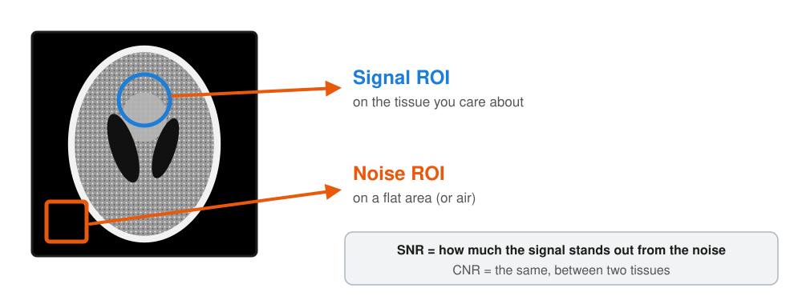

- **Signal:** on the tissue you care about. **Noise:** on a flat area or in the air.
- With both, QICOM gives **SNR** and **CNR**.
- Values update live in the table: mean, noise SD, CV, min, max.
- Tabs at the bottom: **Line** (draw a line, see the intensity profile) and **Annotations**.
- **Persist Across Slices:** keep the ROI on every slice, not only the current one.

### Step 4 — Remove air (optional)

Most of a slice is air. Air matches air, so it makes images look more similar than they are.
This step removes the air **around** the body (air inside the body stays).

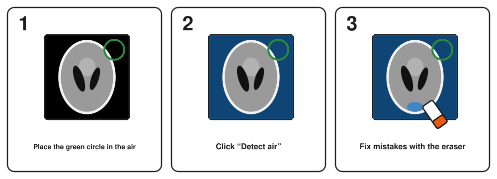

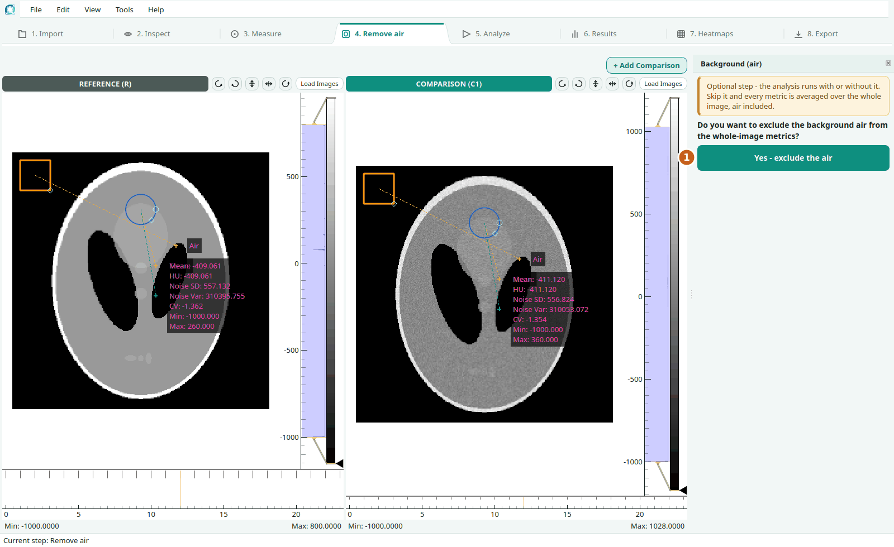
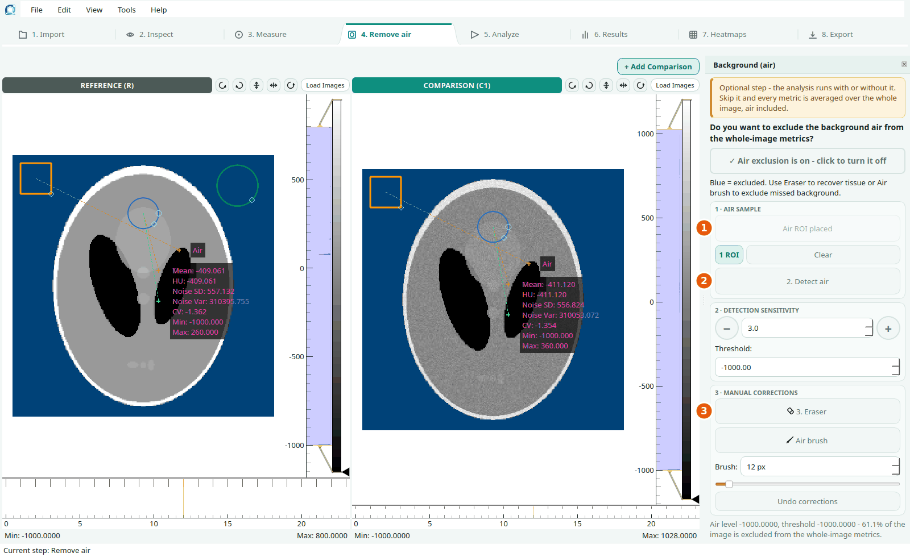

1. Click the big button to switch exclusion **on**. Click **Add air ROI**: a green circle appears.
   Drag it onto air only.
2. **Detect air.** Everything painted blue is left out of the whole-image metrics.
   Too much or too little? Use **−/+** sensitivity or type the threshold.
3. **Eraser** gives back tissue taken by mistake. **Air brush** adds missed air.
   **Undo corrections** returns to the detected result.

> Skipping this step is fine. Then the metrics average over the whole image, air included.
> ROI measurements are never affected.

### Step 5 — Analyze

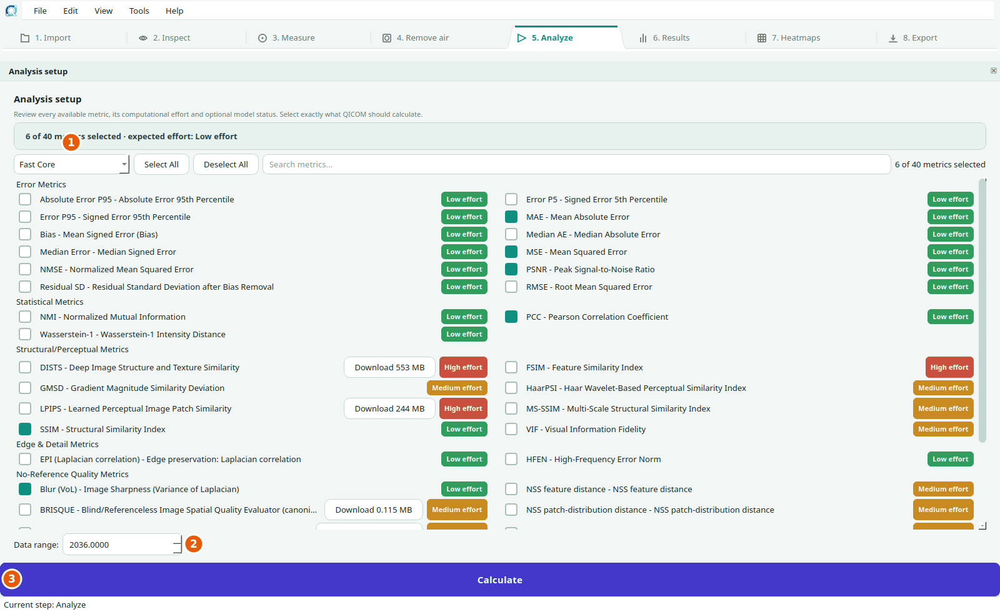

1. **Profile:** a ready-made set of metrics. Start with **Fast Core**.
   Ticking boxes by hand turns it into a custom profile.
2. **Data range:** the span of possible pixel values. QICOM fills it in; leave it unless you know better.
3. **Calculate.** A progress bar replaces the button. You can cancel.

- Badges: **Low / Medium / High effort** = how long a metric takes.
- **Download** next to a metric (LPIPS, DISTS, BRISQUE...): its model is not included.
  It downloads only if you click, and it is checked before use. Without it, the metric is skipped.
- Use the search box to find a metric by name. Hover a metric to read what it means.

### Step 6 — Results

QICOM jumps here by itself when the calculation ends.

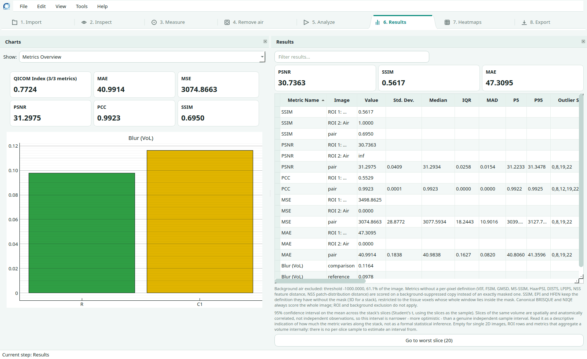

- **Left:** charts. Pick a view in **Show**, and a pair (`R vs C1`, `R vs C2`, `R vs All`).
- **Right:** big cards for the key numbers, then the full table. Type in **Filter results** to search.
- Rows: **pair** = whole image; **ROI 1, ROI 2** = inside each ROI.
- For volumes: median, IQR, P5/P95 and outlier slices.
  **Go to worst slice** jumps to the slice that differs most.

How to read a number:

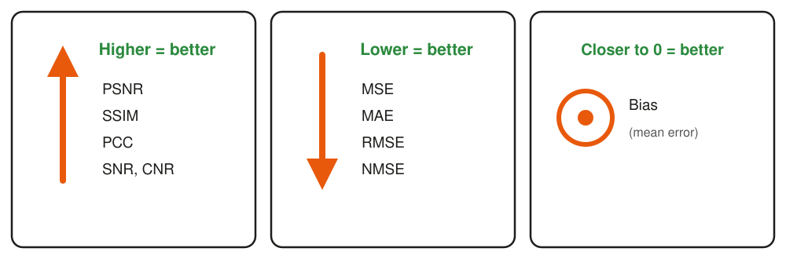

> The **QICOM Index** (0 to 1, 1 = identical) is experimental. Compare it only between
> results made with the **same profile and version**.

### Step 7 — Heatmaps

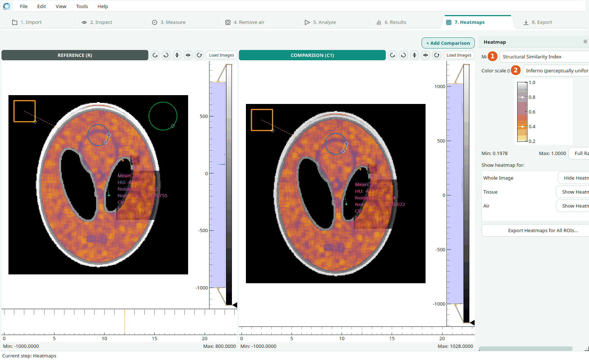

1. Pick a metric (SSIM, MSE, MAE, NMSE, bias).
2. Pick a colour scale.

- The map shows **where** the images differ, on top of the image.
- **Show heatmap for:** whole image or one ROI. **Export Heatmaps** saves them as pictures.
- For SSIM the scale is reversed, so damaged areas still stand out.

### Step 8 — Export

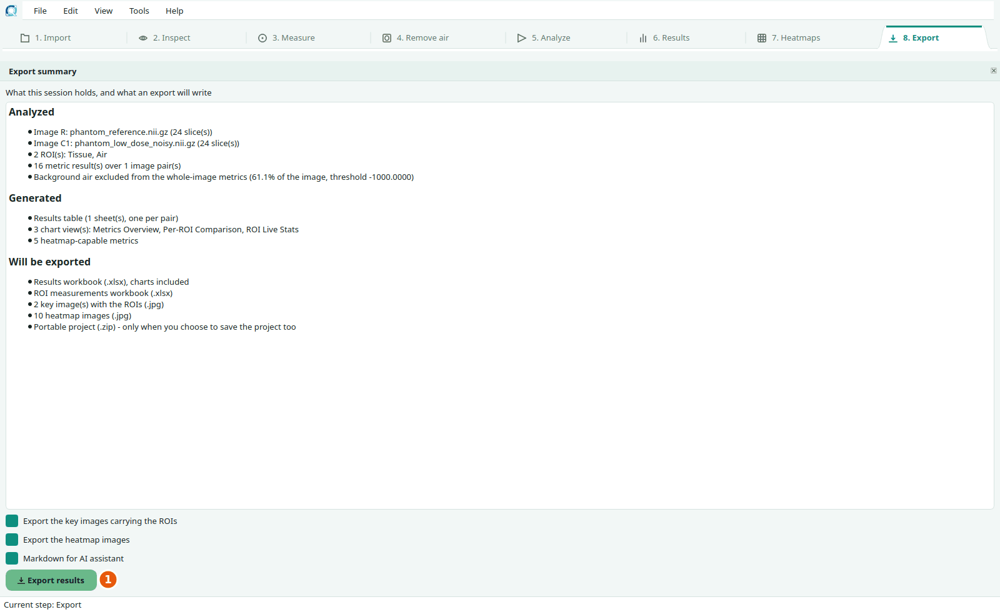

- The page lists what was analysed, what was made, and **what will be written**.
- Untick what you don't want (key images, heatmap images, AI Markdown).
- 1 **Export results** → Excel workbook (with charts), ROI workbook, images.
- To keep working later: **File → Save / Export...** saves a portable project (`.zip`).

> **AI assistant Markdown** (`*_ai_assistant.md`): numbers and metric definitions only —
> no file names, no patient data, no DICOM header. QICOM sends it nowhere.
> Open it and read it before you paste it into any chat.

---

## 5. Qualitative analysis: people score images

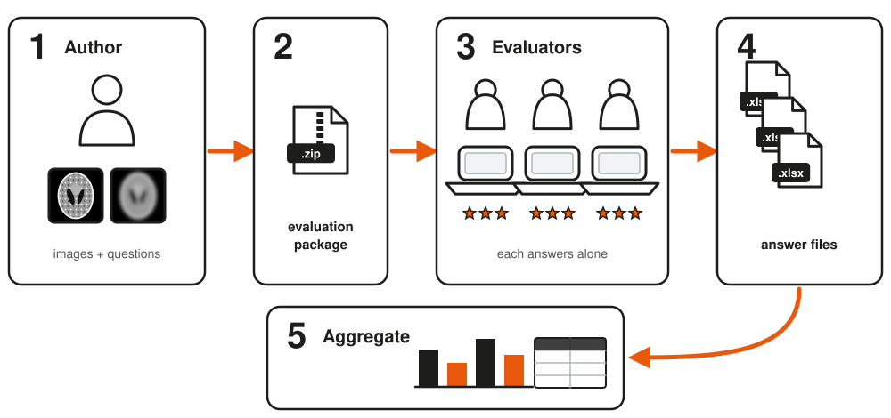

There are three roles. Each has its own button on the start screen.

| Role | Start screen button | Steps |
|---|---|---|
| **Author** — builds the test | New Evaluation / Edit Evaluation | Setup → Images → Questions → All pages → Preview → Save |
| **Evaluator** — answers it | **Take Evaluation** (green) | Evaluate → Review answers → Complete & save |
| **Collector** — puts answers together | Aggregate Results | Questions → Answers → Analysis → Export |

### 5A. Author: build the evaluation

**Step 1 — Setup.** Decide how the whole test behaves, before you build it.

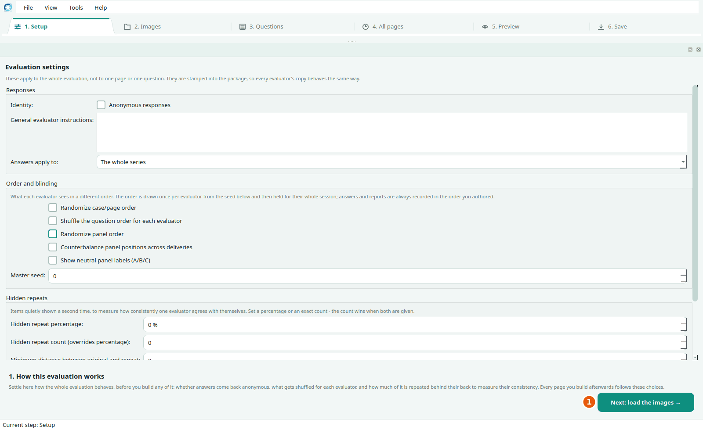

- **Anonymous responses:** no names are asked or kept.
- **Instructions** for evaluators. **Answers apply to:** the whole series or each slice.
- **Order and blinding:** shuffle pages, questions or image boxes; neutral labels A/B/C;
  a **seed** makes the shuffle repeatable.
- **Hidden repeats:** show some items twice, to see if people agree with themselves.
- 1 **Next: load the images.**

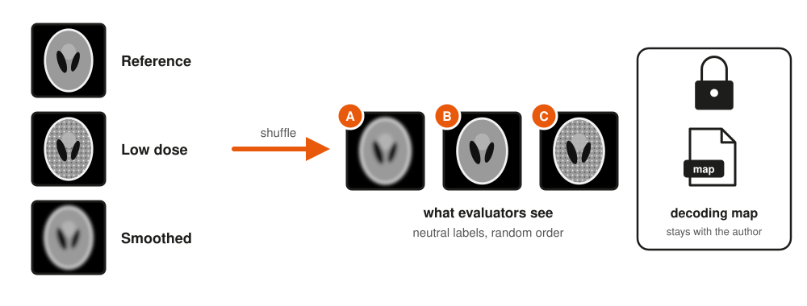

**Step 2 — Images.** Load the images of **this page**.

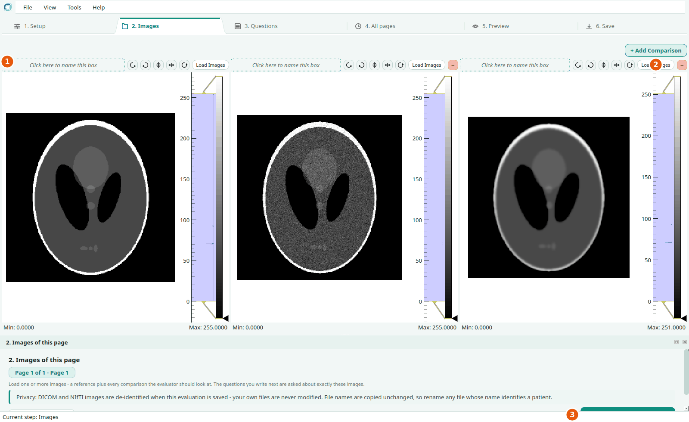

1. Click a box (or drop a file). Click the name bar to rename it.
2. **+ Add Comparison** for more boxes. 3 **Next.**

> DICOM and NIfTI are de-identified when you save. File names are copied as they are:
> rename any file whose name identifies a patient.

**Step 3 — Questions.** Write what evaluators must answer about these images.

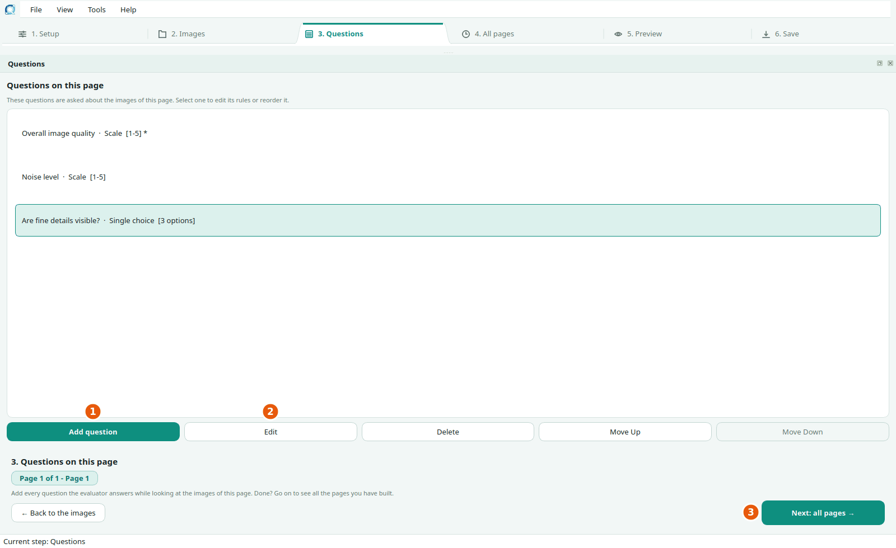

1. **Add question** · 2 **Edit** (also Delete, Move Up/Down) · 3 **Next: all pages.**

Answer formats: numeric scale (with words at the ends, e.g. 1 = Poor, 5 = Excellent),
single choice, multiple choice, drop-down, open text, ranking, A-or-B (2-AFC),
A / B / no difference. Every question can allow **Not assessable**.

**Step 4 — All pages.** One row per page: its images and questions.

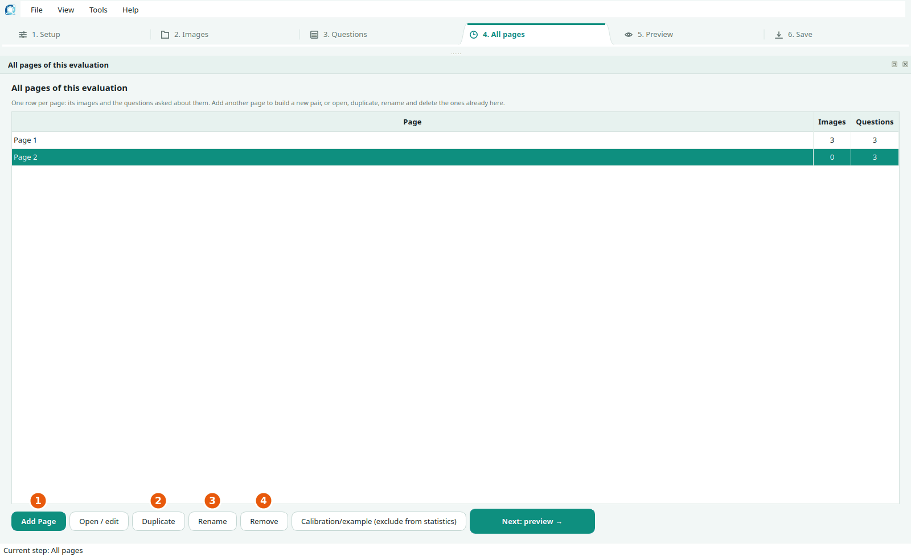

1. **Add Page** (back to step 2 for the new page) · 2 **Duplicate** (copies the questions) ·
   3 **Rename** · 4 **Remove**.
- **Calibration/example:** a practice page, left out of the statistics.

**Step 5 — Preview.** See exactly what an evaluator will see. Try the answers.

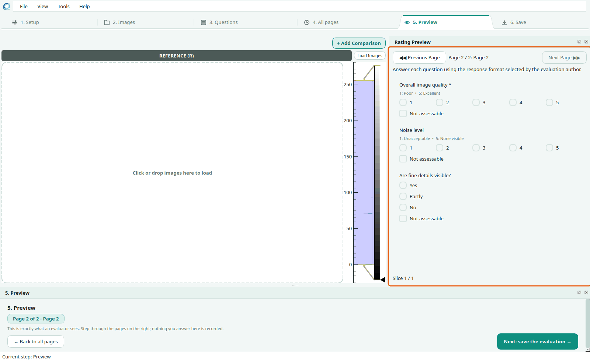

**Step 6 — Save.**

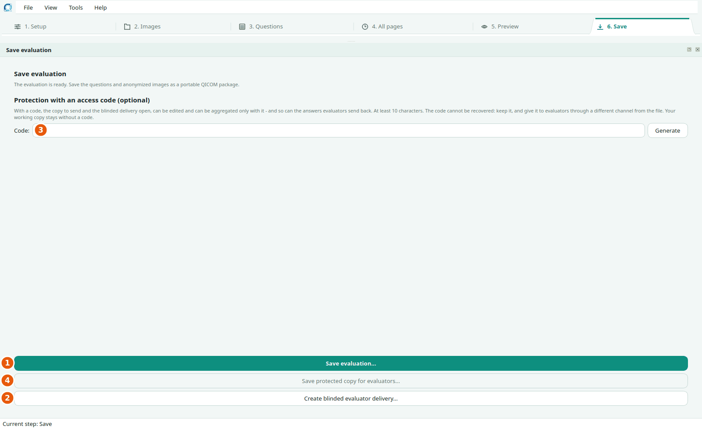

1. **Save evaluation...** → one `.zip` file. Send this file to evaluators.
2. **Create blinded evaluator delivery...** → a ZIP with neutral names + a separate
   **decoding map** (keep the map for yourself).
3. **Access code** (optional, at least 10 characters, **cannot be recovered**). Type one or click **Generate**.
4. **Save protected copy for evaluators...** → only people with the code can open it.
   Send the code by a different channel than the file.

### 5B. Evaluator: answer the evaluation

1. Start screen → **Qualitative Analysis** → **Take Evaluation** → pick the `.zip`.
2. Log in, or **Continue without logging in**.

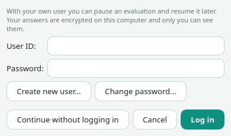

| | With your own user | Without logging in |
|---|---|---|
| Pause and continue later | ✓ | ✗ (one session) |
| Answers kept on this computer | ✓ encrypted, only you can see them | ✗ nothing is kept |

**Step 1 — Evaluate.**

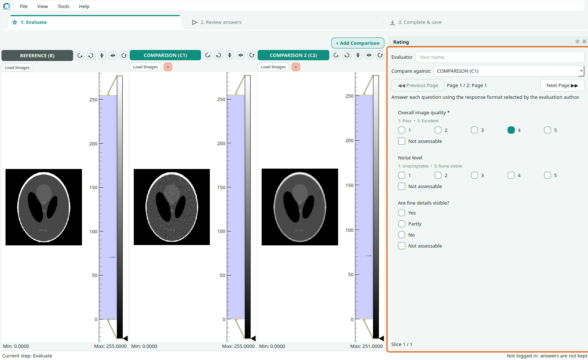

- Type your name (unless the test is anonymous).
- **Compare against:** which image you are scoring.
- Answer each question. Required questions have a `*`.
- **Previous / Next Page** to move. Scroll for other slices.

**Step 2 — Review answers.** A table of everything you answered. Go back to fix anything.

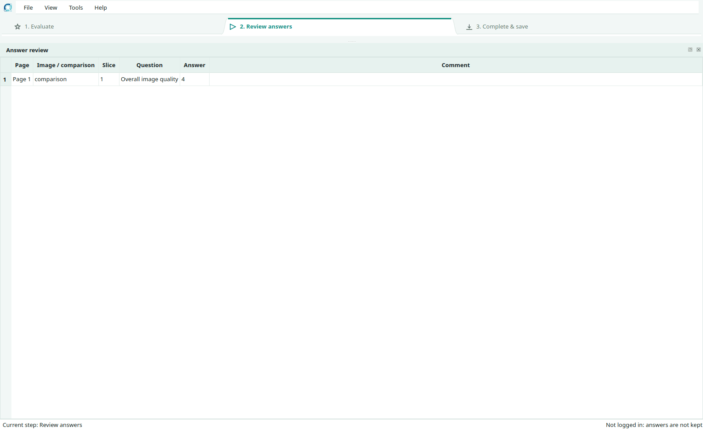

**Step 3 — Complete & save.**

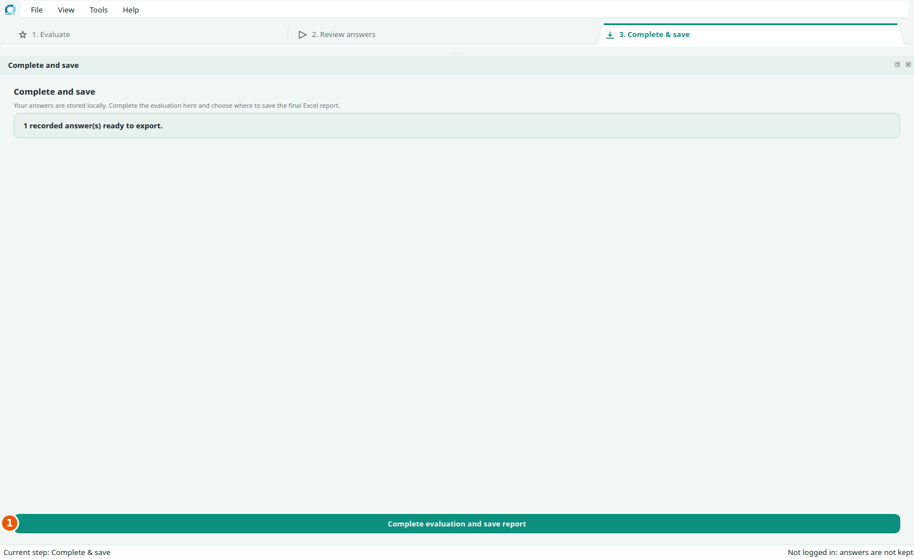

1. **Complete evaluation and save report** → an Excel file with your answers
   (an encrypted answer file if the test is protected by a code). Send it back to the author.

### 5C. Collector: aggregate the answers

**1 — Questions.** Load the evaluation `.zip` you sent out. Blinded delivery? Also load its decoding map.

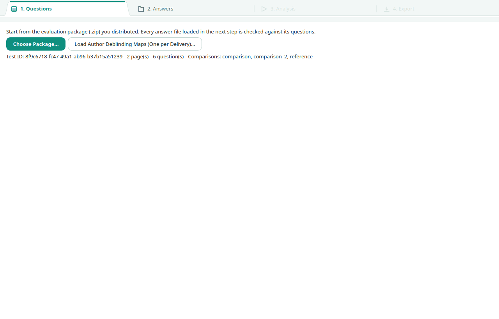

**2 — Answers.** **Add Answer Files...** — `.json`, the evaluators' Excel files, or CSV.

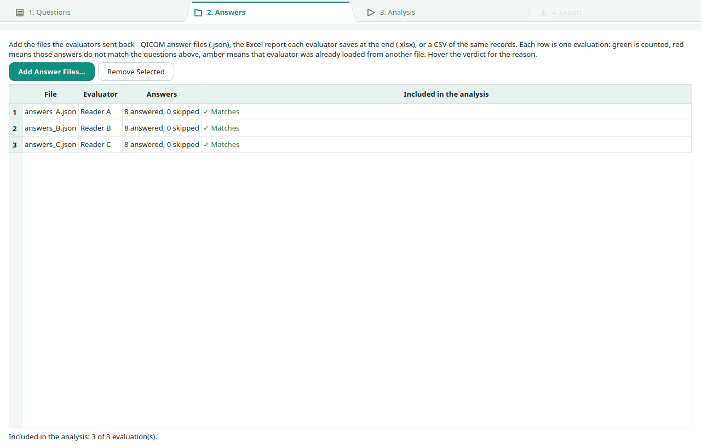

- **Green** = counted. **Red** = does not match these questions (hover to see why).
  **Amber** = this evaluator was already loaded from another file.
- Expected 10 answers and got 20? Someone answered twice. You decide.

**3 — Analysis.** **Run the analysis.**

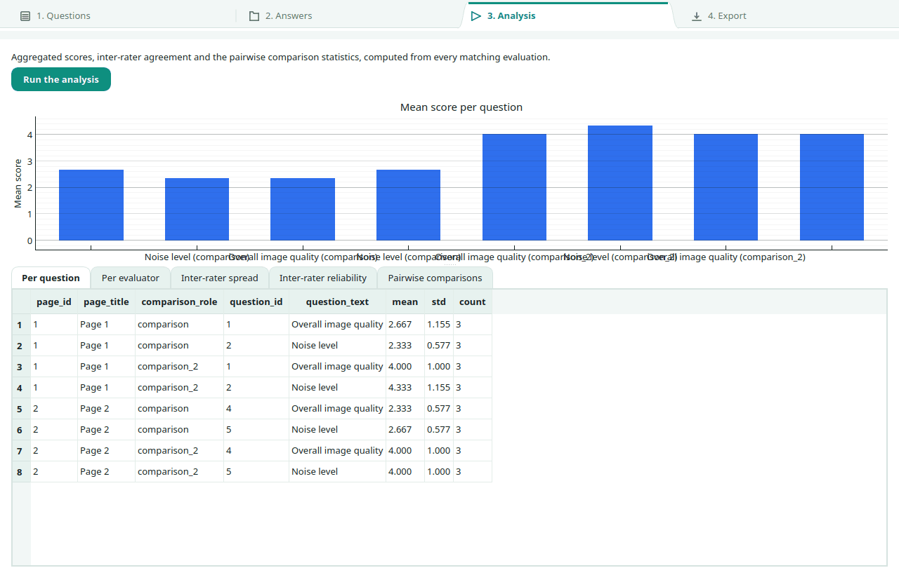

Tabs: per question, per evaluator, spread between evaluators, agreement (reliability),
pairwise comparisons. Details: [QUALITATIVE_METHODOLOGY.md](../../QUALITATIVE_METHODOLOGY.md).

**4 — Export.** Excel (with charts) or a folder of CSV files.

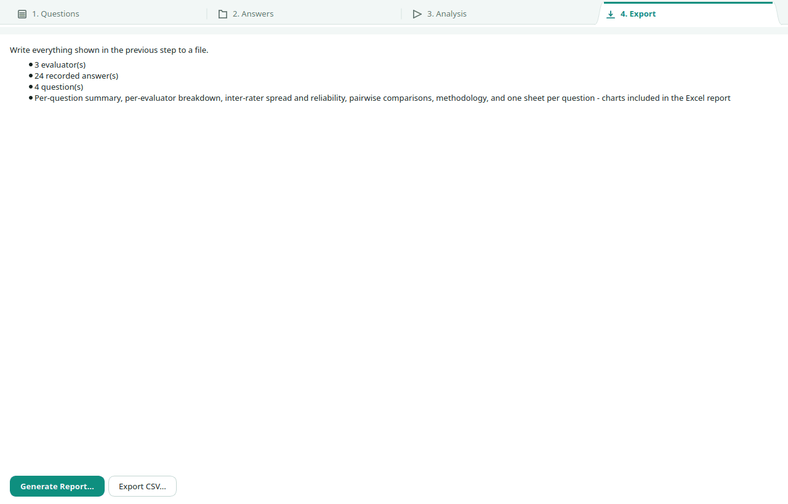

---

## 6. Radiomics: compare features inside a region

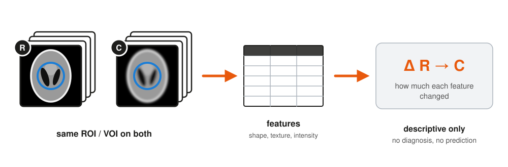

Radiomics turns the inside of a region into numbers (shape, intensity, texture),
then shows how much each number changed from **R** to **C**. Only DICOM and NIfTI.

**Step 1 — Images.** Load the reference (1) and the comparison (2): click the box,
use **Load Images**, or **File** menu (file or DICOM folder).

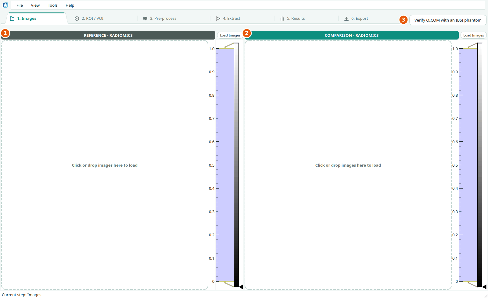

3. **Verify QICOM with an IBSI phantom** — optional self-check (see below).

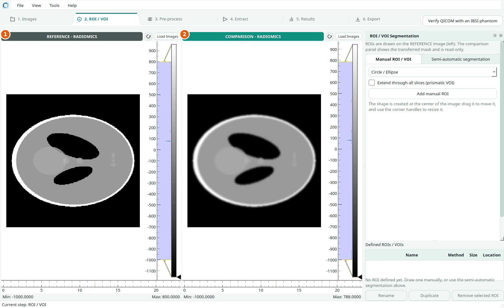

**Step 2 — ROI / VOI.** Draw on the **reference** (left). The comparison gets the same region.

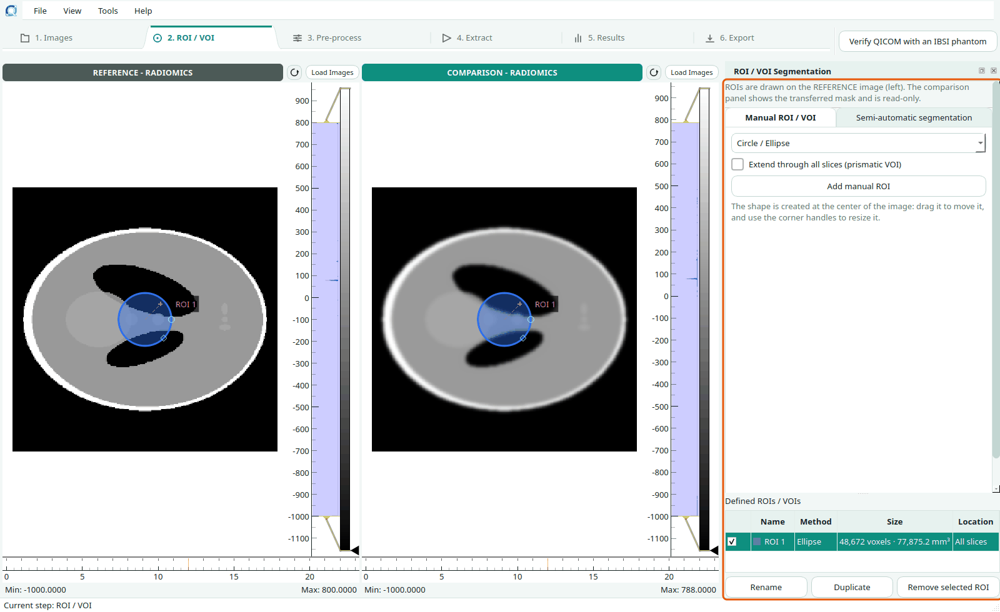

- **Manual ROI / VOI:** pick a shape → **Add manual ROI** → drag and resize it.
  Tick **Extend through all slices** for a 3D region (VOI).
- **Semi-automatic segmentation:** threshold or region growing from a click.
- A segmentation from another program: **File → Import NIfTI labelmap…**
- The list at the bottom shows every region: size in voxels and mm³, slices it covers.

**Step 3 — Pre-process.** The recipe used before extraction.

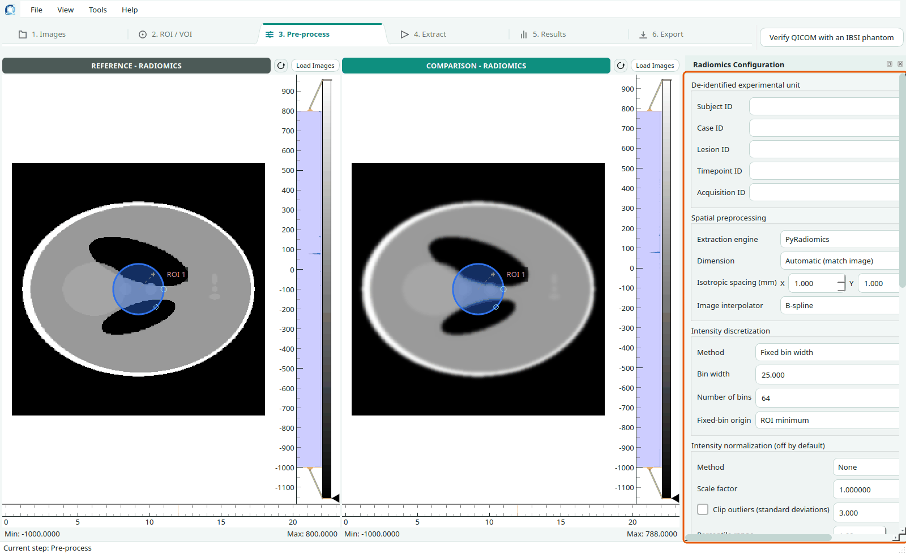

- **Identity** fields (subject, case, lesion, timepoint): use codes, never names.
- **Engine** (PyRadiomics, or MIRP if installed), **voxel spacing**, **interpolation**.
- **Discretization:** fixed bin width or fixed number of bins.
- **Normalization / clipping:** off by default. Nothing changes unless you ask.

**Step 4 — Extract.** Check the summary, then 1 **Extract all features**.

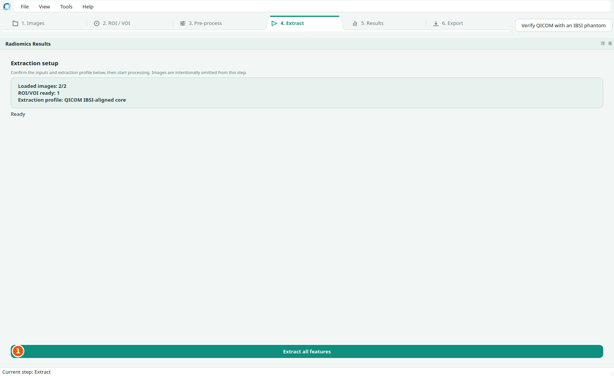

**Step 5 — Results.**

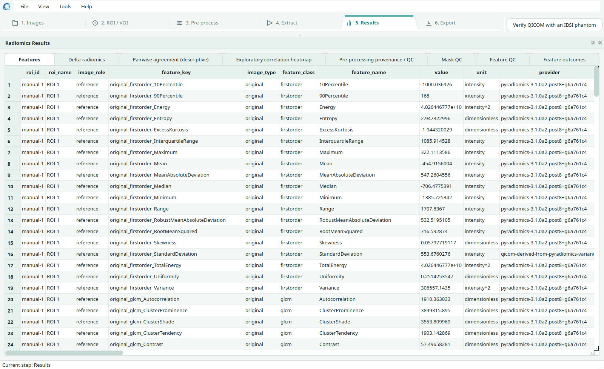

| Tab | Shows |
|---|---|
| Features | every feature, for R and C |
| Delta-radiomics | change R → C (absolute and %) |
| Pairwise agreement | how close R and C are, descriptive only |
| Exploratory correlation heatmap | which features move together |
| Pre-processing provenance / QC | exactly what was done to the images |
| Mask QC | Dice, Jaccard, volume difference, Hausdorff... between the two masks |
| Feature QC / outcomes | warnings, and what was computed or skipped, and why |

**Step 6 — Export.** 1 **Excel** · 2 **CSV set** · 3 **self-contained HTML**.
Save the project with **File → Save** (`.zip`).

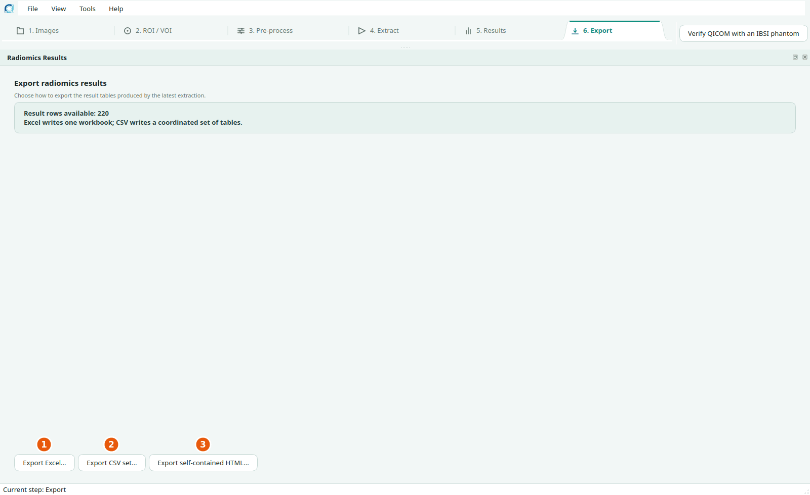

> Statistics such as ICC need at least **three independent subjects**. Use
> **Tools → Aggregate radiomics cohort...** over several saved radiomics projects.
> No predictive models, no clinical thresholds: out of scope.

### IBSI self-check

- Compares QICOM with the official IBSI digital phantom (104 features).
- **Run IBSI verification** downloads the official files **only after you agree**,
  checks them, and keeps them for offline use.
- **PASS** = every required feature within tolerance. **INCOMPLETE** = some are missing.
- It is a check of formulas, not a certification.

---

## 7. Utility tools

Open them from the start screen (**Utility Tools**) or from **Tools** in any window.
The list is on the left, the tool on the right.

**Every tool follows the same rules:**

- ✓ It never changes your original files. It writes **copies**, in a **new** folder.
- ✓ A result appears all at once, or not at all — never half-written.
- ✓ A coloured button always shows the next step.
- ✓ Same mouse controls as everywhere (scroll = slices, left-drag = contrast).

| Tool | Use it to... |
|---|---|
| Semi-automatic segmentation | build a label map, one region at a time |
| Mask operations and comparison | union, intersection, difference; Dice, Jaccard, volumes, Hausdorff |
| Convert images | DICOM / NIfTI / bitmap stack → NIfTI, PNG slices or TIFF slices |
| Resample | change voxel size, or match another image's grid |
| Image arithmetic | difference, absolute difference, sum, mean, ratio |
| Controlled degradation | add noise, blur, resolution loss, JPEG — repeatable from a seed |
| Inspect and edit DICOM tags | read every tag; write edited copies |
| Compare DICOM headers | two headers side by side; show only differences |
| Check and organize DICOM folders | find missing or mixed slices; copy into an ordered tree |
| Decompress DICOM | rewrite compressed DICOM uncompressed, for older software |
| Anonymize images | de-identified copy of a whole folder |

### Semi-automatic segmentation

- It separates **intensity classes** (air, fat, soft tissue, bone), not organs.
- CT presets give HU ranges as a **starting point**. Adjust them.
- **Apply** can: remove from the image, keep only this, or assign to a label.
- Saves a NIfTI label map + a JSON table of names and colours. Undo/redo at every step.

### Mask operations and comparison

Open mask **A**, then mask **B** (same grid). Combine them, fill empty slices,
or **Compare A and B** → Dice, Jaccard, volumes, Hausdorff (mm). Export CSV.

### Convert images

Open a file or folder → pick **NIfTI volume**, **PNG slices** (as seen on screen, 8 or 16 bit)
or **TIFF slices** (real values) → **Convert...** A new `<name>_<format>` folder is created.

### Resample

**To a voxel spacing** (type mm, or click **Isotropic**) or **onto the grid of a reference image**.
Places images by their coordinates — it does **not** register (align) them.

### Image arithmetic

Open two or more images on the same grid (A, B, ...) → pick an operation → **Compute** → **Save result...**

### Controlled degradation

1. Choose an effect (Gaussian/Poisson noise, Gaussian blur, resolution loss, JPEG).
2. Set its strength and the **seed** → **Apply**. Add more effects; remove any from the list.
3. **Save degraded image...** The recipe is saved with it, so anyone can make the same image again.

Useful to test which metric notices which kind of damage.

### Inspect and edit DICOM tags

- Open a file or a folder. Pick the series and the file.
- **Search** any tag. **Hide private tags**. **Export CSV**.
- Double-click **New value** to edit. Pixel tags are locked; tags that change measurements ask first.
- **Write copies to a folder...** Originals are never touched.

> Values are shown as stored, patient data included. A CSV export contains them too.

### Compare DICOM headers

Open two files. Tick **Only differences** and **Hide UIDs** to see what really changed
between two acquisitions.

### Check and organize DICOM folders

**Choose folder...** → one row per study and series, with problems found
(missing slices, irregular spacing, mixed orientation). **Export report (CSV)** or
**Copy organized into a folder...** (folders named by study and series, never by patient).

### Decompress DICOM

Open a compressed DICOM (JPEG lossless, JPEG-LS, JPEG 2000, RLE...) → it is rewritten
uncompressed, one file per frame, in a new folder.

### Anonymize images

1. **Choose files...** or **Choose folder...** (tick **Include subfolders** if needed).
2. Read the list: **What happens** to each file. Files that cannot be checked are named here.
3. Optional: **Replace folder and file names with generic ones.**
4. **Anonymize.** Copies go to `<folder>_anonymized`.

> ✗ Text **burned into the pixels** is not detected or removed.
> ✓ Open the copy and check it before you share it.

---

## 8. Settings

Open from the start screen (settings button) or **Tools → Settings**. Changes save by themselves.

| Tab | What you set |
|---|---|
| General | language (8 languages, switches at once), theme, number format, decimals |
| Default metrics | which metrics are ticked when a new analysis starts; NSS reference model |
| Identity | your name, filled in when you take a non-anonymous evaluation |
| Diagnostics | create a synthetic demo / bug-report bundle (no patient data) |

**Restore defaults** puts everything back.

---

## 9. Privacy and safety

- ✓ Images are processed **only on your computer**. No upload. No telemetry.
- ✓ Projects and evaluation packages **anonymize DICOM by default**.
  If a file cannot be anonymized safely, QICOM **stops and tells you**. Exporting anyway
  needs your explicit OK, and those files are marked as not verified.
- ✓ Imported ZIP files are checked before they are opened.
- ✓ Text that looks like a spreadsheet formula is neutralised in Excel/CSV exports.
- ✗ QICOM does not read or remove text burned into the pixels.
- ✗ Quantitative project ZIPs keep NIfTI headers and original file names as they are.

Full details: [SECURITY.md](../../SECURITY.md).

---

## 10. When something goes wrong

| Problem | Try this |
|---|---|
| The app does not start (Windows) | Unzip to a real folder first. Do not run it from inside the zip. |
| macOS says the app is damaged / unknown | Check the checksum, then *Privacy & Security → Open Anyway*. |
| "Mismatched Slice Counts" before calculating | Choose *Use only the current slice* or *Use full stacks (trim to the shortest)* — or load matching series. |
| Images have different sizes | **Tools → Resample** the comparison onto the reference grid. |
| A metric is missing from the results | It needs a model (click **Download** in Analyze) or the image is too small for it. Check the outcome column/register. |
| LPIPS / DISTS never appear | Their models are not included. Download them once in **Analyze** (or Settings → Default metrics). |
| Radiomics refuses my PNG/JPG | Radiomics needs DICOM or NIfTI (real geometry). Convert first. |
| Answer file is red in Aggregate | It belongs to a different questionnaire. Hover the verdict to read why. |
| "The answers could not be aggregated" | Read the detail, e.g. a required comment is missing in one file. |
| Forgot the access code | It cannot be recovered. Use the unprotected working copy. |
| The screen looks wrong / too small | Change theme in **View**; the windows scroll on small screens. |

### Errors and logs

- An indicator in the status bar means unread errors. Click it, or open **View → Panels → Errors**.
- **Help → Report a Bug...** → **Save error report...** (version, system, recent log, no images)
  and attach it to your e-mail. You can add the synthetic demo bundle too.

The log file:

| System | Log file |
|---|---|
| Windows | `%LOCALAPPDATA%\qicom\Logs\qicom.log` |
| macOS | `~/Library/Logs/qicom/qicom.log` |
| Linux | `~/.local/state/qicom/log/qicom.log` |

**Help → About QICOM** shows the version, the licence and how to cite QICOM.

---

## 11. Words used in QICOM

| Word | In plain words |
|---|---|
| **Reference (R)** | the image you trust |
| **Comparison (C)** | an image you test against the reference |
| **Slice** | one 2D picture inside a 3D volume |
| **ROI / VOI** | a region you draw: 2D (ROI) or through the slices (VOI) |
| **Window / level** | contrast and brightness of the display; never changes the data |
| **Metric** | a formula that turns two images (or one) into a number |
| **Profile** | a saved set of metrics (e.g. Fast Core) |
| **Data range** | the span of possible pixel values, used by PSNR and SSIM |
| **Heatmap** | a coloured map of where two images differ |
| **SNR / CNR** | signal-to-noise / contrast-to-noise: how much a tissue stands out |
| **HU** | Hounsfield units, the CT intensity scale (air ≈ −1000, water = 0) |
| **Blinded** | evaluators do not know which image is which |
| **Seed** | a number that makes a "random" shuffle or noise repeatable |
| **Package** | the `.zip` that holds an evaluation (images + questions) |
| **Decoding map** | the file that says which neutral label (A, B, C) is which image |
| **Feature** | a radiomics number: shape, intensity or texture inside a region |
| **Delta (Δ)** | how much a feature changed from R to C |
| **IBSI** | the international standard for radiomics feature definitions |
| **Receipt** | the record saved with results: versions, settings and fingerprints (hashes) of every input |
| **Anonymize** | remove the data that identifies a person from a copy of the file |

---

*More detail:* [README](../../README.md) ·
[Qualitative methodology](../../QUALITATIVE_METHODOLOGY.md) ·
[Radiomics methodology](../../RADIOMICS_METHODOLOGY.md) ·
[Security](../../SECURITY.md)

*Screenshots use a synthetic phantom and invented DICOM data. No patient images.*
