# QICOM — Manuel d'utilisation

**Regardez d'abord les images. Lisez le texte seulement si vous en avez besoin.**

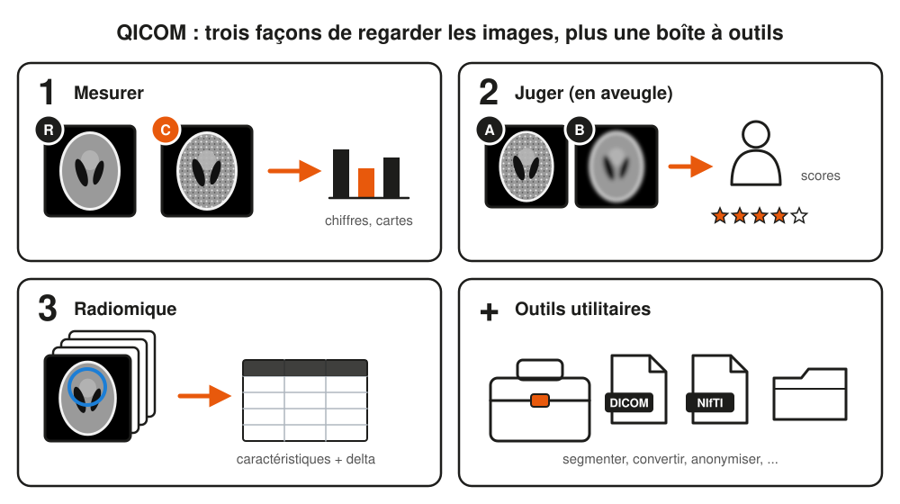

> **Recherche et contrôle qualité uniquement.** QICOM n'est pas un dispositif médical.
> Ne l'utilisez pas pour poser un diagnostic ni pour décider des soins d'un patient.

---

## Sommaire

1. [Avant de commencer](#1-avant-de-commencer)
2. [Installer et ouvrir](#2-installer-et-ouvrir)
3. [Les bases (à lire une fois)](#3-les-bases-à-lire-une-fois)
4. [Analyse quantitative : mesurer deux images](#4-analyse-quantitative--mesurer-deux-images)
5. [Analyse qualitative : des personnes notent les images](#5-analyse-qualitative--des-personnes-notent-les-images)
6. [Radiomique : comparer des caractéristiques dans une région](#6-radiomique--comparer-des-caractéristiques-dans-une-région)
7. [Outils utilitaires](#7-outils-utilitaires)
8. [Paramètres](#8-paramètres)
9. [Confidentialité et sécurité](#9-confidentialité-et-sécurité)
10. [Quand quelque chose ne va pas](#10-quand-quelque-chose-ne-va-pas)
11. [Les mots de QICOM](#11-les-mots-de-qicom)

---

## 1. Avant de commencer

**Ce que fait QICOM :** il compare des images médicales et vous dit à quel point elles diffèrent.

| Vous voulez... | Utilisez |
|---|---|
| Obtenir des **chiffres** qui disent à quel point une image est proche d'une autre | **Quantitative** |
| Faire noter des images par des **personnes**, sans qu'elles sachent laquelle est laquelle | **Qualitative** |
| Comparer des **caractéristiques de texture et de forme** dans une région | **Radiomique** |
| Convertir, anonymiser, segmenter, rééchantillonner, lire les tags DICOM... | **Outils utilitaires** |

**Ce qu'il vous faut**

- Un ordinateur sous Windows 10/11 (64 bits), macOS 14 sur Apple Silicon ou Linux 64 bits.
- 8 GB de mémoire suffisent. 16 GB, c'est mieux. 32 GB pour de grands volumes 3D.
- Vos images : **DICOM** (un fichier ou un dossier avec une série), **NIfTI** (`.nii`, `.nii.gz`)
  ou **PNG / JPG / BMP**. La radiomique accepte seulement DICOM et NIfTI.

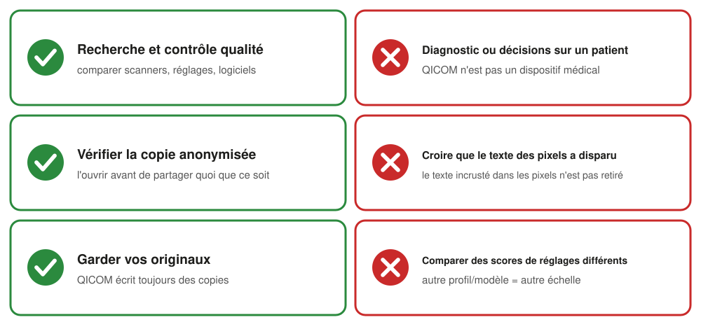

---

## 2. Installer et ouvrir

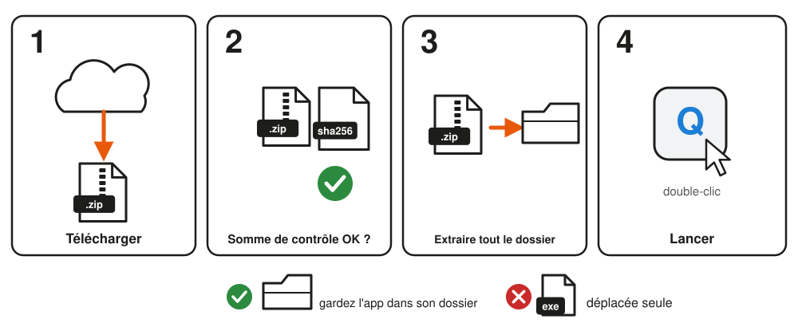

1. **Téléchargez** le fichier pour votre système, avec son fichier `.sha256`.
2. **Vérifiez** le téléchargement. Le résultat doit être `True` (Windows) ou `OK` (macOS/Linux) :
   - Windows (PowerShell) : comparez `Get-FileHash QICOM-windows-x64.zip` avec le fichier `.sha256`
   - macOS : `shasum -a 256 -c QICOM-macos-arm64.zip.sha256`
   - Linux : `sha256sum -c QICOM-linux-x64.tar.gz.sha256`
3. **Extrayez** dans un vrai dossier (pas dans la fenêtre du zip). Gardez le dossier entier.
4. **Lancez** QICOM :
   - Windows : double-cliquez sur `qicom.exe`. Si « Windows a protégé votre ordinateur » apparaît et
     que la somme de contrôle est OK, cliquez *Informations complémentaires* → *Exécuter quand même*
     (seulement si votre organisation l'autorise).
   - macOS : double-cliquez sur `QICOM.app`. Si macOS la bloque : *Réglages Système → Confidentialité
     et sécurité → Ouvrir quand même*.
   - Debian/Ubuntu : `sudo apt install ./QICOM-linux-x64.deb`, puis ouvrez **QICOM** depuis le menu
     des applications ou tapez `qicom`.
   - Depuis le code source : `qicom-gui`.

> ✗ Un antivirus qui nomme une vraie menace, ce **n'est pas** la même chose que l'avertissement
> « application inconnue ». Ne le contournez pas. Prévenez votre service informatique.

### L'écran de démarrage

QICOM s'ouvre toujours sur cet écran. Choisissez ce que vous voulez faire.

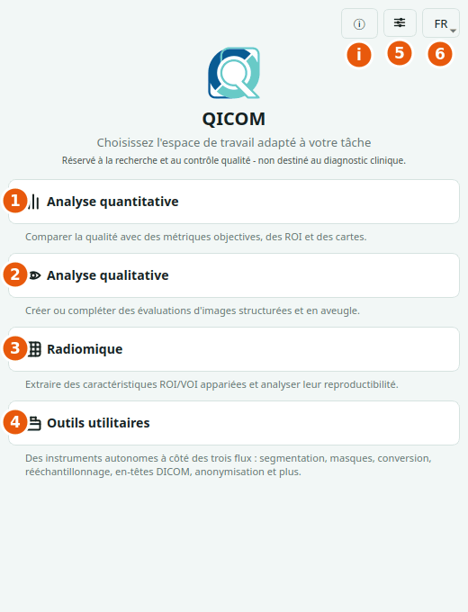
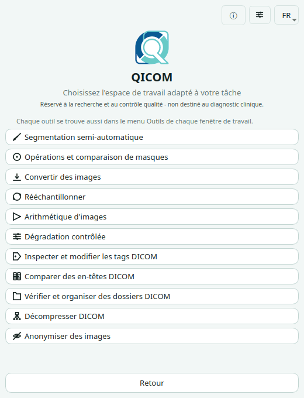

| | Bouton | Ce qu'il ouvre |
|---|---|---|
| 1 | Analyse quantitative | mesurer des images avec des chiffres et des cartes |
| 2 | Analyse qualitative | créer, effectuer ou rassembler des évaluations en aveugle |
| 3 | Radiomique | comparer des caractéristiques dans une région |
| 4 | Outils utilitaires | la boîte à outils (image de droite) |
| i / 5 / 6 | ⓘ, paramètres, langue | à propos de QICOM, préférences, langue |

Chaque bouton ouvre une petite deuxième page :

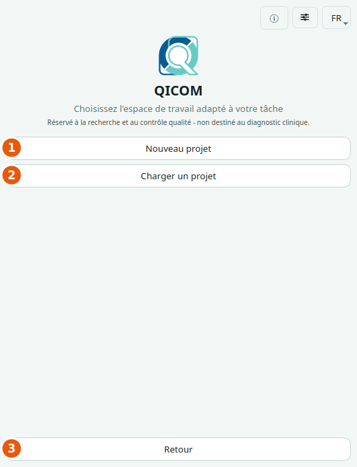
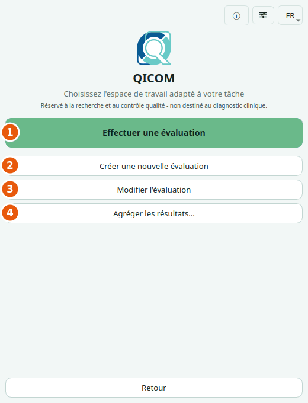
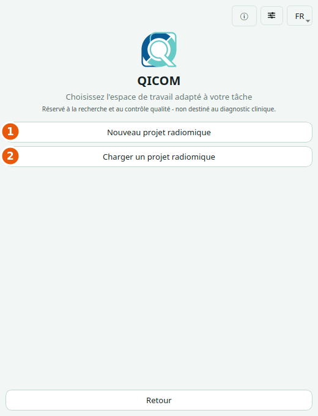

- **Quantitative :** 1 Nouveau projet · 2 Charger un projet enregistré (`.zip`) · 3 Retour.
  Les projets récents apparaissent dessous : un clic pour les rouvrir.
- **Qualitative :** 1 **Effectuer une évaluation** (en vert : on vous en a envoyé une) ·
  2 Créer une nouvelle · 3 Modifier · 4 Agréger les résultats.
- **Radiomique :** 1 Nouveau projet · 2 Charger un projet enregistré.

Pour revenir ici plus tard : **Fichier → Fermer le projet**.

---

## 3. Les bases (à lire une fois)

### Les étapes sont des onglets

Chaque espace de travail est une rangée d'onglets numérotés. **Allez de gauche à droite.**
Vous pouvez toujours revenir en arrière.

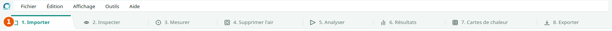

### Souris et clavier sur une image

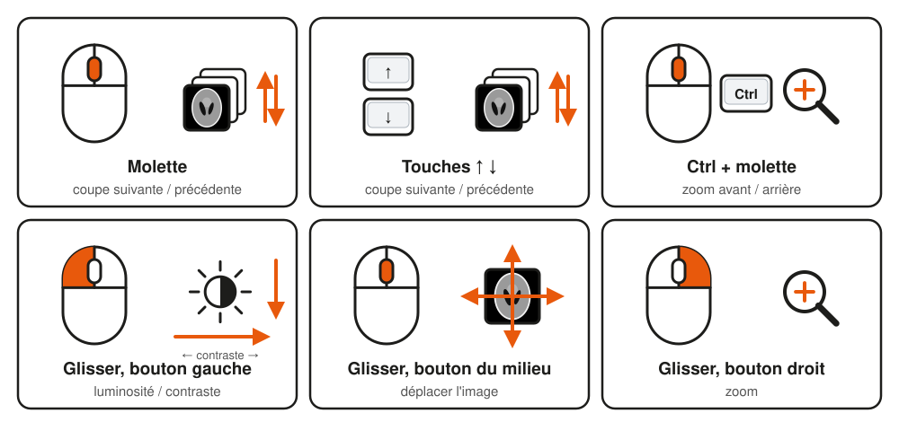

- **Charger une image :** cliquez sur un cadre vide, ou glissez-y un fichier.
- **Annuler / rétablir :** `Ctrl+Z` / `Ctrl+Y` (Quantitative).
- Boutons au-dessus de chaque image : pivoter, retourner, réinitialiser, **Charger des images**.

### Référence et comparaison

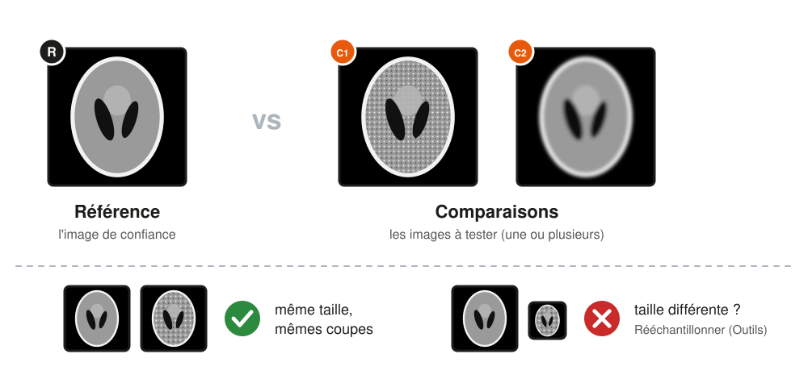

- **R — Référence :** l'image de confiance (par exemple pleine dose, originale).
- **C1, C2, ... — Comparaisons :** les images que vous testez. Ajoutez-en autant que vous voulez
  avec **+ Ajouter une comparaison**.
- Les images doivent avoir **la même taille et le même nombre de coupes**.
  Ce n'est pas le cas ? Utilisez d'abord **Outils → Rééchantillonner**.

### Ce que QICOM écrit

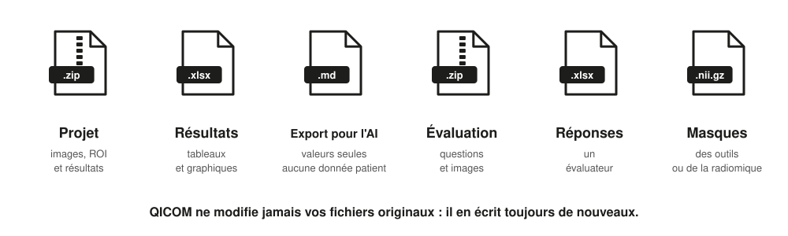

### Menus (les mêmes dans chaque fenêtre)

| Menu | Contenu |
|---|---|
| **Fichier** | ouvrir, enregistrer, exporter, fermer le projet |
| **Édition** | annuler, rétablir (Quantitative) |
| **Affichage** | thème (clair/gris/sombre), **Panneaux** (historique, journal, erreurs) |
| **Outils** | les Outils utilitaires, format des nombres, langue, **Paramètres** |
| **Aide** | signaler un bug, à propos de QICOM (licence, citation) |

---

## 4. Analyse quantitative : mesurer deux images

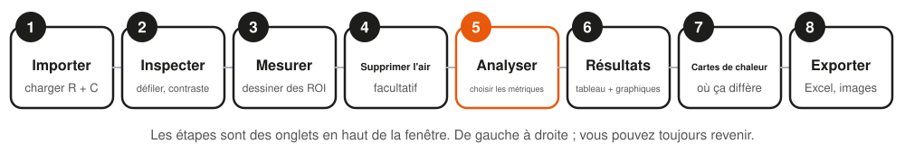

### Étape 1 — Importer

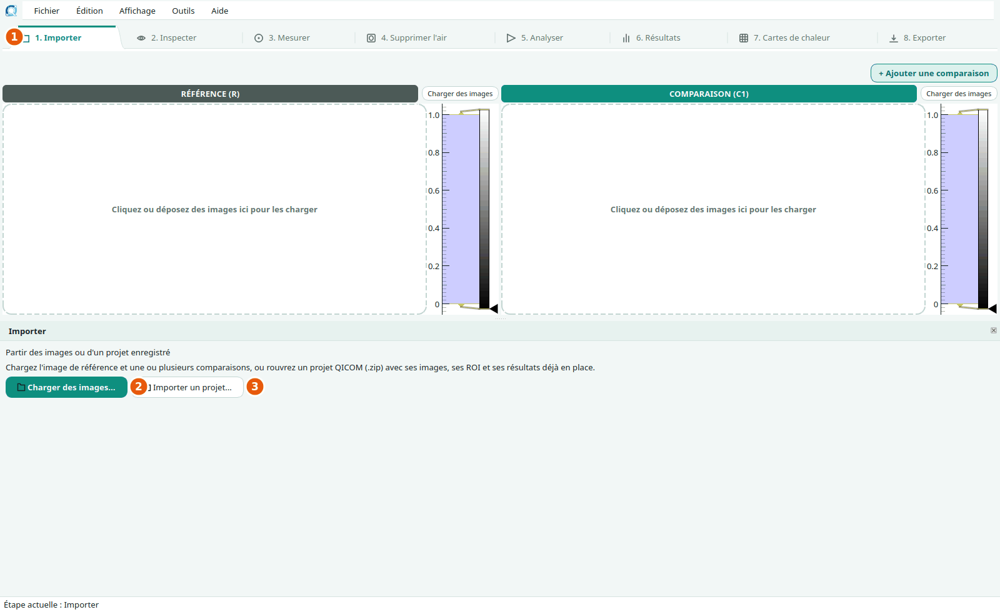

1. Les onglets des étapes.
2. **Charger des images :** choisissez un fichier ou un dossier, puis le cadre (Référence ou Comparaison).
3. **Importer un projet :** rouvrez un projet QICOM enregistré (`.zip`) avec images, ROI et résultats.

Plus rapide : cliquez sur un cadre vide, ou glissez-y un fichier.

### Étape 2 — Inspecter

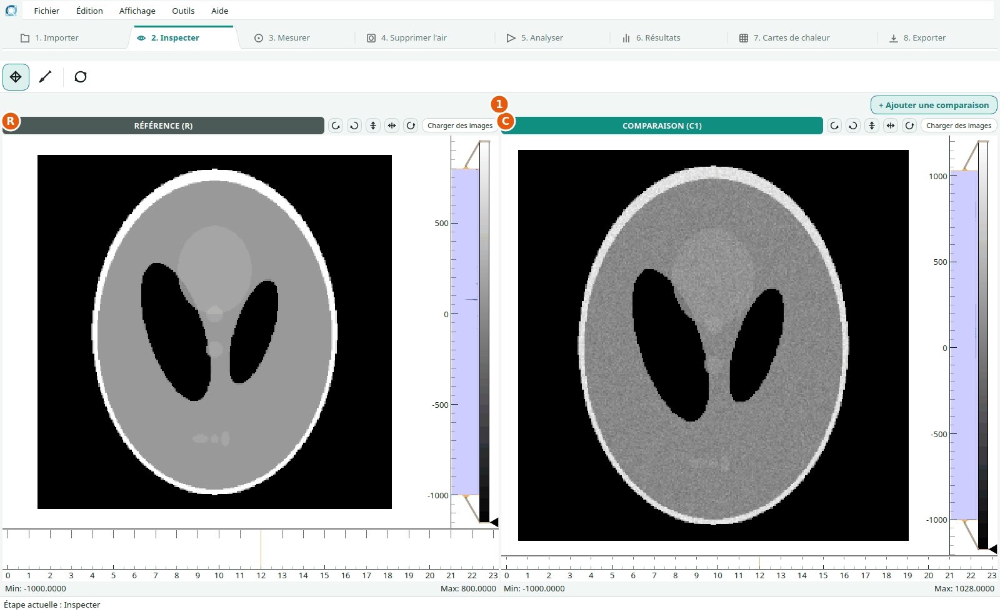

- **R** est la référence, **C** la comparaison. Chacune a sa barre de contraste à droite.
- 1 Outils d'affichage : **Zoom / Pan**, **Annotation** (une note texte sur l'image),
  **Synchroniser les niveaux** (vous changez le contraste d'une image → toutes les images suivent).
- Tournez la molette pour changer de coupe. Glissez avec le bouton gauche pour la luminosité et le contraste.

Plus d'une comparaison ? Chacune a son cadre :

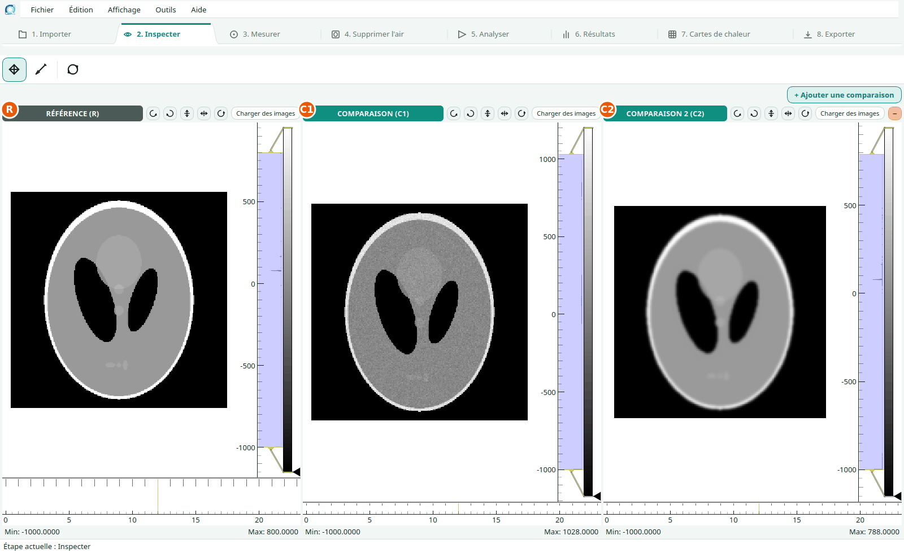

> Avant de calculer, QICOM vérifie la taille des pixels, l'orientation et l'espacement des coupes.
> Les problèmes apparaissent dans **Affichage → Panneaux → Erreurs**. Il ne modifie jamais vos pixels
> de lui-même.

### Étape 3 — Mesurer (facultatif)

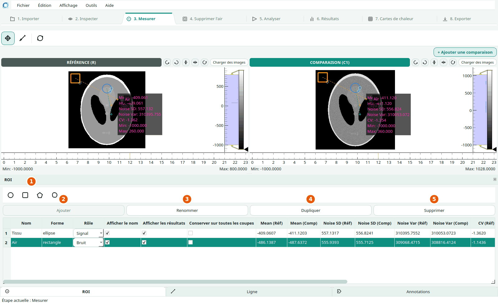

1. Choisissez une forme : **cercle**, **rectangle**, **polygone**, **main levée**.
2. **Ajouter** — la même ROI apparaît sur chaque image, au même endroit.
3. **Renommer** · 4 **Dupliquer** · 5 **Supprimer**.

Dans le tableau, choisissez le **Rôle** de chaque ROI :

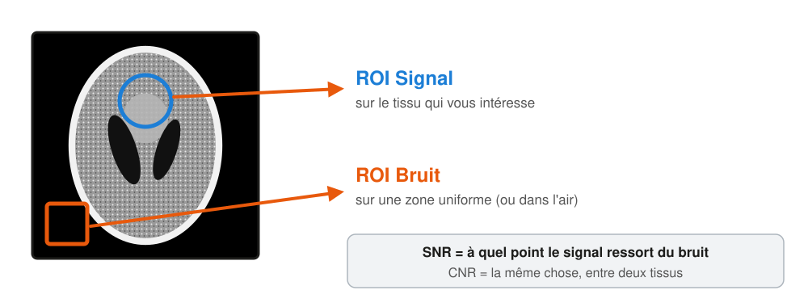

- **Signal :** sur le tissu qui vous intéresse. **Bruit :** sur une zone uniforme ou dans l'air.
- Avec les deux, QICOM donne le **SNR** et le **CNR**.
- Les valeurs se mettent à jour en direct dans le tableau : moyenne, SD du bruit, CV, min, max.
- Onglets en bas : **Ligne** (tracez une ligne, voyez le profil d'intensité) et **Annotations**.
- **Conserver sur toutes les coupes :** la ROI reste sur chaque coupe, pas seulement sur la coupe actuelle.

### Étape 4 — Supprimer l'air (facultatif)

Une coupe est surtout faite d'air. L'air ressemble à l'air : les images paraissent donc plus proches
qu'elles ne le sont. Cette étape retire l'air **autour** du corps (l'air à l'intérieur du corps reste).

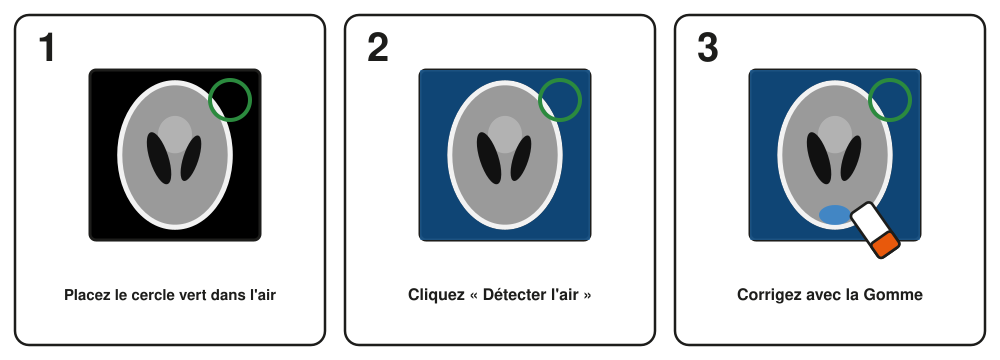

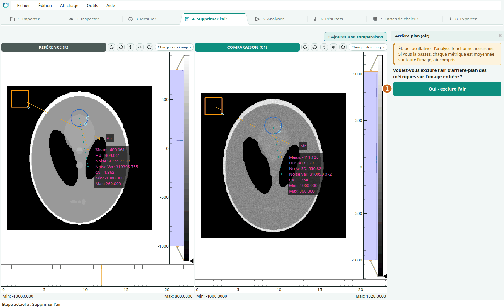
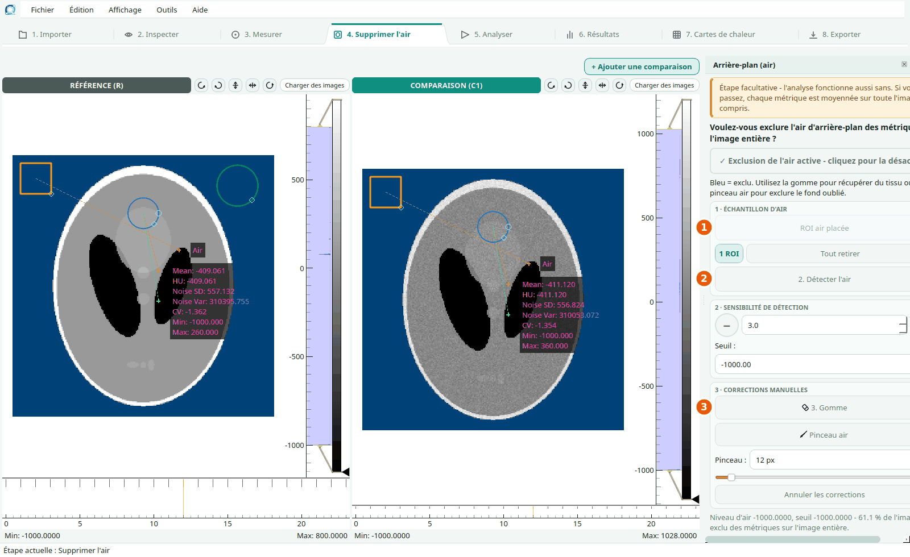

1. Cliquez sur le grand bouton pour **activer** l'exclusion. Cliquez **Ajouter une ROI air** :
   un cercle vert apparaît. Glissez-le sur une zone d'air seulement.
2. **Détecter l'air.** Tout ce qui est peint en bleu est exclu des métriques sur l'image entière.
   Trop ou pas assez ? Utilisez la sensibilité **−/+** ou tapez le seuil.
3. **Gomme** rend le tissu pris par erreur. **Pinceau air** ajoute l'air oublié.
   **Annuler les corrections** revient au résultat détecté.

> Sauter cette étape, c'est permis. Les métriques font alors la moyenne sur toute l'image, air compris.
> Les mesures dans les ROI ne changent jamais.

### Étape 5 — Analyser

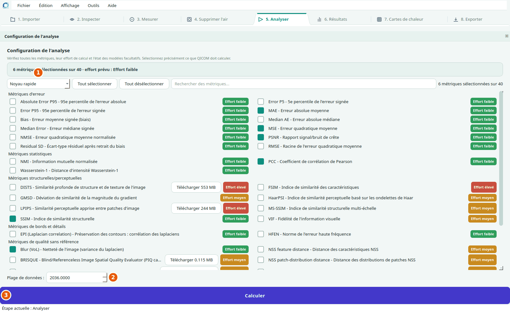

1. **Profil :** un ensemble de métriques prêt à l'emploi. Commencez par **Noyau rapide**.
   Cocher des cases à la main en fait un profil personnalisé.
2. **Plage de données :** l'étendue des valeurs possibles des pixels. QICOM la remplit ;
   laissez-la si vous n'avez pas mieux.
3. **Calculer.** Une barre de progression remplace le bouton. Vous pouvez annuler.

- Badges : **Effort faible / moyen / élevé** = combien de temps prend une métrique.
- **Télécharger** à côté d'une métrique (LPIPS, DISTS, BRISQUE...) : son modèle n'est pas inclus.
  Il se télécharge seulement si vous cliquez, et il est vérifié avant usage. Sans lui, la métrique est sautée.
- Utilisez la recherche pour trouver une métrique par son nom. Survolez une métrique pour lire ce qu'elle signifie.

### Étape 6 — Résultats

QICOM arrive ici tout seul quand le calcul est terminé.

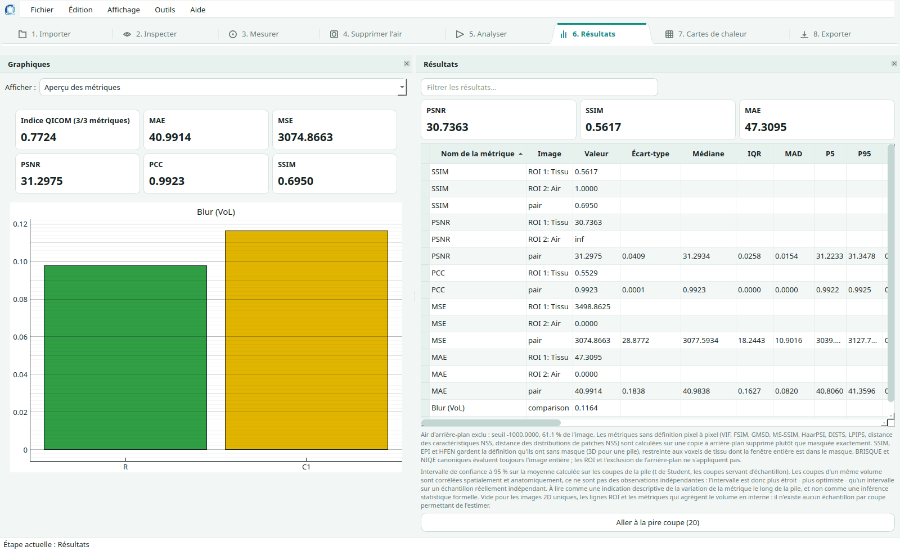

- **À gauche :** graphiques. Choisissez une vue dans **Afficher** et une paire (`R vs C1`, `R vs C2`, `R vs All`).
- **À droite :** de grandes cartes pour les chiffres clés, puis le tableau complet.
  Tapez dans **Filtrer les résultats** pour chercher.
- Lignes : **pair** = image entière ; **ROI 1, ROI 2** = à l'intérieur de chaque ROI.
- Pour les volumes : médiane, IQR, P5/P95 et coupes aberrantes.
  **Aller à la pire coupe** saute à la coupe la plus différente.

Comment lire un chiffre :

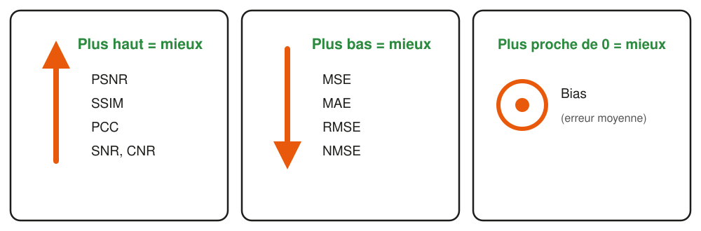

> L'**indice QICOM** (de 0 à 1, 1 = identiques) est expérimental. Comparez-le seulement entre
> des résultats obtenus avec **le même profil et la même version**.

### Étape 7 — Cartes de chaleur

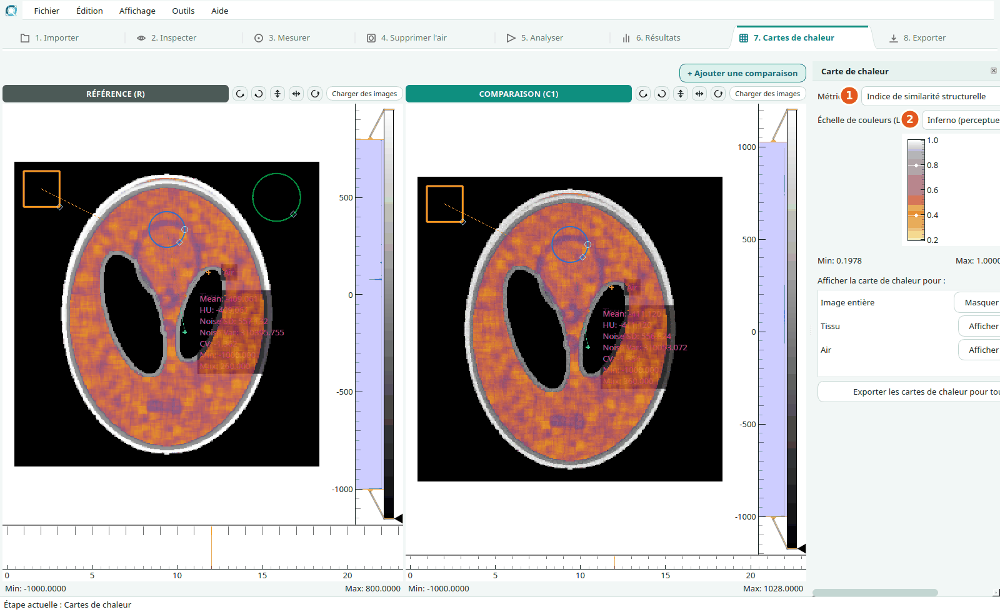

1. Choisissez une métrique (SSIM, MSE, MAE, NMSE, biais).
2. Choisissez une échelle de couleurs.

- La carte montre **où** les images diffèrent, par-dessus l'image.
- **Afficher la carte de chaleur pour :** image entière ou une ROI.
  **Exporter les cartes de chaleur pour toutes les ROI...** les enregistre comme images.
- Pour SSIM, l'échelle est inversée : les zones abîmées ressortent quand même.

### Étape 8 — Exporter

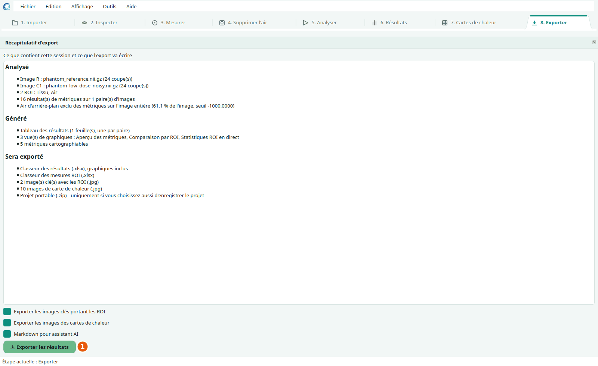

- La page liste ce qui a été analysé, ce qui a été produit et **ce qui sera écrit**.
- Décochez ce que vous ne voulez pas (images clés, cartes de chaleur, Markdown pour l'AI).
- 1 **Exporter les résultats** → classeur Excel (avec graphiques), classeur des ROI, images.
- Pour continuer plus tard : **Fichier → Enregistrer / Exporter...** enregistre un projet portable (`.zip`).

> **Markdown pour assistant AI** (`*_ai_assistant.md`) : seulement des chiffres et des définitions
> de métriques — pas de noms de fichiers, pas de données patient, pas d'en-tête DICOM. QICOM ne l'envoie
> nulle part. Ouvrez-le et lisez-le avant de le coller dans un chat.

---

## 5. Analyse qualitative : des personnes notent les images

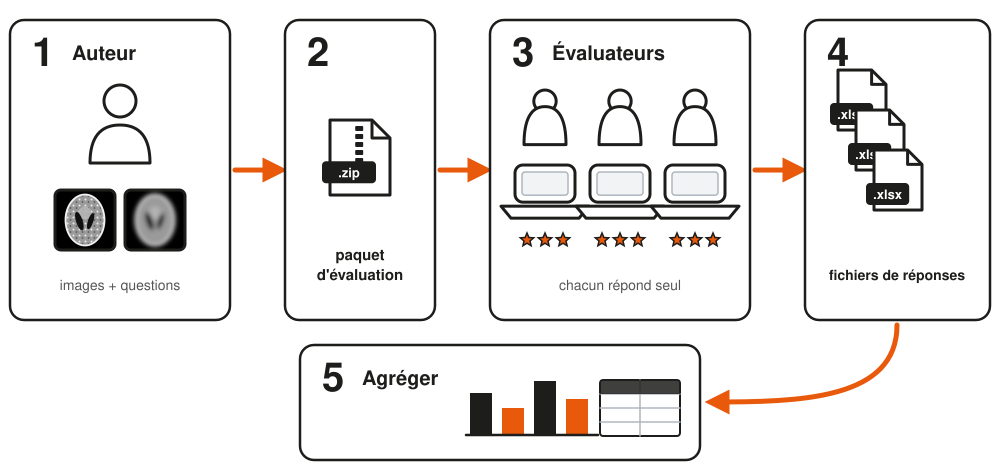

Il y a trois rôles. Chacun a son bouton sur l'écran de démarrage.

| Rôle | Bouton de l'écran de démarrage | Étapes |
|---|---|---|
| **Auteur** — crée le test | Créer une nouvelle évaluation / Modifier l'évaluation | Réglages → Images → Questions → Toutes les pages → Aperçu → Enregistrer |
| **Évaluateur** — y répond | **Effectuer une évaluation** (vert) | Évaluer → Vérifier les réponses → Terminer et enregistrer |
| **Collecteur** — rassemble les réponses | Agréger les résultats | Questions → Réponses → Analyse → Exporter |

### 5A. Auteur : créer l'évaluation

**Étape 1 — Réglages.** Décidez du comportement de tout le test, avant de le construire.

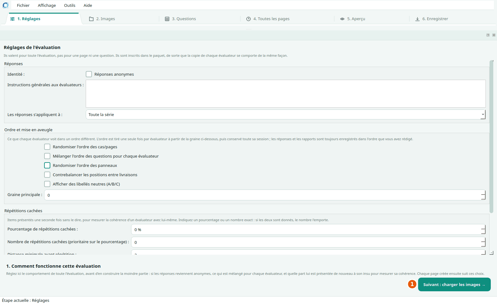

- **Réponses anonymes :** aucun nom n'est demandé ni gardé.
- **Instructions** pour les évaluateurs. **Les réponses s'appliquent à :** toute la série ou chaque coupe.
- **Ordre et aveugle :** mélanger pages, questions ou cadres ; étiquettes neutres A/B/C ;
  une **graine** (seed) rend le mélange reproductible.
- **Répétitions cachées :** montrer certains éléments deux fois, pour voir si chacun est cohérent avec lui-même.
- 1 **Suivant : charger les images.**

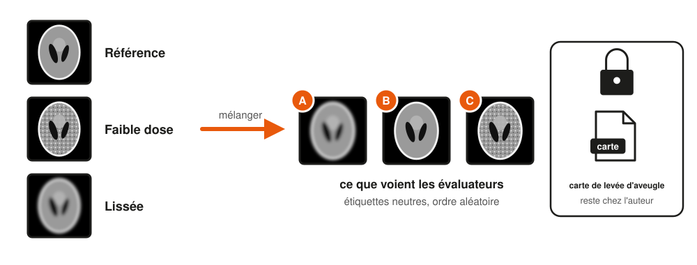

**Étape 2 — Images.** Chargez les images de **cette page**.

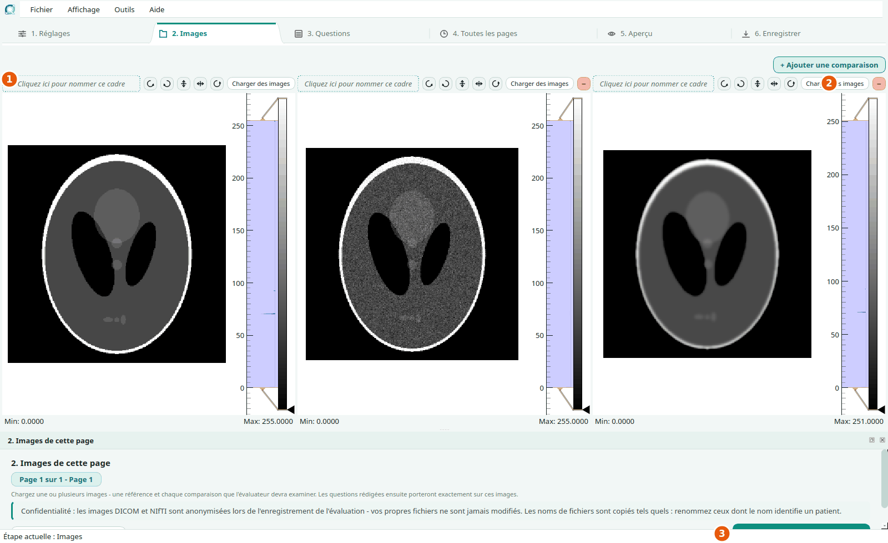

1. Cliquez sur un cadre (ou glissez-y un fichier). Cliquez sur la barre du nom pour le renommer.
2. **+ Ajouter une comparaison** pour d'autres cadres. 3 **Suivant.**

> DICOM et NIfTI sont dé-identifiés à l'enregistrement. Les noms de fichiers sont copiés tels quels :
> renommez tout fichier dont le nom identifie un patient.

**Étape 3 — Questions.** Écrivez ce à quoi les évaluateurs doivent répondre sur ces images.

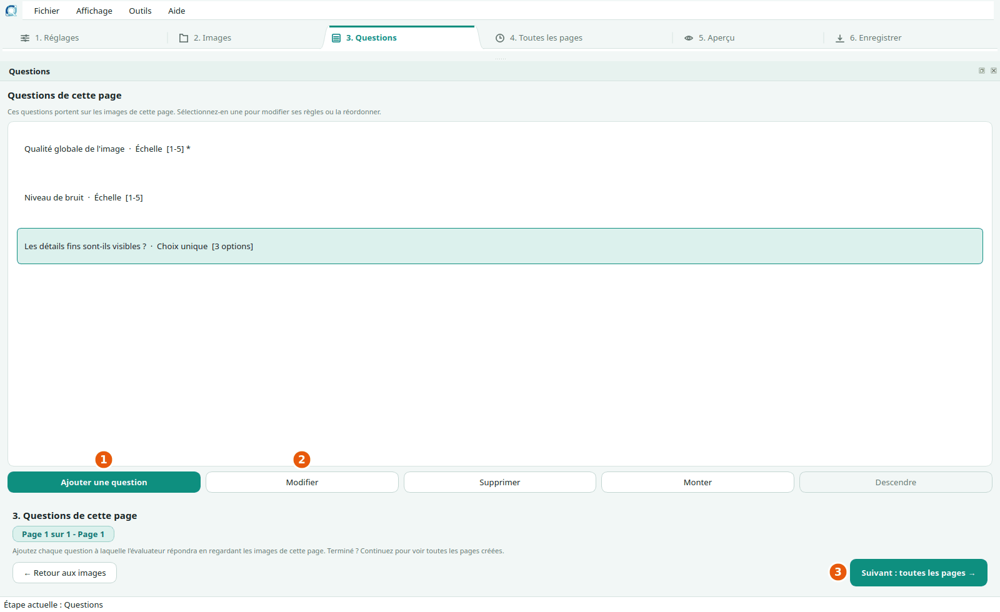

1. **Ajouter une question** · 2 **Modifier** (aussi Supprimer, Monter/Descendre) ·
   3 **Suivant : toutes les pages.**

Formats de réponse : échelle numérique (avec des mots aux extrémités, ex. 1 = Mauvaise, 5 = Excellente),
choix unique, choix multiple, liste déroulante, texte libre, classement, A ou B (2-AFC),
A / B / aucune différence. Chaque question peut permettre **Non évaluable**.

**Étape 4 — Toutes les pages.** Une ligne par page : ses images et ses questions.

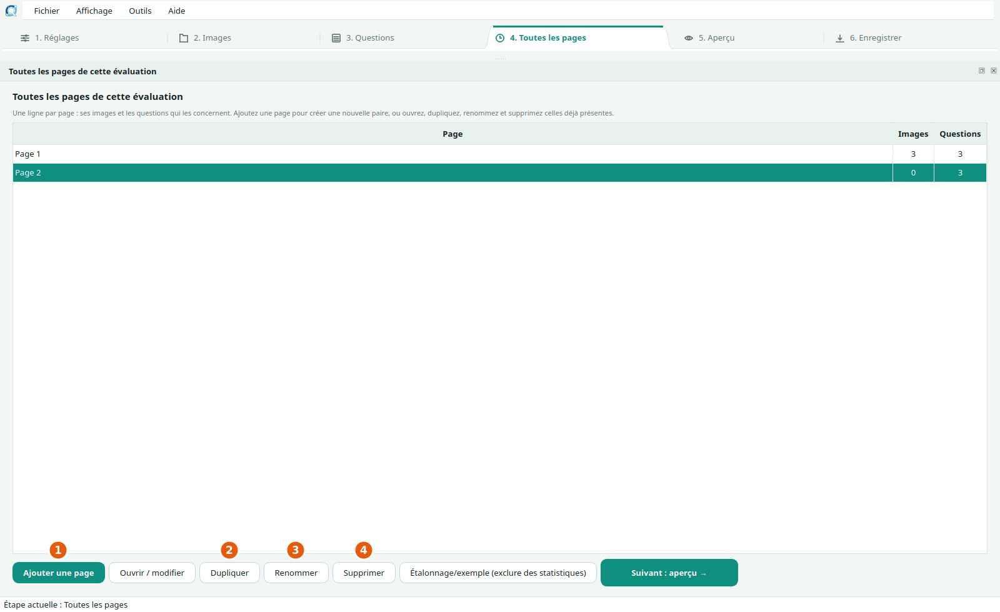

1. **Ajouter une page** (retour à l'étape 2 pour la nouvelle page) · 2 **Dupliquer** (copie les questions) ·
   3 **Renommer** · 4 **Supprimer**.
- **Étalonnage/exemple :** une page d'entraînement, exclue des statistiques.

**Étape 5 — Aperçu.** Voyez exactement ce que verra un évaluateur. Essayez les réponses.

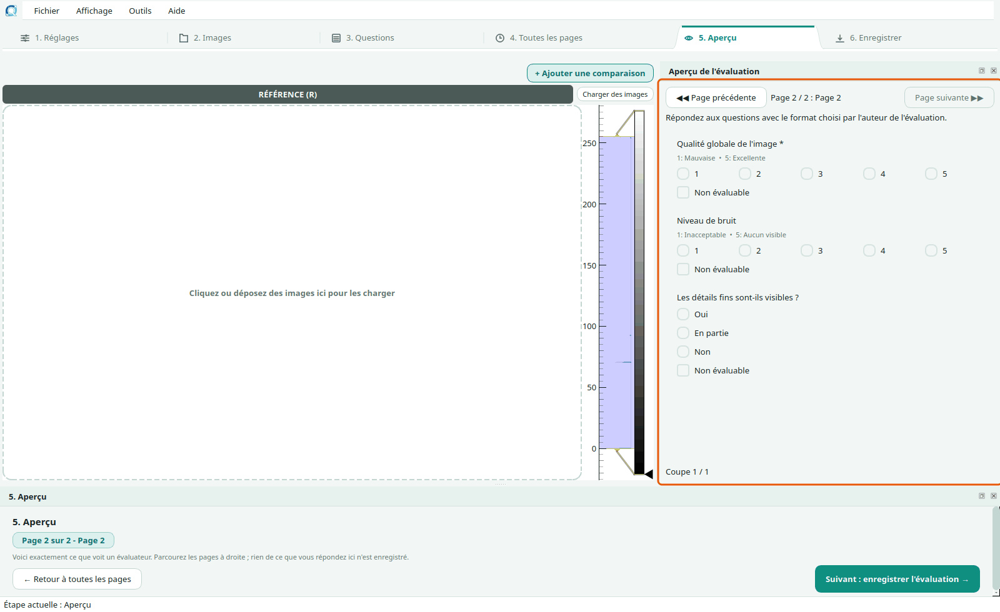

**Étape 6 — Enregistrer.**

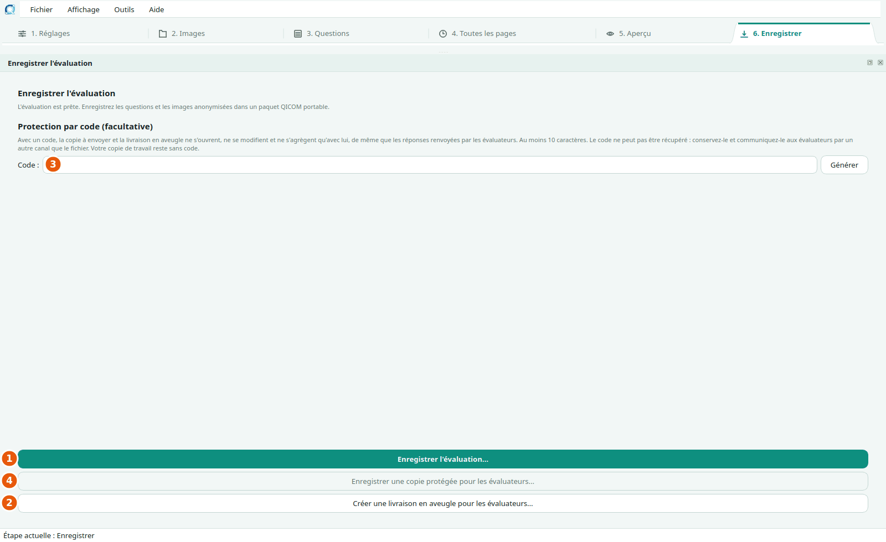

1. **Enregistrer l'évaluation...** → un seul fichier `.zip`. Envoyez ce fichier aux évaluateurs.
2. **Créer une livraison en aveugle pour les évaluateurs...** → un ZIP avec des noms neutres + une
   **carte de levée d'aveugle** séparée (gardez la carte pour vous).
3. **Code d'accès** (facultatif, au moins 10 caractères, **impossible à récupérer**).
   Tapez-en un ou cliquez **Générer**.
4. **Enregistrer une copie protégée pour les évaluateurs...** → seules les personnes qui ont le code
   peuvent l'ouvrir. Envoyez le code par un autre canal que le fichier.

### 5B. Évaluateur : répondre à l'évaluation

1. Écran de démarrage → **Analyse qualitative** → **Effectuer une évaluation** → choisissez le `.zip`.
2. Connectez-vous, ou **Continuer sans se connecter**.

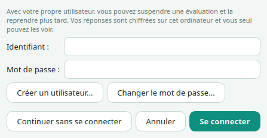

| | Avec votre utilisateur | Sans se connecter |
|---|---|---|
| Faire une pause et reprendre | ✓ | ✗ (une seule session) |
| Réponses gardées sur cet ordinateur | ✓ chiffrées, vous seul pouvez les voir | ✗ rien n'est gardé |

**Étape 1 — Évaluer.**

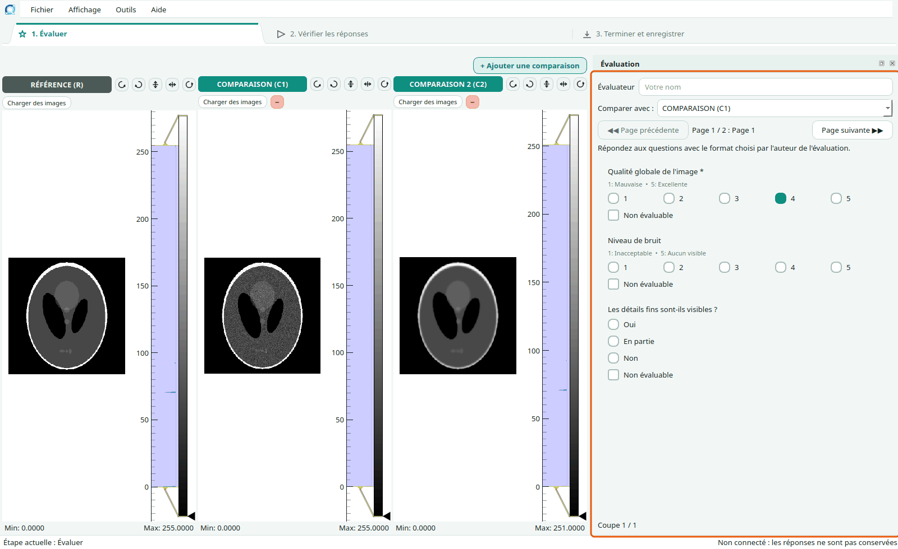

- Tapez votre nom (sauf si le test est anonyme).
- **Comparer avec :** l'image que vous notez.
- Répondez à chaque question. Les questions obligatoires ont un `*`.
- **Page précédente / suivante** pour avancer. Tournez la molette pour les autres coupes.

**Étape 2 — Vérifier les réponses.** Un tableau de tout ce que vous avez répondu. Revenez en arrière pour corriger.

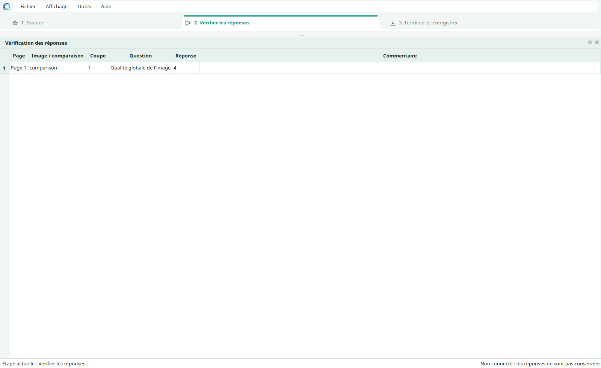

**Étape 3 — Terminer et enregistrer.**

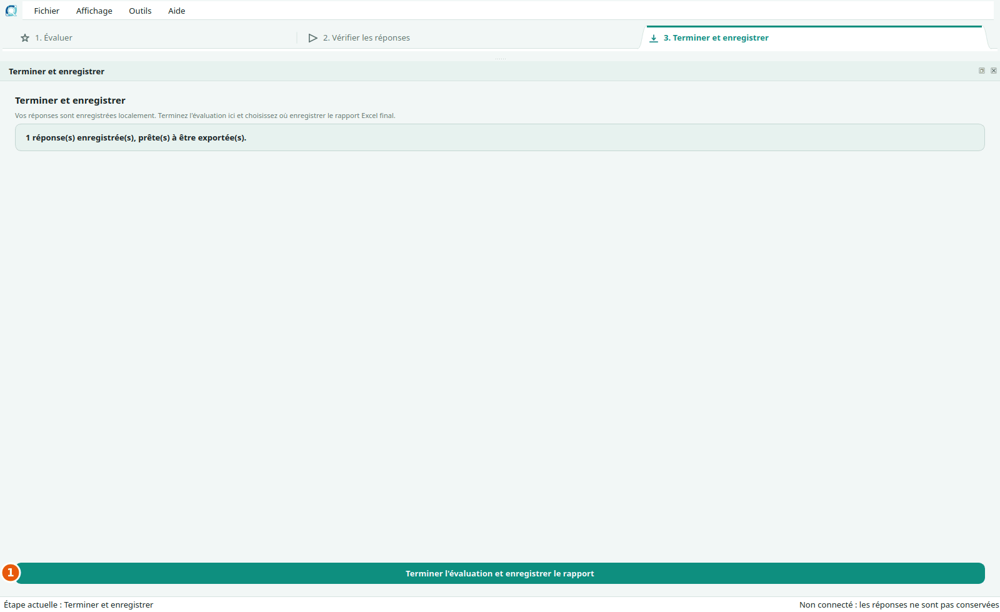

1. **Terminer l'évaluation et enregistrer le rapport** → un fichier Excel avec vos réponses
   (un fichier de réponses chiffré si le test est protégé par un code). Renvoyez-le à l'auteur.

### 5C. Collecteur : agréger les réponses

**1 — Questions.** Chargez le `.zip` de l'évaluation que vous avez envoyée. Livraison en aveugle ?
Chargez aussi sa carte de levée d'aveugle.

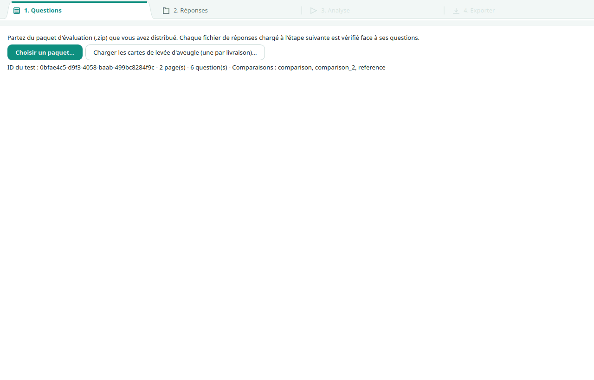

**2 — Réponses.** **Ajouter des fichiers de réponses...** — `.json`, les fichiers Excel des évaluateurs ou CSV.

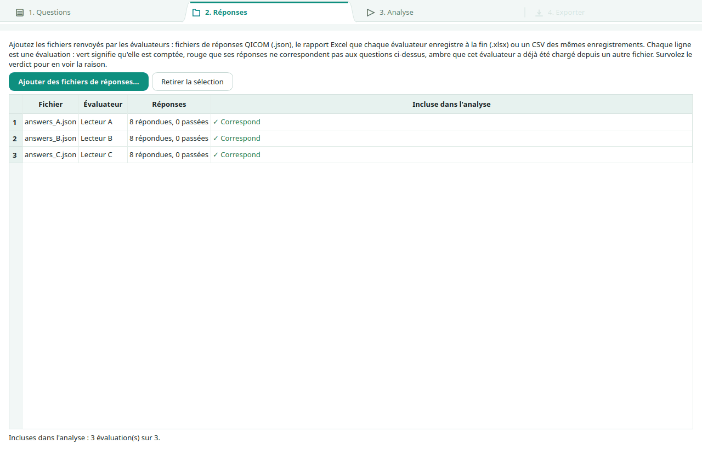

- **Vert** = compté. **Rouge** = ne correspond pas à ces questions (survolez pour savoir pourquoi).
  **Orange** = cet évaluateur a déjà été chargé depuis un autre fichier.
- Vous en attendiez 10 et il en arrive 20 ? Quelqu'un a répondu deux fois. C'est vous qui décidez.

**3 — Analyse.** **Lancer l'analyse.**

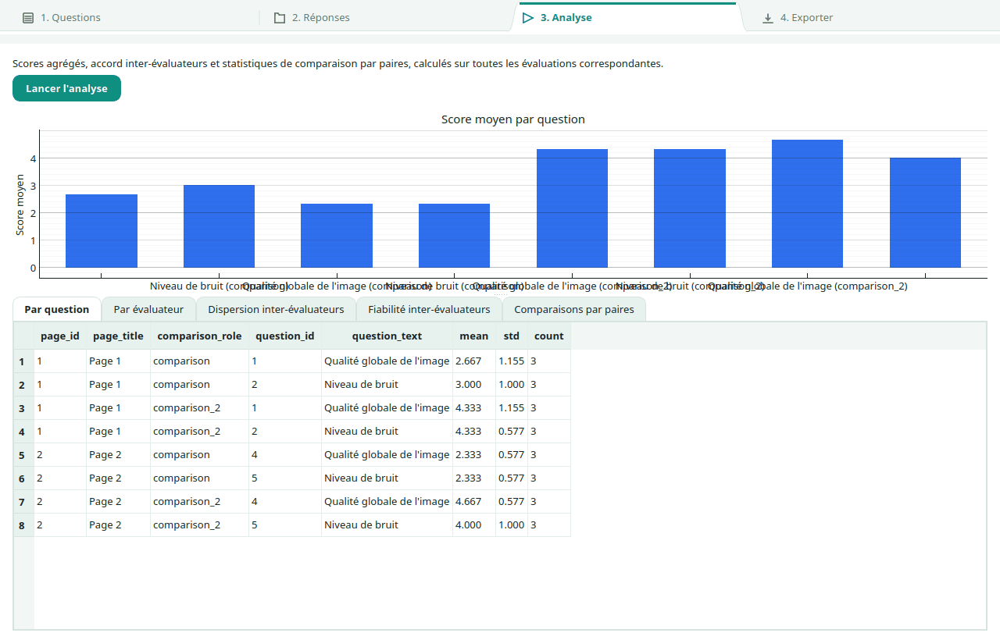

Onglets : par question, par évaluateur, dispersion inter-évaluateurs, fiabilité inter-évaluateurs,
comparaisons par paires. Détails : [QUALITATIVE_METHODOLOGY.md](../../QUALITATIVE_METHODOLOGY.md) (en anglais).

**4 — Exporter.** Excel (avec graphiques) ou un dossier de fichiers CSV.

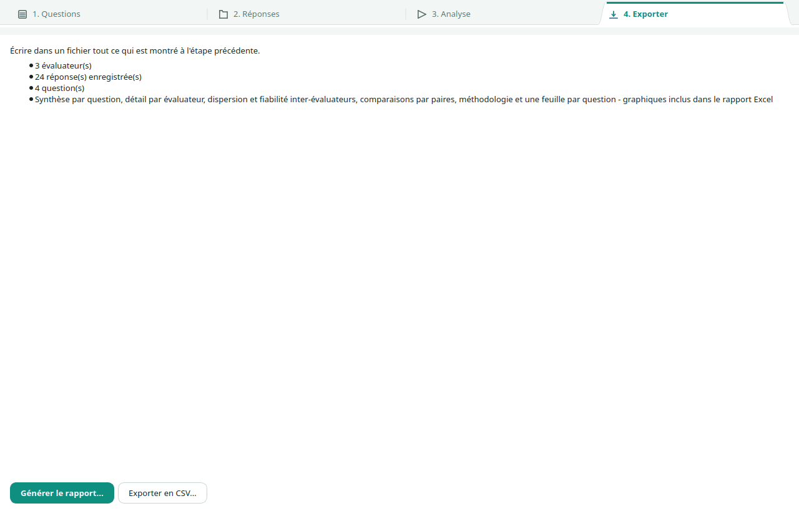

---

## 6. Radiomique : comparer des caractéristiques dans une région

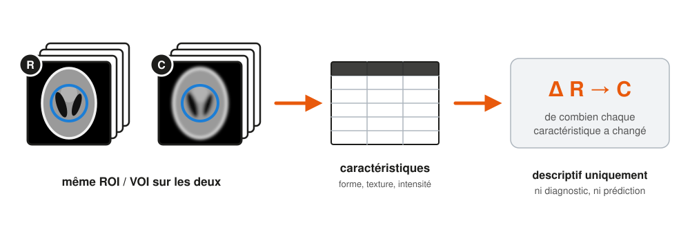

La radiomique transforme l'intérieur d'une région en chiffres (forme, intensité, texture),
puis montre de combien chaque chiffre a changé de **R** à **C**. Seulement DICOM et NIfTI.

**Étape 1 — Images.** Chargez la référence (1) et la comparaison (2) : cliquez sur le cadre,
utilisez **Charger des images** ou le menu **Fichier** (fichier ou dossier DICOM).

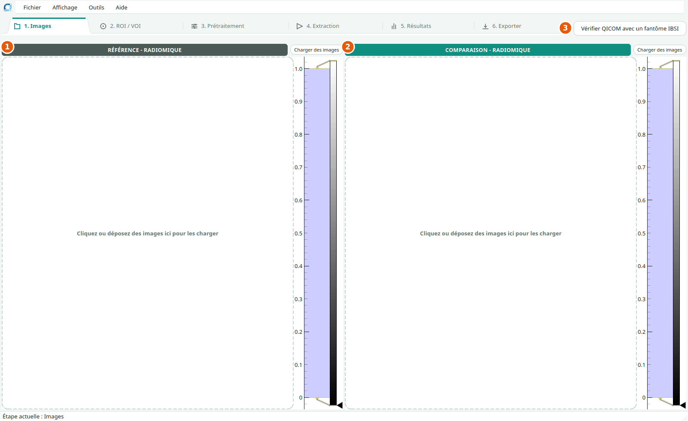

3. **Vérifier QICOM avec un fantôme IBSI** — auto-vérification facultative (voir plus bas).

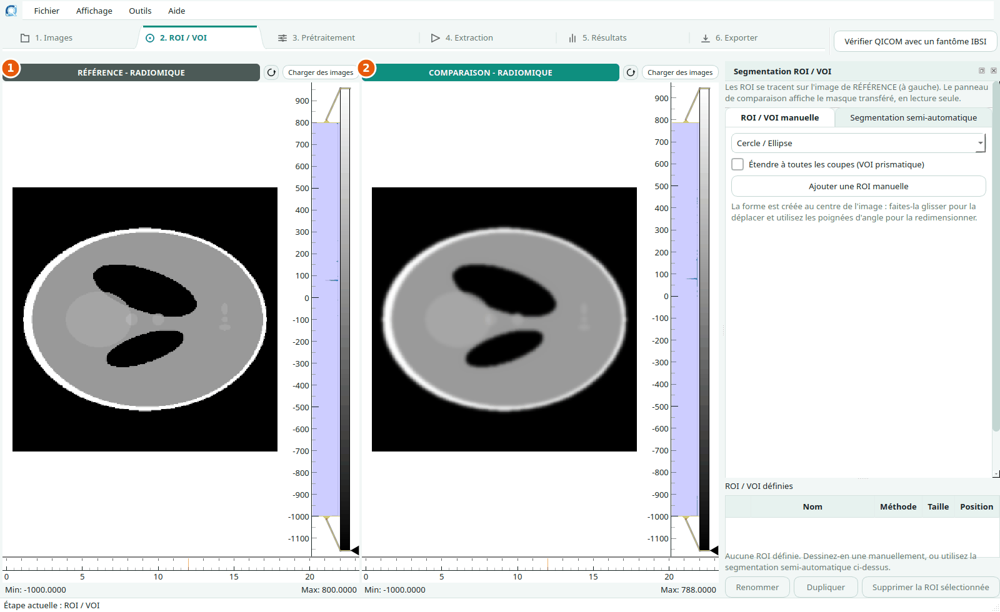

**Étape 2 — ROI / VOI.** Dessinez sur la **référence** (à gauche). La comparaison reçoit la même région.

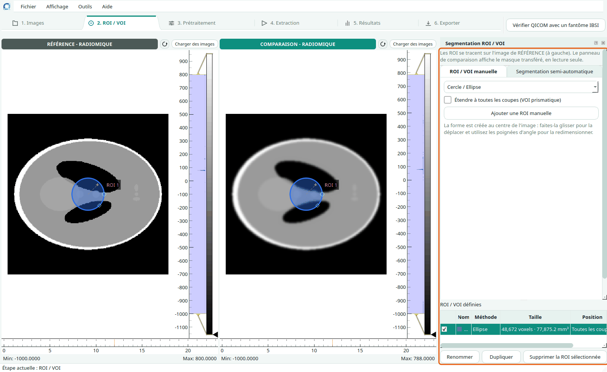

- **ROI / VOI manuelle :** choisissez une forme → **Ajouter une ROI manuelle** → déplacez-la et
  redimensionnez-la. Cochez **Étendre à toutes les coupes** pour une région 3D (VOI).
- **Segmentation semi-automatique :** seuil ou croissance de région à partir d'un clic.
- Une segmentation faite avec un autre programme : **Fichier → Importer une carte d'étiquettes NIfTI…**
- La liste en bas montre chaque région : taille en voxels et en mm³, coupes couvertes.

**Étape 3 — Prétraitement.** La recette appliquée avant l'extraction.

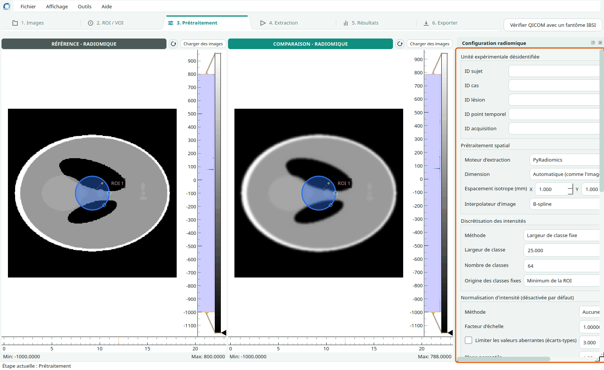

- Champs d'**identité** (sujet, cas, lésion, timepoint) : utilisez des codes, jamais des noms.
- **Moteur** (PyRadiomics, ou MIRP s'il est installé), **espacement des voxels**, **interpolation**.
- **Discrétisation :** largeur de bin fixe ou nombre de bins fixe.
- **Normalisation / écrêtage :** désactivés par défaut. Rien ne change si vous ne le demandez pas.

**Étape 4 — Extraction.** Vérifiez le résumé, puis 1 **Extraire toutes les caractéristiques**.

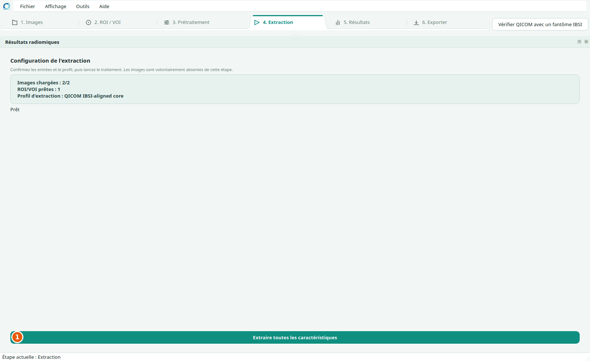

**Étape 5 — Résultats.**

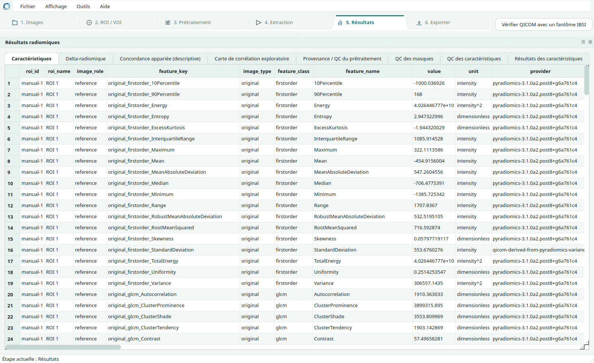

| Onglet | Affiche |
|---|---|
| Caractéristiques | chaque caractéristique, pour R et pour C |
| Delta-radiomique | variation R → C (absolue et en %) |
| Concordance appariée | à quel point R et C sont proches, descriptif seulement |
| Carte de corrélation exploratoire | quelles caractéristiques bougent ensemble |
| Provenance / QC du prétraitement | exactement ce qui a été fait aux images |
| QC des masques | Dice, Jaccard, différence de volume, Hausdorff... entre les deux masques |
| QC / résultats des caractéristiques | avertissements, et ce qui a été calculé ou sauté, et pourquoi |

**Étape 6 — Exporter.** 1 **Excel** · 2 **ensemble CSV** · 3 **HTML autonome**.
Enregistrez le projet avec **Fichier → Enregistrer le projet radiomique** (`.zip`).

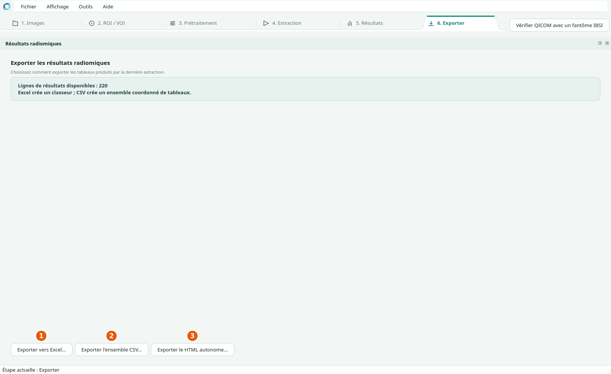

> Des statistiques comme l'ICC demandent au moins **trois sujets indépendants**. Utilisez
> **Outils → Agréger une cohorte radiomique...** sur plusieurs projets radiomiques enregistrés.
> Pas de modèles prédictifs, pas de seuils cliniques : c'est hors du périmètre.

### Auto-vérification IBSI

- Compare QICOM au fantôme numérique officiel IBSI (104 caractéristiques).
- **Exécuter la vérification IBSI** télécharge les fichiers officiels **seulement après votre accord**,
  les vérifie et les garde pour un usage hors ligne.
- **PASS** = chaque caractéristique requise est dans la tolérance. **INCOMPLETE** = il en manque.
- C'est une vérification des formules, pas une certification.

---

## 7. Outils utilitaires

Ouvrez-les depuis l'écran de démarrage (**Outils utilitaires**) ou depuis **Outils** dans chaque fenêtre.
La liste est à gauche, l'outil à droite.

**Chaque outil suit les mêmes règles :**

- ✓ Il ne modifie jamais vos fichiers originaux. Il écrit des **copies**, dans un **nouveau** dossier.
- ✓ Un résultat apparaît en entier, ou pas du tout — jamais à moitié écrit.
- ✓ Un bouton coloré montre toujours l'étape suivante.
- ✓ Mêmes commandes de souris partout (molette = coupes, glisser à gauche = contraste).

| Outil | Sert à... |
|---|---|
| Segmentation semi-automatique | construire une carte d'étiquettes, une région à la fois |
| Opérations et comparaison de masques | union, intersection, différence ; Dice, Jaccard, volumes, Hausdorff |
| Convertir des images | DICOM / NIfTI / pile de bitmaps → NIfTI, coupes PNG ou coupes TIFF |
| Rééchantillonner | changer la taille des voxels, ou suivre la grille d'une autre image |
| Arithmétique d'images | différence, différence absolue, somme, moyenne, rapport |
| Dégradation contrôlée | ajouter du bruit, du flou, une perte de résolution, du JPEG — reproductible avec une graine |
| Inspecter et modifier les tags DICOM | lire chaque tag ; écrire des copies modifiées |
| Comparer des en-têtes DICOM | deux en-têtes côte à côte ; seulement les différences |
| Vérifier et organiser des dossiers DICOM | trouver des coupes manquantes ou mélangées ; copier dans une arborescence ordonnée |
| Décompresser DICOM | réécrire des DICOM compressés sans compression, pour des logiciels plus anciens |
| Anonymiser des images | copie dé-identifiée d'un dossier entier |

### Segmentation semi-automatique

- Elle sépare des **classes d'intensité** (air, graisse, tissus mous, os), pas des organes.
- Les préréglages CT donnent des plages HU comme **point de départ**. Ajustez-les.
- **Appliquer** peut : retirer de l'image, garder seulement ceci, ou attribuer à une étiquette.
- Enregistre une carte d'étiquettes NIfTI + un tableau JSON des noms et couleurs.
  Annuler/rétablir à chaque étape.

### Opérations et comparaison de masques

Ouvrez le masque **A**, puis le masque **B** (même grille). Combinez-les, remplissez les coupes vides,
ou **Comparer A et B** → Dice, Jaccard, volumes, Hausdorff (mm). Export CSV.

### Convertir des images

Ouvrez un fichier ou un dossier → choisissez **Volume NIfTI**, **Coupes PNG** (comme à l'écran, 8 ou 16 bits)
ou **Coupes TIFF** (valeurs réelles) → **Convertir...** Un nouveau dossier `<nom>_<format>` est créé.

### Rééchantillonner

**Vers un espacement de voxels** (tapez les mm, ou cliquez **Isotrope**) ou
**sur la grille d'une image de référence**. Place les images selon leurs coordonnées — il ne les
**recale pas** (ne les aligne pas).

### Arithmétique d'images

Ouvrez deux images ou plus sur la même grille (A, B, ...) → choisissez une opération → **Calculer** →
**Enregistrer le résultat...**

### Dégradation contrôlée

1. Choisissez un effet (bruit gaussien/de Poisson, flou gaussien, perte de résolution, JPEG).
2. Réglez sa force et la **graine** → **Appliquer**. Ajoutez d'autres effets ; retirez-en de la liste.
3. **Enregistrer l'image dégradée...** La recette est enregistrée avec elle : chacun peut refaire la même image.

Utile pour tester quelle métrique remarque quel type de dégât.

### Inspecter et modifier les tags DICOM

- Ouvrez un fichier ou un dossier. Choisissez la série et le fichier.
- **Cherchez** n'importe quel tag. **Masquer les balises privées**. **Exporter en CSV**.
- Double-cliquez sur **Nouvelle valeur** pour modifier. Les tags des pixels sont verrouillés ;
  ceux qui changent les mesures demandent confirmation.
- **Écrire les copies dans un dossier...** Les originaux ne sont jamais touchés.

> Les valeurs sont affichées telles qu'enregistrées, données patient comprises. Un export CSV les contient aussi.

### Comparer des en-têtes DICOM

Ouvrez deux fichiers. Cochez **Différences uniquement** et **Masquer les UID** pour voir ce qui a
vraiment changé entre deux acquisitions.

### Vérifier et organiser des dossiers DICOM

**Choisir un dossier...** → une ligne par étude et par série, avec les problèmes trouvés
(coupes manquantes, espacement irrégulier, orientation mélangée). **Exporter le rapport (CSV)...** ou
**Copier de façon organisée dans un dossier...** (dossiers nommés par étude et série, jamais par patient).

### Décompresser DICOM

Ouvrez un DICOM compressé (JPEG lossless, JPEG-LS, JPEG 2000, RLE...) → il est réécrit sans
compression, un fichier par image (frame), dans un nouveau dossier.

### Anonymiser des images

1. **Choisir des fichiers...** ou **Choisir un dossier...** (cochez **Inclure les sous-dossiers** si besoin).
2. Lisez la liste : **ce qui arrive** à chaque fichier. Les fichiers impossibles à vérifier sont nommés ici.
3. Facultatif : **Remplacer les noms de dossiers et de fichiers par des noms génériques.**
4. **Anonymiser.** Les copies vont dans `<dossier>_anonymized`.

> ✗ Le texte **incrusté dans les pixels** n'est ni détecté ni retiré.
> ✓ Ouvrez la copie et vérifiez-la avant de la partager.

---

## 8. Paramètres

Ouvrez-les depuis l'écran de démarrage (bouton des paramètres) ou **Outils → Paramètres**.
Les changements s'enregistrent tout seuls.

| Onglet | Ce que vous réglez |
|---|---|
| Général | langue (8 langues, changement immédiat), thème, format des nombres, décimales |
| Métriques par défaut | les métriques cochées au début d'une nouvelle analyse ; modèle de référence NSS |
| Identité | votre nom, rempli quand vous effectuez une évaluation non anonyme |
| Diagnostic | créer une démo synthétique / un paquet de rapport de bug (aucune donnée patient) |

**Rétablir les valeurs par défaut** remet tout comme avant.

---

## 9. Confidentialité et sécurité

- ✓ Les images sont traitées **uniquement sur votre ordinateur**. Aucun envoi. Aucune télémétrie.
- ✓ Projets et paquets d'évaluation **anonymisent les DICOM par défaut**.
  Si un fichier ne peut pas être anonymisé en toute sécurité, QICOM **s'arrête et vous le dit**.
  L'exporter quand même demande votre accord explicite, et ces fichiers sont marqués comme non vérifiés.
- ✓ Les fichiers ZIP importés sont contrôlés avant d'être ouverts.
- ✓ Le texte qui ressemble à une formule de tableur est neutralisé dans les exports Excel/CSV.
- ✗ QICOM ne lit pas et ne retire pas le texte incrusté dans les pixels.
- ✗ Les ZIP des projets quantitatifs gardent tels quels les en-têtes NIfTI et les noms de fichiers d'origine.

Tous les détails : [SECURITY.md](../../SECURITY.md) (en anglais).

---

## 10. Quand quelque chose ne va pas

| Problème | Essayez ceci |
|---|---|
| L'application ne démarre pas (Windows) | Extrayez d'abord dans un vrai dossier. Ne la lancez pas depuis le zip. |
| macOS dit que l'app est endommagée / inconnue | Vérifiez la somme de contrôle, puis *Confidentialité et sécurité → Ouvrir quand même*. |
| « Nombre de coupes différent » avant le calcul | Choisissez *Utiliser uniquement la coupe actuellement affichée* ou *Utiliser les piles complètes (tronquer à la plus courte)* — ou chargez des séries correspondantes. |
| Les images n'ont pas la même taille | **Outils → Rééchantillonner** la comparaison sur la grille de la référence. |
| Une métrique manque dans les résultats | Il faut un modèle (cliquez **Télécharger** dans Analyser) ou l'image est trop petite. Regardez la colonne/le registre des résultats. |
| LPIPS / DISTS n'apparaissent jamais | Leurs modèles ne sont pas inclus. Téléchargez-les une fois dans **Analyser** (ou Paramètres → Métriques par défaut). |
| La radiomique refuse mon PNG/JPG | La radiomique demande DICOM ou NIfTI (vraie géométrie). Convertissez d'abord. |
| Un fichier de réponses est rouge dans l'agrégation | Il appartient à un autre questionnaire. Survolez le verdict pour lire pourquoi. |
| « Les réponses n'ont pas pu être agrégées » | Lisez le détail, ex. un commentaire obligatoire manque dans un fichier. |
| J'ai oublié le code d'accès | Il est impossible à récupérer. Utilisez la copie de travail non protégée. |
| L'écran s'affiche mal / est trop petit | Changez de thème dans **Affichage** ; sur les petits écrans, les fenêtres défilent. |

### Erreurs et journaux

- Un indicateur dans la barre d'état signale des erreurs non lues. Cliquez dessus, ou ouvrez
  **Affichage → Panneaux → Erreurs**.
- **Aide → Signaler un bug...** → **Enregistrer le rapport d'erreurs…** (version, système, journal
  récent, aucune image) et joignez-le à votre e-mail. Vous pouvez ajouter aussi le paquet de démo synthétique.

Le fichier journal :

| Système | Fichier journal |
|---|---|
| Windows | `%LOCALAPPDATA%\qicom\Logs\qicom.log` |
| macOS | `~/Library/Logs/qicom/qicom.log` |
| Linux | `~/.local/state/qicom/log/qicom.log` |

**Aide → À propos de QICOM** montre la version, la licence et comment citer QICOM.

---

## 11. Les mots de QICOM

| Mot | En mots simples |
|---|---|
| **Référence (R)** | l'image de confiance |
| **Comparaison (C)** | une image que vous testez par rapport à la référence |
| **Coupe** | une image 2D dans un volume 3D |
| **ROI / VOI** | une région que vous dessinez : 2D (ROI) ou à travers les coupes (VOI) |
| **Fenêtre / niveau** | contraste et luminosité de l'affichage ; ne change jamais les données |
| **Métrique** | une formule qui transforme deux images (ou une) en un chiffre |
| **Profil** | un ensemble enregistré de métriques (ex. Noyau rapide) |
| **Plage de données** | l'étendue des valeurs possibles des pixels, utilisée par PSNR et SSIM |
| **Carte de chaleur** | une carte en couleurs de l'endroit où deux images diffèrent |
| **SNR / CNR** | rapport signal/bruit / contraste/bruit : à quel point un tissu ressort |
| **HU** | unités Hounsfield, l'échelle d'intensité de la CT (air ≈ −1000, eau = 0) |
| **En aveugle** | les évaluateurs ne savent pas quelle image est laquelle |
| **Graine (seed)** | un nombre qui rend reproductible un mélange ou un bruit « aléatoire » |
| **Paquet** | le `.zip` qui contient une évaluation (images + questions) |
| **Carte de levée d'aveugle** | le fichier qui dit quelle étiquette neutre (A, B, C) correspond à quelle image |
| **Caractéristique** | un chiffre radiomique : forme, intensité ou texture dans une région |
| **Delta (Δ)** | de combien une caractéristique a changé de R à C |
| **IBSI** | la norme internationale des définitions des caractéristiques radiomiques |
| **Reçu** | l'enregistrement gardé avec les résultats : versions, réglages et empreintes (hash) de chaque entrée |
| **Anonymiser** | retirer d'une copie du fichier les données qui identifient une personne |

---

*Pour aller plus loin (en anglais) :* [README](../../README.md) ·
[Méthodologie qualitative](../../QUALITATIVE_METHODOLOGY.md) ·
[Méthodologie radiomique](../../RADIOMICS_METHODOLOGY.md) ·
[Sécurité](../../SECURITY.md)

*Les captures d'écran utilisent un fantôme synthétique et des données DICOM inventées. Aucune image de patient.*
