# QICOM — Manuale utente

**Guarda prima le figure. Leggi il testo solo se ti serve.**

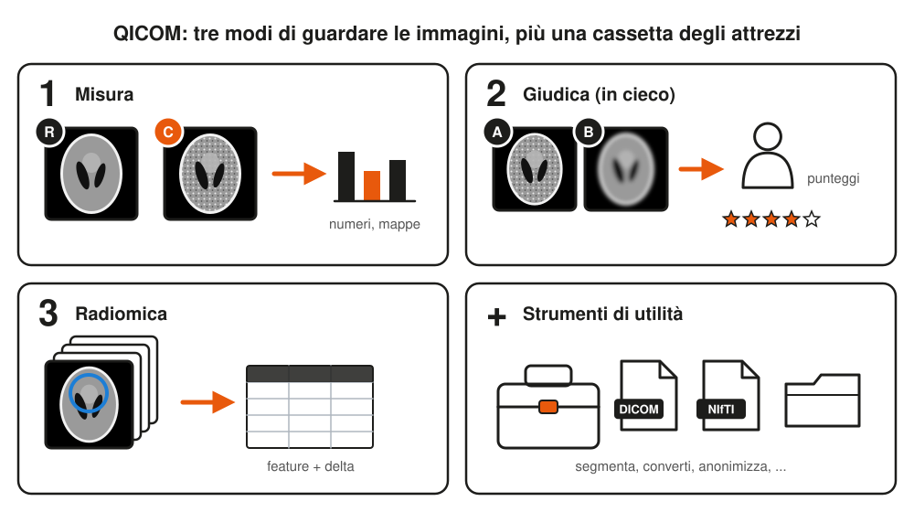

> **Solo per ricerca e controllo qualità.** QICOM non è un dispositivo medico.
> Non usarlo per fare diagnosi né per prendere decisioni sulla cura di un paziente.

---

## Indice

1. [Prima di iniziare](#1-prima-di-iniziare)
2. [Installare e aprire](#2-installare-e-aprire)
3. [Le basi (da leggere una volta)](#3-le-basi-da-leggere-una-volta)
4. [Analisi quantitativa: misurare due immagini](#4-analisi-quantitativa-misurare-due-immagini)
5. [Analisi qualitativa: le persone valutano le immagini](#5-analisi-qualitativa-le-persone-valutano-le-immagini)
6. [Radiomica: confrontare le feature dentro una regione](#6-radiomica-confrontare-le-feature-dentro-una-regione)
7. [Strumenti di utilità](#7-strumenti-di-utilità)
8. [Impostazioni](#8-impostazioni)
9. [Privacy e sicurezza](#9-privacy-e-sicurezza)
10. [Quando qualcosa non va](#10-quando-qualcosa-non-va)
11. [Le parole di QICOM](#11-le-parole-di-qicom)

---

## 1. Prima di iniziare

**Cosa fa QICOM:** confronta immagini medicali e ti dice quanto sono diverse.

| Vuoi... | Usa |
|---|---|
| Ottenere **numeri** che dicono quanto un'immagine è vicina a un'altra | **Quantitativa** |
| Far valutare le immagini a **persone**, senza che sappiano quale è quale | **Qualitativa** |
| Confrontare **feature di tessitura e forma** dentro una regione | **Radiomica** |
| Convertire, anonimizzare, segmentare, ricampionare, leggere i tag DICOM... | **Strumenti di utilità** |

**Cosa ti serve**

- Un computer con Windows 10/11 (64 bit), macOS 14 su Apple Silicon o Linux 64 bit.
- 8 GB di memoria bastano. 16 GB è meglio. 32 GB per grandi volumi 3D.
- Le tue immagini: **DICOM** (un file o una cartella con una serie), **NIfTI** (`.nii`, `.nii.gz`)
  oppure **PNG / JPG / BMP**. La radiomica accetta solo DICOM e NIfTI.

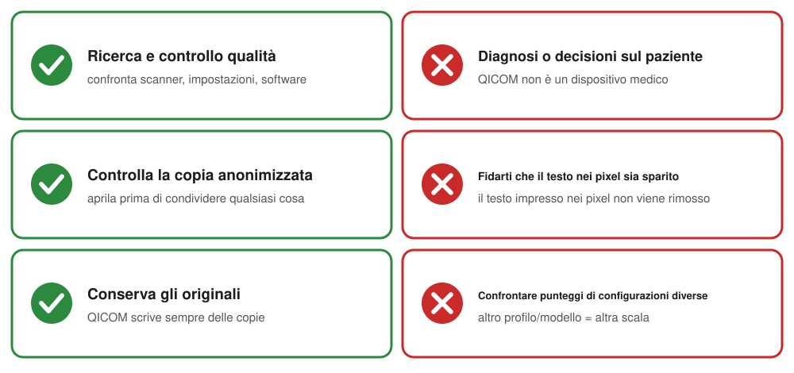

---

## 2. Installare e aprire

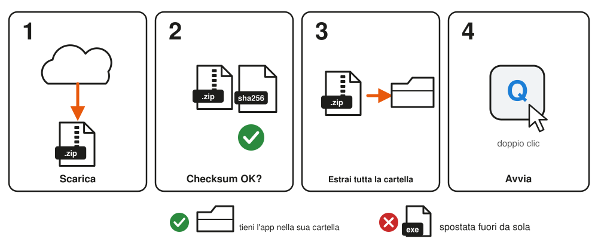

1. **Scarica** il file per il tuo sistema, insieme al file `.sha256`.
2. **Controlla** il download. Il risultato deve essere `True` (Windows) oppure `OK` (macOS/Linux):
   - Windows (PowerShell): confronta `Get-FileHash QICOM-windows-x64.zip` con il file `.sha256`
   - macOS: `shasum -a 256 -c QICOM-macos-arm64.zip.sha256`
   - Linux: `sha256sum -c QICOM-linux-x64.tar.gz.sha256`
3. **Estrai** in una cartella vera (non dentro la finestra dello zip). Tieni la cartella intera.
4. **Avvia** QICOM:
   - Windows: doppio clic su `qicom.exe`. Se compare "Windows ha protetto il PC" e il checksum
     è OK, clicca *Ulteriori informazioni* → *Esegui comunque* (solo se la tua organizzazione lo consente).
   - macOS: doppio clic su `QICOM.app`. Se macOS la blocca: *Impostazioni di Sistema → Privacy e
     sicurezza → Apri comunque*.
   - Debian/Ubuntu: `sudo apt install ./QICOM-linux-x64.deb`, poi apri **QICOM** dal menu delle
     applicazioni o scrivi `qicom`.
   - Dal codice sorgente: `qicom-gui`.

> ✗ Un antivirus che indica una minaccia vera **non** è la stessa cosa dell'avviso "app non
> riconosciuta". Non aggirarlo. Avvisa il tuo reparto IT.

### La schermata iniziale

QICOM si apre sempre su questa schermata. Scegli cosa vuoi fare.

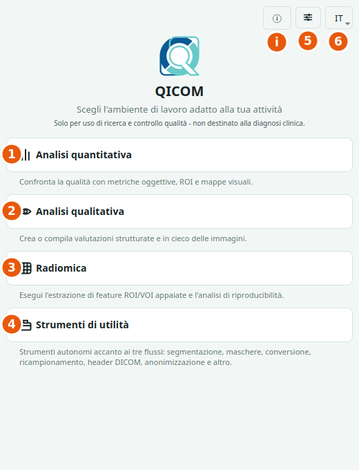
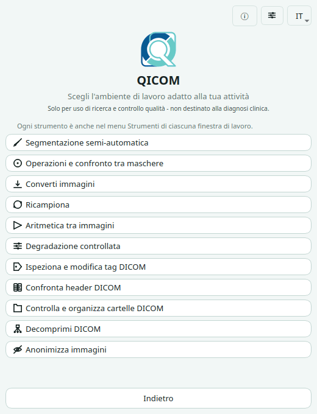

| | Pulsante | Cosa apre |
|---|---|---|
| 1 | Analisi quantitativa | misura le immagini con numeri e mappe |
| 2 | Analisi qualitativa | crea, esegui o raccogli valutazioni in cieco |
| 3 | Radiomica | confronta le feature dentro una regione |
| 4 | Strumenti di utilità | la cassetta degli attrezzi (figura a destra) |
| i / 5 / 6 | ⓘ, impostazioni, lingua | informazioni su QICOM, preferenze, lingua |

Ogni pulsante apre una seconda piccola pagina:

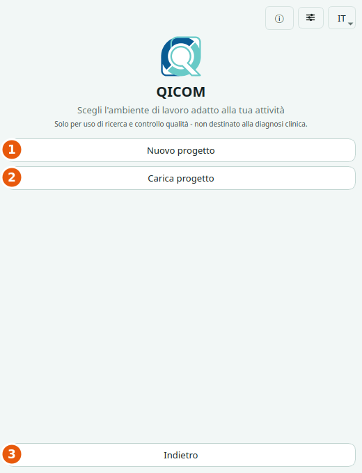
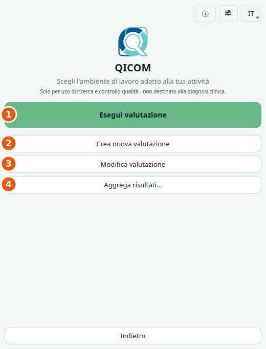
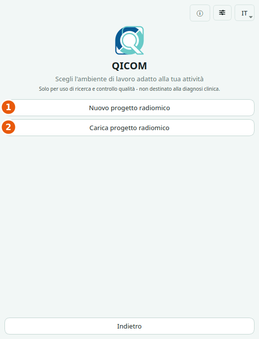

- **Quantitativa:** 1 Nuovo progetto · 2 Carica un progetto salvato (`.zip`) · 3 Indietro.
  Sotto compaiono i progetti recenti: un clic per riaprirli.
- **Qualitativa:** 1 **Esegui valutazione** (verde: te ne hanno mandata una) · 2 Crea nuova ·
  3 Modifica · 4 Aggrega risultati.
- **Radiomica:** 1 Nuovo progetto · 2 Carica un progetto salvato.

Per tornare qui più tardi: **File → Chiudi progetto**.

---

## 3. Le basi (da leggere una volta)

### I passi sono schede

Ogni area di lavoro è una fila di schede numerate. **Vai da sinistra a destra.** Puoi sempre tornare indietro.

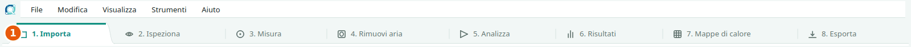

### Mouse e tastiera su un'immagine

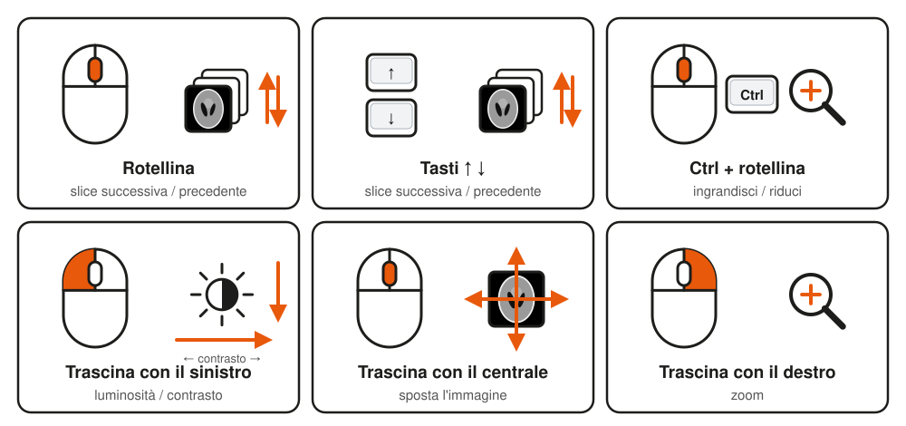

- **Caricare un'immagine:** clicca un riquadro vuoto, oppure trascinaci sopra un file.
- **Annulla / ripeti:** `Ctrl+Z` / `Ctrl+Y` (Quantitativa).
- Pulsanti sopra ogni immagine: ruota, rifletti, ripristina, **Carica immagini**.

### Riferimento e confronto

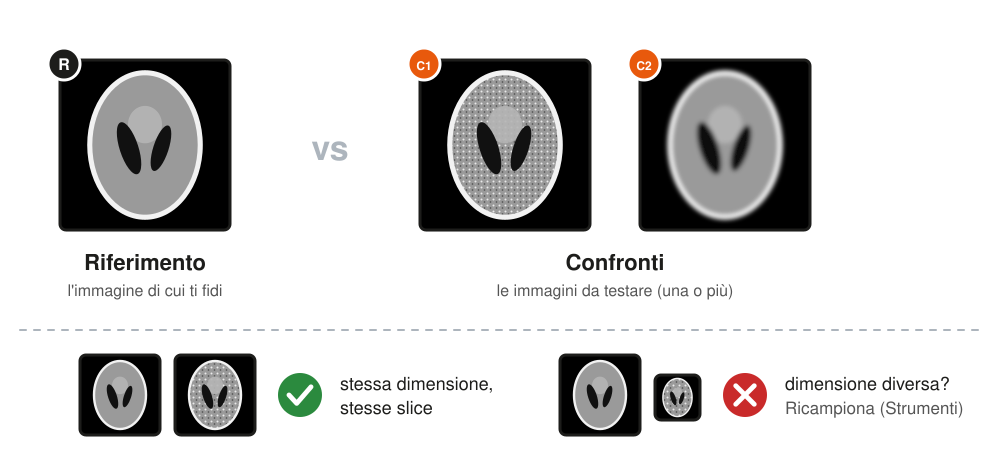

- **R — Riferimento:** l'immagine di cui ti fidi (per esempio dose piena, originale).
- **C1, C2, ... — Confronti:** le immagini che vuoi testare. Aggiungine quante vuoi con **+ Aggiungi confronto**.
- Le immagini devono avere **la stessa dimensione e lo stesso numero di slice**.
  Non è così? Usa prima **Strumenti → Ricampiona**.

### Cosa scrive QICOM

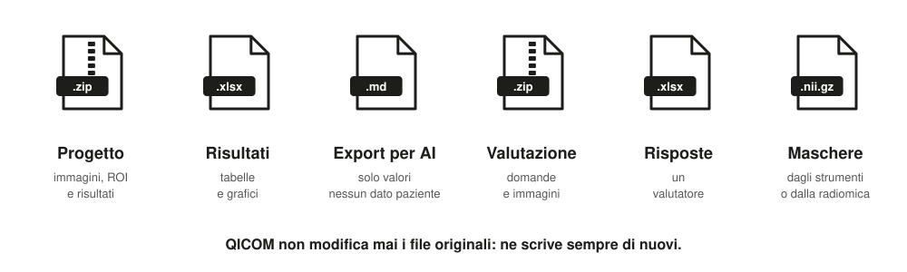

### Menu (uguali in ogni finestra)

| Menu | Cosa contiene |
|---|---|
| **File** | apri, salva, esporta, chiudi progetto |
| **Modifica** | annulla, ripeti (Quantitativa) |
| **Visualizza** | tema (chiaro/grigio/scuro), **Pannelli** (cronologia, log, errori) |
| **Strumenti** | gli Strumenti di utilità, formato numeri, lingua, **Impostazioni** |
| **Aiuto** | segnala un bug, informazioni su QICOM (licenza, citazione) |

---

## 4. Analisi quantitativa: misurare due immagini

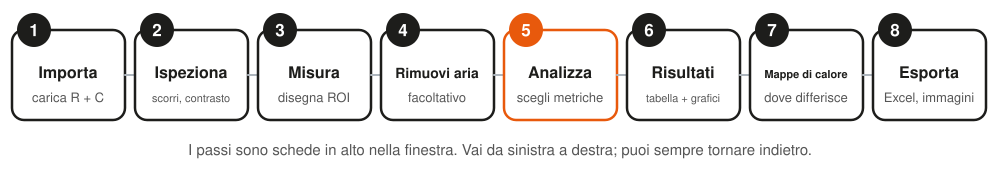

### Passo 1 — Importa

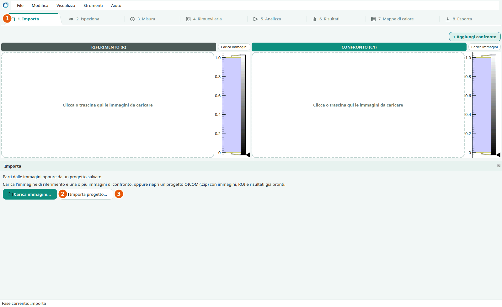

1. Le schede dei passi.
2. **Carica immagini:** scegli un file o una cartella, poi il riquadro (Riferimento o Confronto).
3. **Importa progetto:** riapri un progetto QICOM salvato (`.zip`) con immagini, ROI e risultati.

Più veloce: clicca un riquadro vuoto, oppure trascinaci sopra un file.

### Passo 2 — Ispeziona

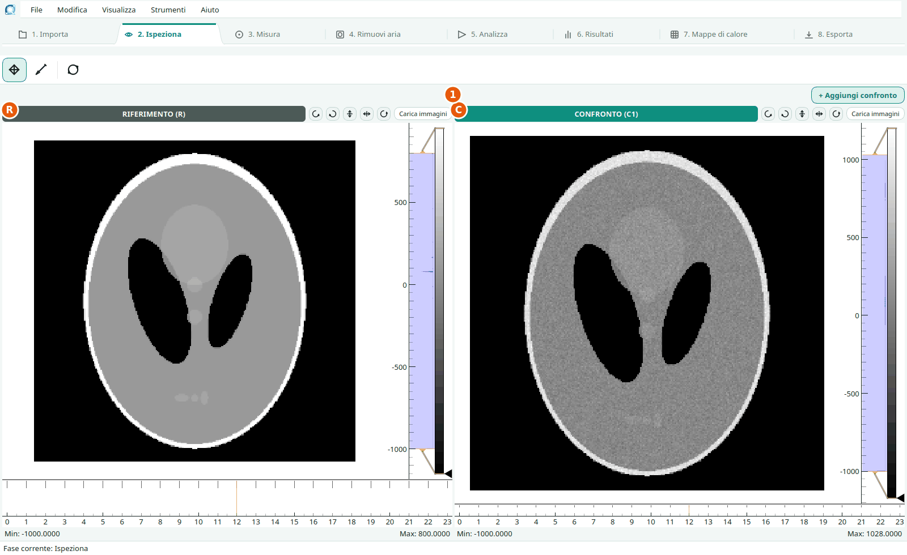

- **R** è il riferimento, **C** il confronto. Ognuno ha la sua barra del contrasto a destra.
- 1 Strumenti di visualizzazione: **Zoom / Pan**, **Annotazione** (una nota di testo sull'immagine),
  **Sincronizza livelli** (cambi il contrasto su un'immagine → tutte le immagini seguono).
- Scorri con la rotellina per cambiare slice. Trascina con il tasto sinistro per luminosità e contrasto.

Più di un confronto? Ognuno ha il suo riquadro:

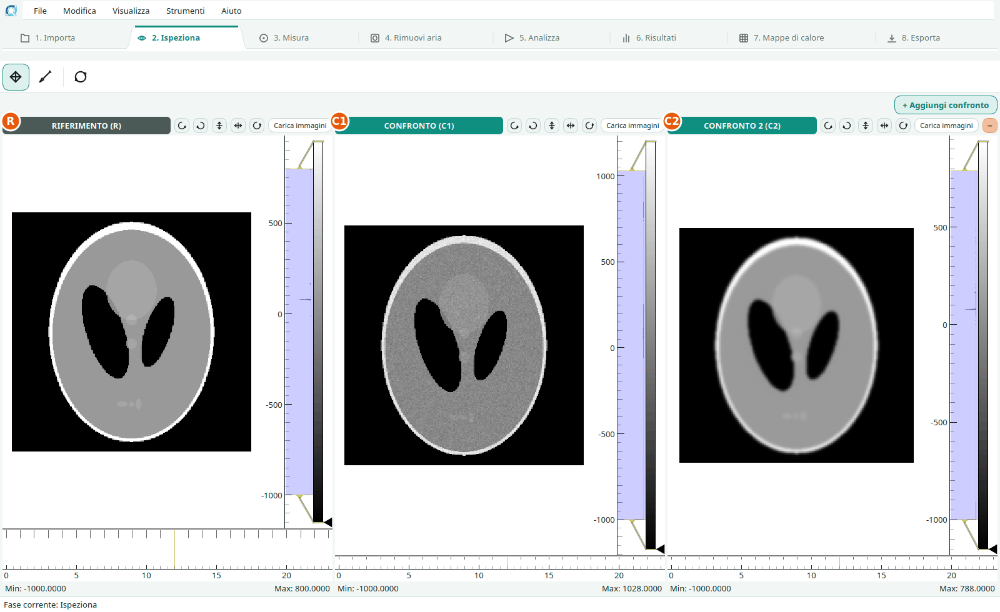

> Prima di calcolare, QICOM controlla dimensione dei pixel, orientamento e distanza tra le slice.
> I problemi compaiono in **Visualizza → Pannelli → Errori**. Non modifica mai i pixel di sua iniziativa.

### Passo 3 — Misura (facoltativo)

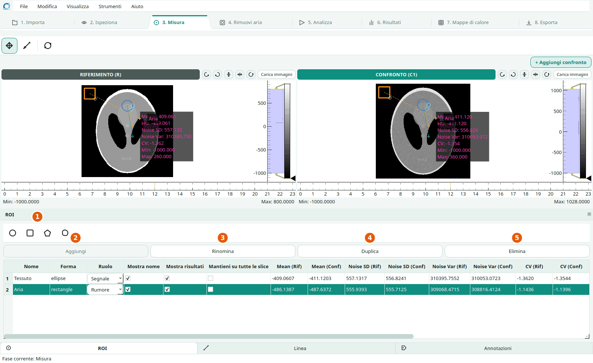

1. Scegli una forma: **cerchio**, **rettangolo**, **poligono**, **a mano libera**.
2. **Aggiungi** — la stessa ROI compare su ogni immagine, nello stesso punto.
3. **Rinomina** · 4 **Duplica** · 5 **Elimina**.

Nella tabella imposta il **Ruolo** di ogni ROI:

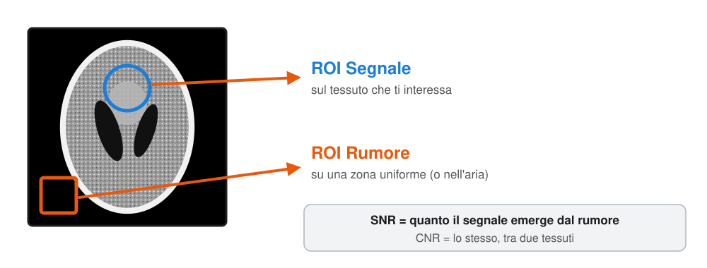

- **Segnale:** sul tessuto che ti interessa. **Rumore:** su una zona uniforme o nell'aria.
- Con entrambe, QICOM calcola **SNR** e **CNR**.
- I valori si aggiornano dal vivo nella tabella: media, SD del rumore, CV, minimo, massimo.
- Schede in basso: **Linea** (traccia una linea e vedi il profilo di intensità) e **Annotazioni**.
- **Mantieni su tutte le slice:** la ROI resta su ogni slice, non solo su quella corrente.

### Passo 4 — Rimuovi aria (facoltativo)

Gran parte di una slice è aria. L'aria è uguale all'aria, quindi fa sembrare le immagini più simili
di quanto siano. Questo passo toglie l'aria **intorno** al corpo (l'aria dentro il corpo resta).

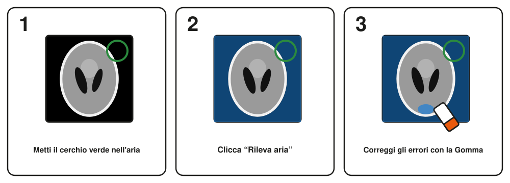

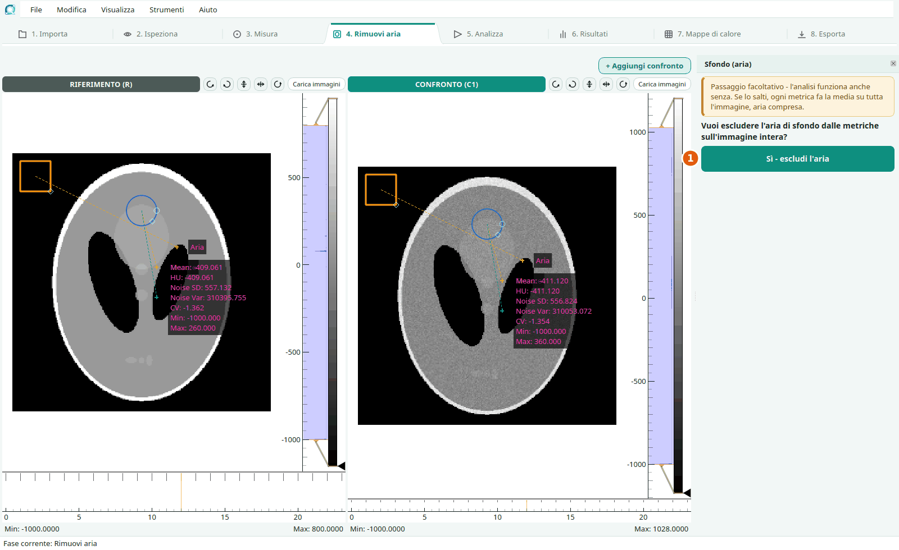
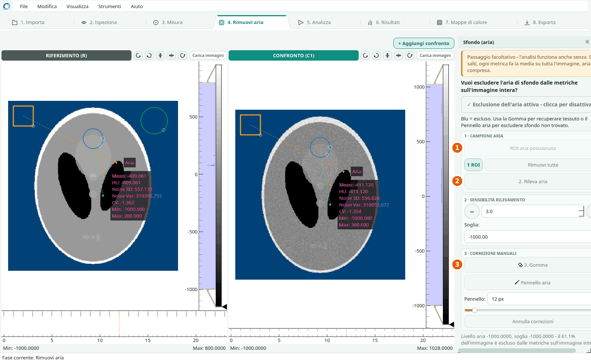

1. Clicca il pulsante grande per **attivare** l'esclusione. Clicca **Aggiungi ROI aria**: compare
   un cerchio verde. Trascinalo su un punto con sola aria.
2. **Rileva aria.** Tutto ciò che è colorato di blu viene escluso dalle metriche sull'intera immagine.
   Troppo o troppo poco? Usa la sensibilità **−/+** o scrivi la soglia.
3. **Gomma** restituisce il tessuto preso per sbaglio. **Pennello aria** aggiunge l'aria mancata.
   **Annulla correzioni** torna al risultato rilevato.

> Saltare questo passo va bene. In quel caso le metriche fanno la media su tutta l'immagine, aria compresa.
> Le misure nelle ROI non cambiano mai.

### Passo 5 — Analizza

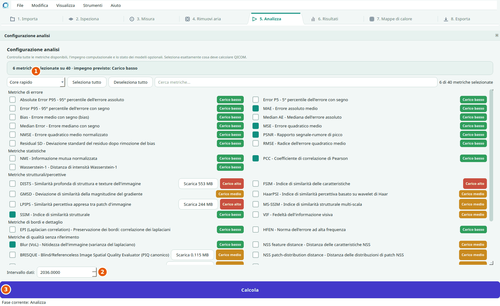

1. **Profilo:** un insieme pronto di metriche. Inizia con **Core rapido**.
   Se spunti le caselle a mano diventa un profilo personalizzato.
2. **Intervallo dati:** l'intervallo dei valori possibili dei pixel. QICOM lo compila da solo;
   lascialo com'è se non sai di meglio.
3. **Calcola.** Una barra di avanzamento prende il posto del pulsante. Puoi annullare.

- Etichette: **Carico basso / medio / alto** = quanto tempo richiede una metrica.
- **Scarica** accanto a una metrica (LPIPS, DISTS, BRISQUE...): il suo modello non è incluso.
  Viene scaricato solo se clicchi, e verificato prima dell'uso. Senza, la metrica viene saltata.
- Usa la casella di ricerca per trovare una metrica per nome. Passaci sopra con il mouse per leggere cosa significa.

### Passo 6 — Risultati

QICOM arriva qui da solo quando il calcolo finisce.

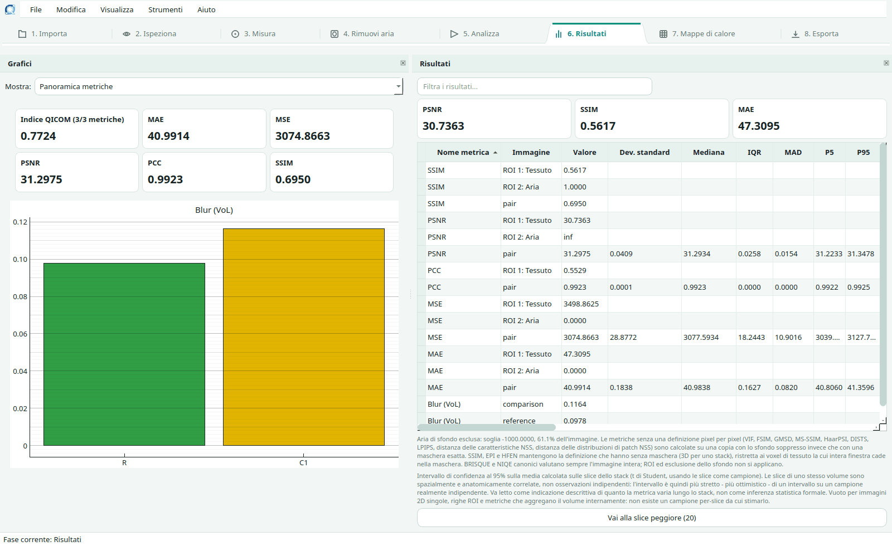

- **A sinistra:** grafici. Scegli una vista in **Mostra** e una coppia (`R vs C1`, `R vs C2`, `R vs All`).
- **A destra:** riquadri grandi con i numeri principali, poi la tabella completa.
  Scrivi in **Filtra i risultati** per cercare.
- Righe: **pair** = intera immagine; **ROI 1, ROI 2** = dentro ogni ROI.
- Per i volumi: mediana, IQR, P5/P95 e slice anomale.
  **Vai alla slice peggiore** salta alla slice più diversa.

Come leggere un numero:

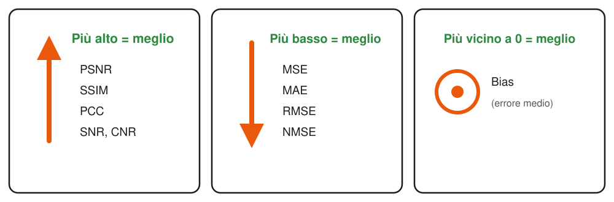

> L'**indice QICOM** (da 0 a 1, 1 = identiche) è sperimentale. Confrontalo solo tra risultati
> ottenuti con **lo stesso profilo e la stessa versione**.

### Passo 7 — Mappe di calore

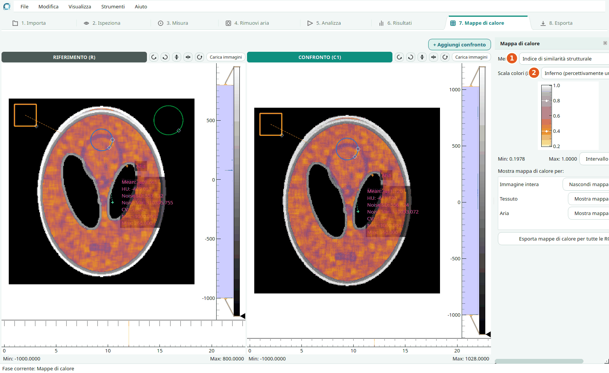

1. Scegli una metrica (SSIM, MSE, MAE, NMSE, bias).
2. Scegli una scala colori.

- La mappa mostra **dove** le immagini differiscono, sopra l'immagine.
- **Mostra mappa di calore per:** intera immagine o una ROI.
  **Esporta mappe di calore per tutte le ROI...** le salva come immagini.
- Per SSIM la scala è invertita, così le zone danneggiate risaltano comunque.

### Passo 8 — Esporta

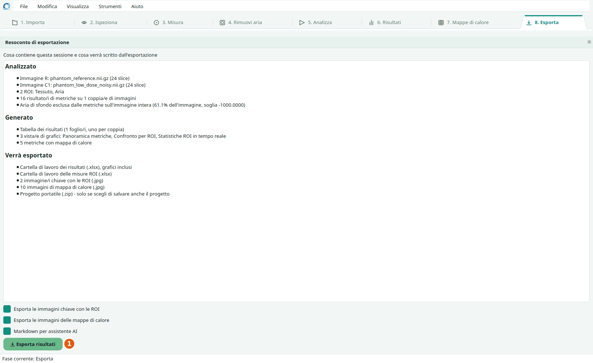

- La pagina elenca cosa è stato analizzato, cosa è stato prodotto e **cosa verrà scritto**.
- Togli la spunta da ciò che non vuoi (immagini chiave, mappe di calore, Markdown per AI).
- 1 **Esporta risultati** → cartella di lavoro Excel (con grafici), cartella ROI, immagini.
- Per continuare più tardi: **File → Salva / Esporta...** salva un progetto portatile (`.zip`).

> **Markdown per assistente AI** (`*_ai_assistant.md`): solo numeri e definizioni delle metriche —
> niente nomi di file, niente dati del paziente, niente header DICOM. QICOM non lo invia da nessuna parte.
> Aprilo e leggilo prima di incollarlo in una chat.

---

## 5. Analisi qualitativa: le persone valutano le immagini

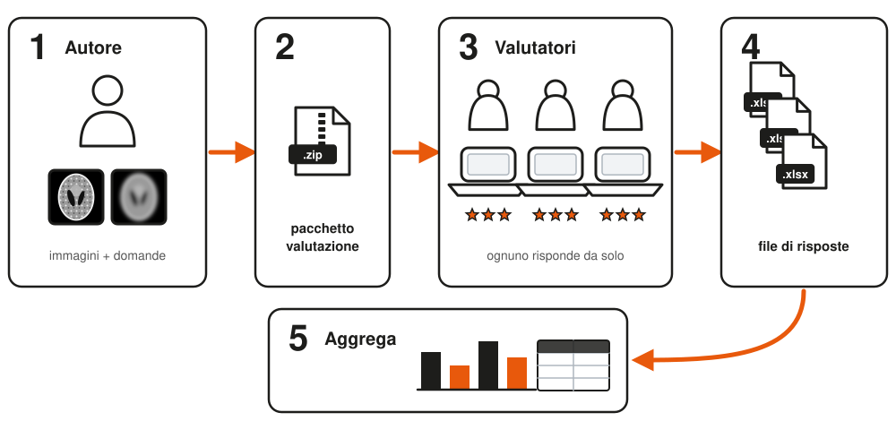

Ci sono tre ruoli. Ognuno ha il suo pulsante nella schermata iniziale.

| Ruolo | Pulsante nella schermata iniziale | Passi |
|---|---|---|
| **Autore** — crea il test | Crea nuova valutazione / Modifica valutazione | Impostazioni → Immagini → Domande → Tutte le pagine → Anteprima → Salva |
| **Valutatore** — risponde | **Esegui valutazione** (verde) | Valuta → Riepilogo risposte → Completa e salva |
| **Chi raccoglie** — mette insieme le risposte | Aggrega risultati | Domande → Risposte → Analisi → Esporta |

### 5A. Autore: creare la valutazione

**Passo 1 — Impostazioni.** Decidi come si comporta tutto il test, prima di costruirlo.

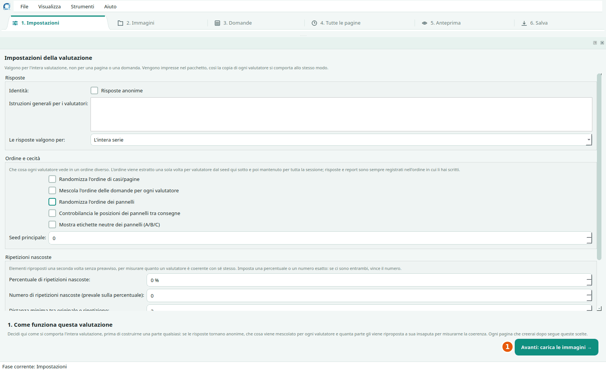

- **Risposte anonime:** nessun nome viene chiesto né conservato.
- **Istruzioni** per i valutatori. **Le risposte valgono per:** l'intera serie o ogni slice.
- **Ordine e cieco:** mescola pagine, domande o riquadri; etichette neutre A/B/C;
  un **seed** rende il mescolamento ripetibile.
- **Ripetizioni nascoste:** mostra alcuni elementi due volte, per vedere se le persone sono coerenti con se stesse.
- 1 **Avanti: carica le immagini.**

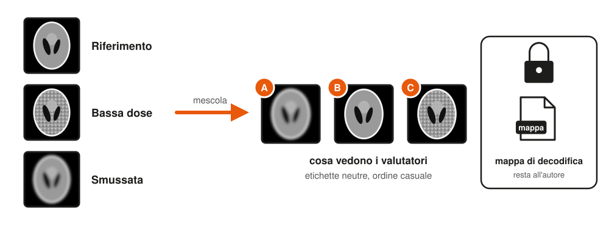

**Passo 2 — Immagini.** Carica le immagini di **questa pagina**.

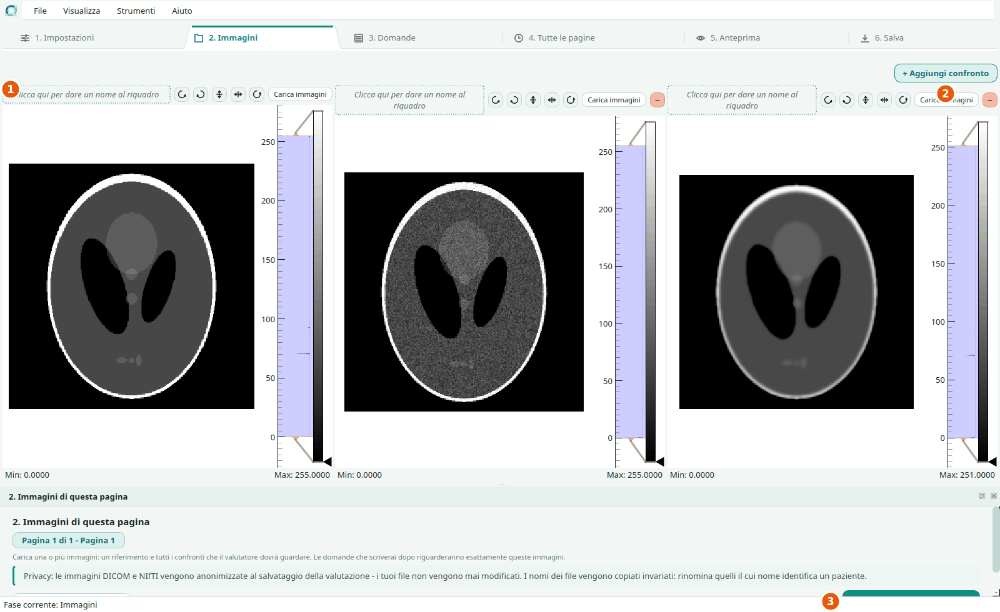

1. Clicca un riquadro (o trascinaci un file). Clicca la barra del nome per rinominarlo.
2. **+ Aggiungi confronto** per altri riquadri. 3 **Avanti.**

> DICOM e NIfTI vengono de-identificati quando salvi. I nomi dei file sono copiati così come sono:
> rinomina ogni file il cui nome identifica un paziente.

**Passo 3 — Domande.** Scrivi a cosa devono rispondere i valutatori su queste immagini.

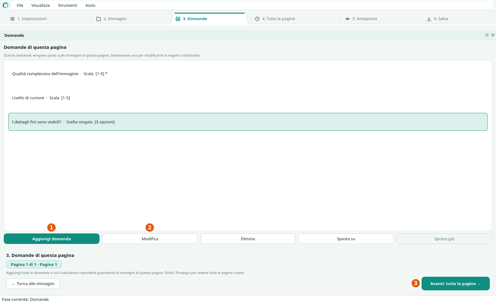

1. **Aggiungi domanda** · 2 **Modifica** (anche Elimina, Sposta su/giù) · 3 **Avanti: tutte le pagine.**

Formati di risposta: scala numerica (con parole agli estremi, es. 1 = Scarsa, 5 = Eccellente),
scelta singola, scelta multipla, elenco a discesa, testo libero, classifica, A o B (2-AFC),
A / B / nessuna differenza. Ogni domanda può ammettere **Non valutabile**.

**Passo 4 — Tutte le pagine.** Una riga per pagina: le sue immagini e domande.

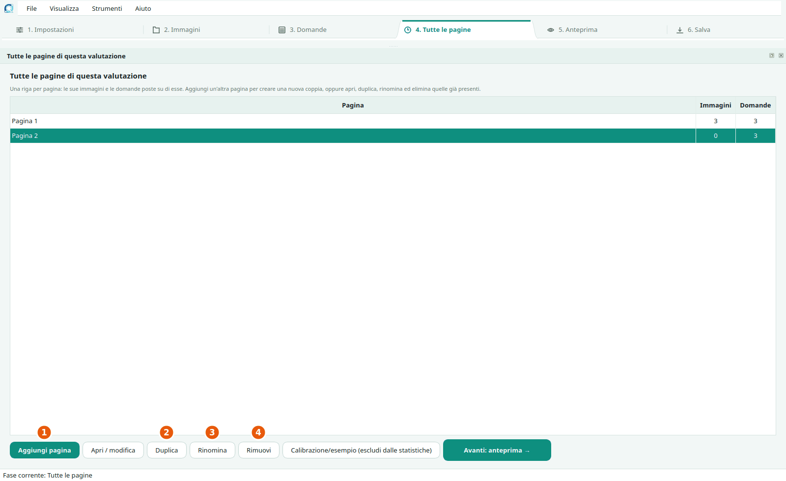

1. **Aggiungi pagina** (torna al passo 2 per la nuova pagina) · 2 **Duplica** (copia le domande) ·
   3 **Rinomina** · 4 **Rimuovi**.
- **Calibrazione/esempio:** una pagina di prova, esclusa dalle statistiche.

**Passo 5 — Anteprima.** Vedi esattamente ciò che vedrà un valutatore. Prova le risposte.

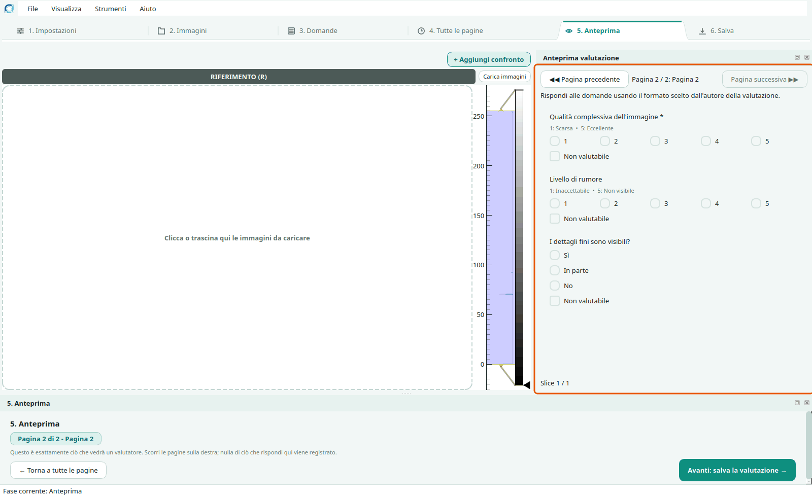

**Passo 6 — Salva.**

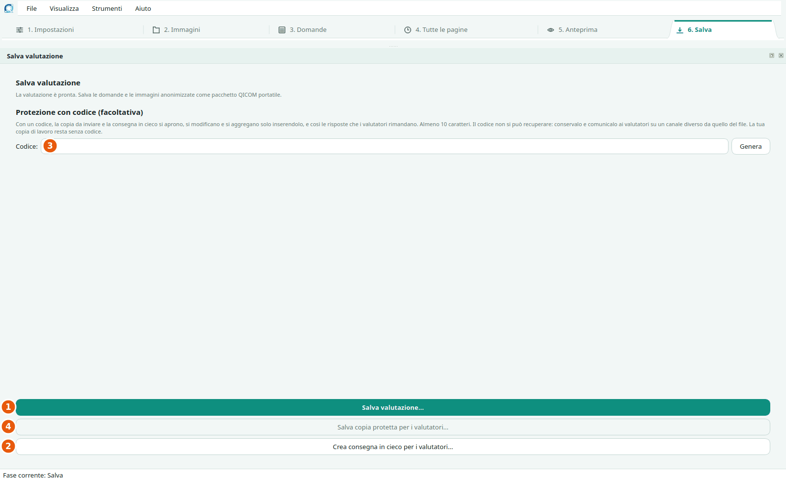

1. **Salva valutazione...** → un unico file `.zip`. Manda questo file ai valutatori.
2. **Crea consegna in cieco per i valutatori...** → uno ZIP con nomi neutri + una **mappa di
   decodifica** separata (la mappa tienila per te).
3. **Codice di accesso** (facoltativo, almeno 10 caratteri, **non recuperabile**).
   Scrivine uno o clicca **Genera**.
4. **Salva copia protetta per i valutatori...** → solo chi ha il codice può aprirla.
   Manda il codice su un canale diverso da quello del file.

### 5B. Valutatore: rispondere alla valutazione

1. Schermata iniziale → **Analisi qualitativa** → **Esegui valutazione** → scegli il `.zip`.
2. Accedi, oppure **Continua senza accedere**.

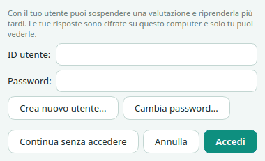

| | Con il tuo utente | Senza accedere |
|---|---|---|
| Mettere in pausa e riprendere | ✓ | ✗ (una sola sessione) |
| Risposte conservate su questo computer | ✓ cifrate, solo tu puoi vederle | ✗ non resta nulla |

**Passo 1 — Valuta.**

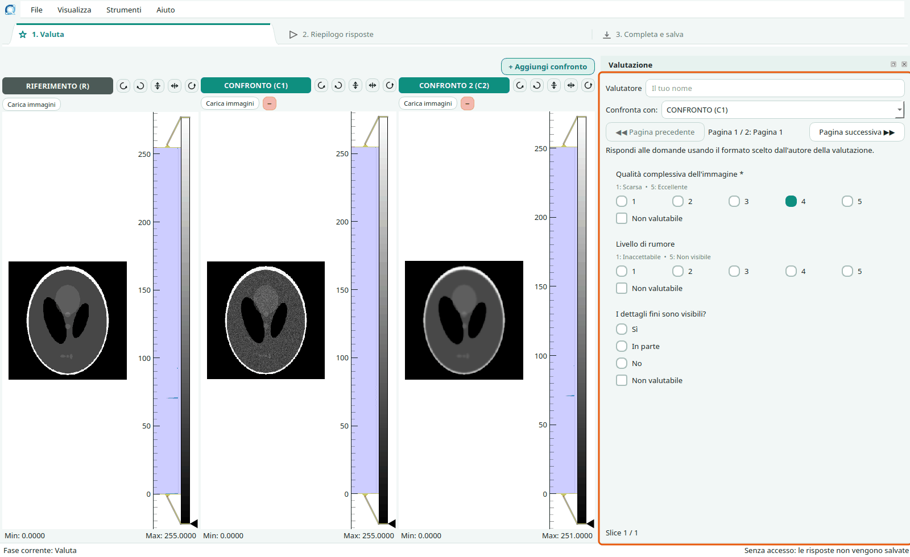

- Scrivi il tuo nome (a meno che il test sia anonimo).
- **Confronta con:** quale immagine stai valutando.
- Rispondi a ogni domanda. Le domande obbligatorie hanno un `*`.
- **Pagina precedente / successiva** per spostarti. Scorri per le altre slice.

**Passo 2 — Riepilogo risposte.** Una tabella con tutto ciò che hai risposto. Torna indietro per correggere.

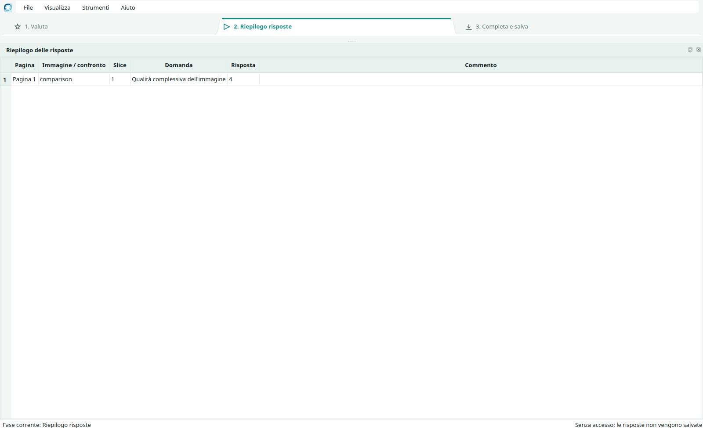

**Passo 3 — Completa e salva.**

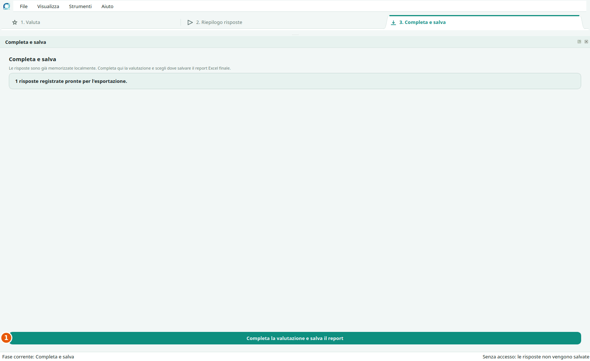

1. **Completa la valutazione e salva il report** → un file Excel con le tue risposte
   (un file di risposte cifrato se il test è protetto da un codice). Rimandalo all'autore.

### 5C. Chi raccoglie: aggregare le risposte

**1 — Domande.** Carica il `.zip` della valutazione che hai inviato. Consegna in cieco?
Carica anche la sua mappa di decodifica.

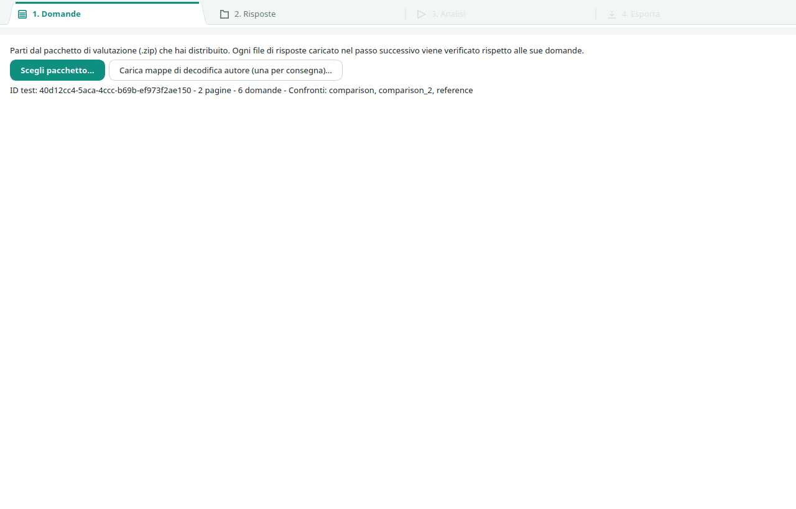

**2 — Risposte.** **Aggiungi file delle risposte...** — `.json`, i file Excel dei valutatori o CSV.

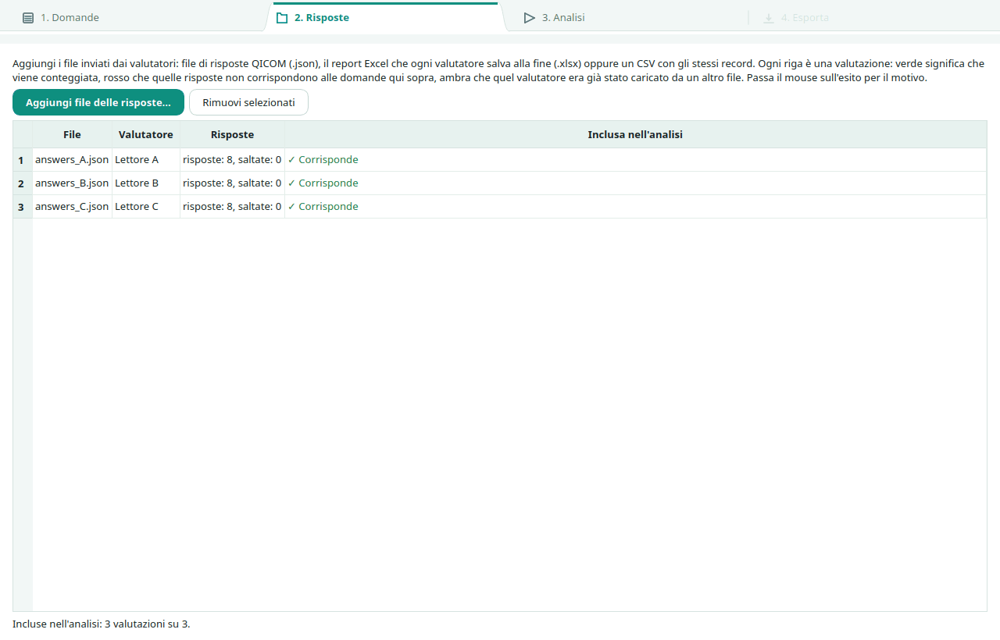

- **Verde** = conteggiato. **Rosso** = non corrisponde a queste domande (passaci sopra per vedere perché).
  **Ambra** = questo valutatore è già stato caricato da un altro file.
- Ne aspettavi 10 e ne arrivano 20? Qualcuno ha risposto due volte. Decidi tu.

**3 — Analisi.** **Esegui l'analisi.**

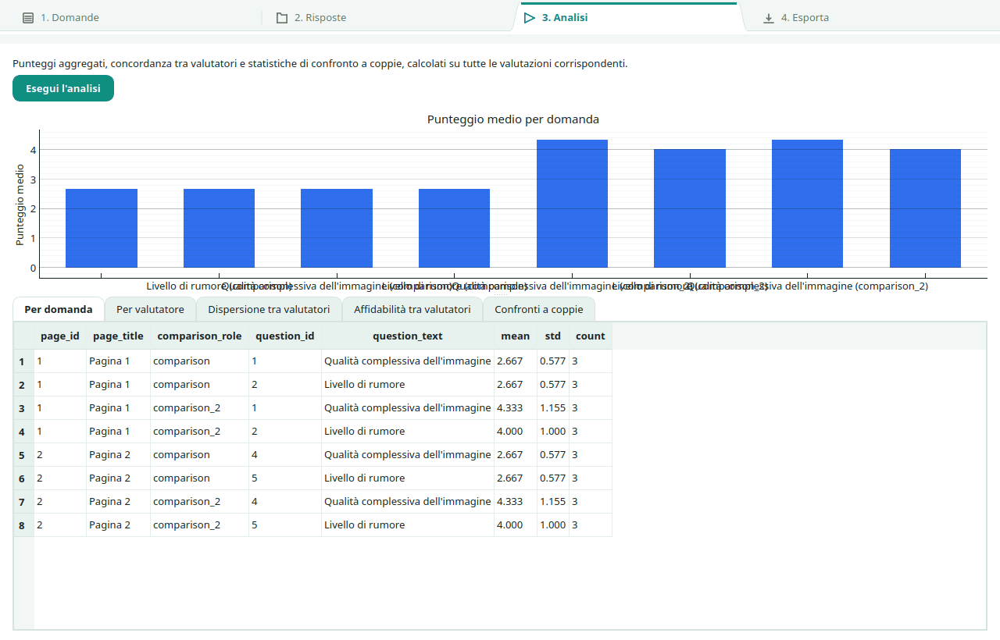

Schede: per domanda, per valutatore, dispersione tra valutatori, affidabilità tra valutatori,
confronti a coppie. Dettagli: [QUALITATIVE_METHODOLOGY.md](../../QUALITATIVE_METHODOLOGY.md) (in inglese).

**4 — Esporta.** Excel (con grafici) o una cartella di file CSV.

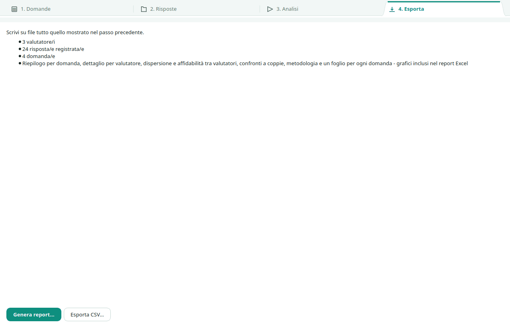

---

## 6. Radiomica: confrontare le feature dentro una regione

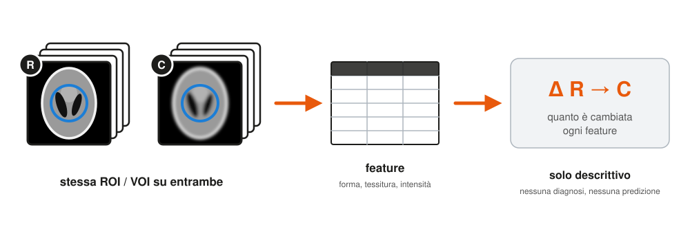

La radiomica trasforma l'interno di una regione in numeri (forma, intensità, tessitura),
poi mostra quanto è cambiato ogni numero da **R** a **C**. Solo DICOM e NIfTI.

**Passo 1 — Immagini.** Carica il riferimento (1) e il confronto (2): clicca il riquadro,
usa **Carica immagini** o il menu **File** (file o cartella DICOM).

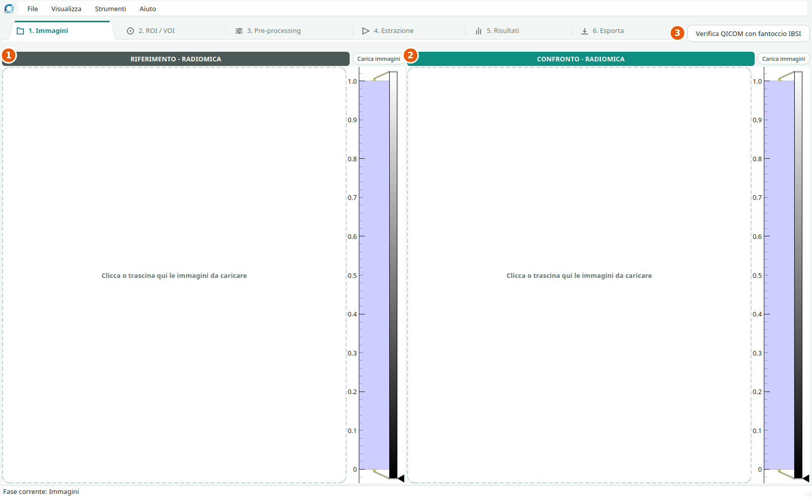

3. **Verifica QICOM con fantoccio IBSI** — autoverifica facoltativa (vedi sotto).

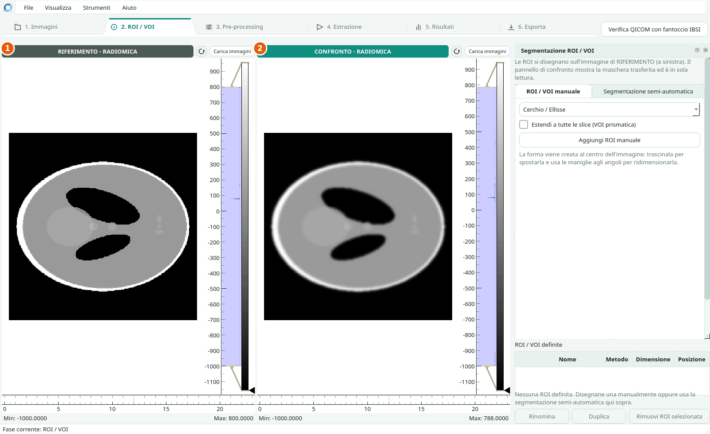

**Passo 2 — ROI / VOI.** Disegna sul **riferimento** (a sinistra). Il confronto riceve la stessa regione.

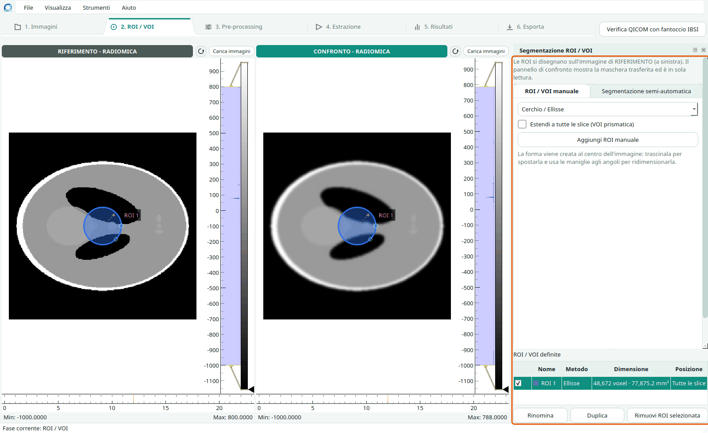

- **ROI / VOI manuale:** scegli una forma → **Aggiungi ROI manuale** → trascinala e ridimensionala.
  Spunta **Estendi a tutte le slice** per una regione 3D (VOI).
- **Segmentazione semi-automatica:** soglia o crescita di regione a partire da un clic.
- Una segmentazione fatta con un altro programma: **File → Importa labelmap NIfTI…**
- L'elenco in basso mostra ogni regione: dimensione in voxel e mm³, slice che copre.

**Passo 3 — Pre-processing.** La ricetta applicata prima dell'estrazione.

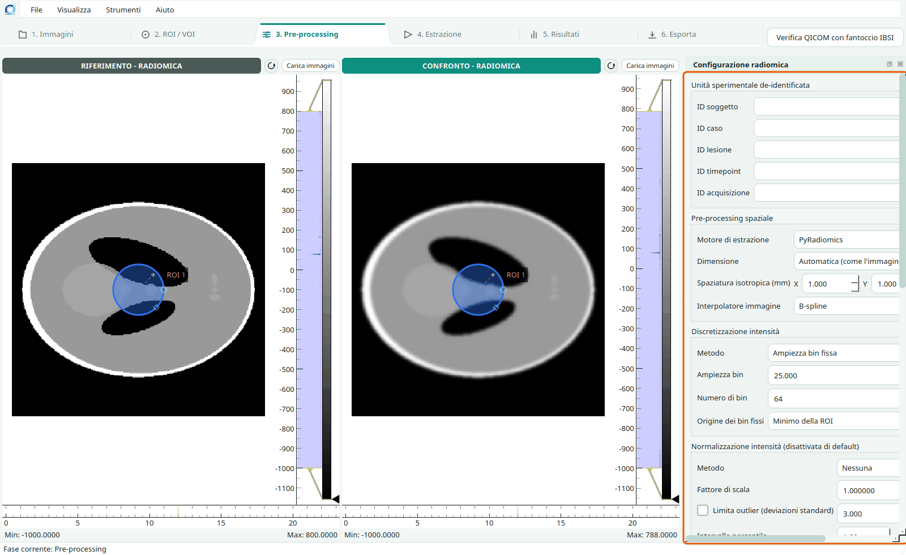

- Campi di **identità** (soggetto, caso, lesione, timepoint): usa codici, mai nomi.
- **Motore** (PyRadiomics, o MIRP se installato), **spaziatura dei voxel**, **interpolazione**.
- **Discretizzazione:** ampiezza fissa dei bin o numero fisso di bin.
- **Normalizzazione / clipping:** disattivati di default. Non cambia nulla se non lo chiedi.

**Passo 4 — Estrazione.** Controlla il riepilogo, poi 1 **Estrai tutte le feature**.

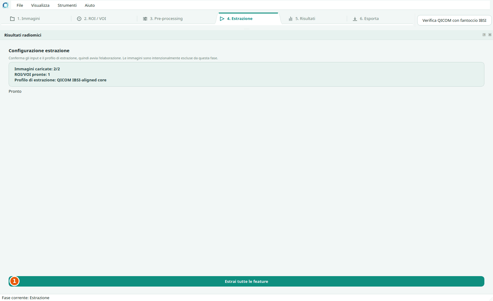

**Passo 5 — Risultati.**

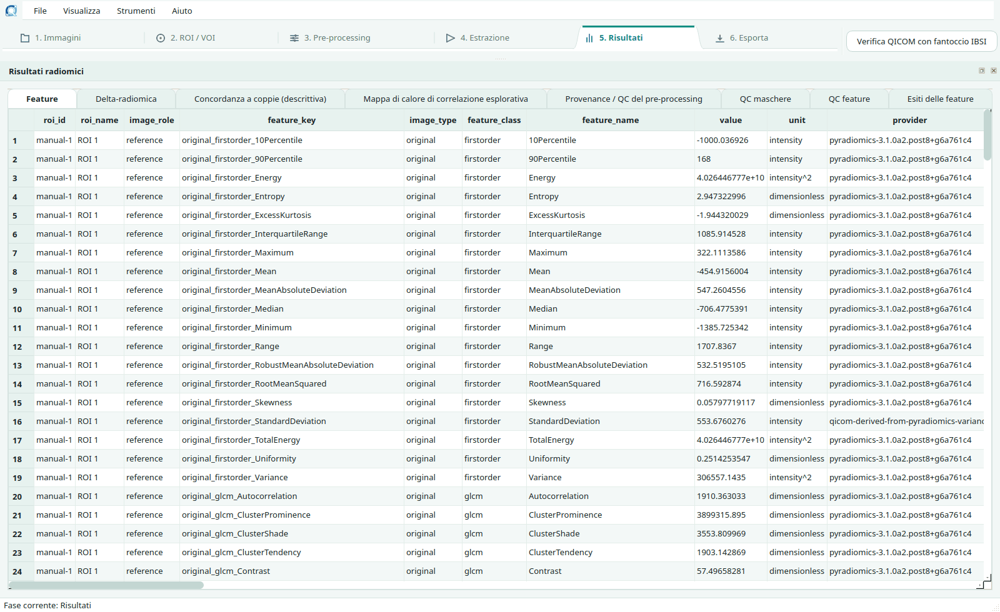

| Scheda | Mostra |
|---|---|
| Feature | ogni feature, per R e per C |
| Delta-radiomica | variazione R → C (assoluta e in %) |
| Concordanza a coppie | quanto sono vicine R e C, solo descrittiva |
| Mappa di calore di correlazione esplorativa | quali feature si muovono insieme |
| Provenance / QC del pre-processing | esattamente cosa è stato fatto alle immagini |
| QC maschere | Dice, Jaccard, differenza di volume, Hausdorff... tra le due maschere |
| QC feature / esiti | avvisi, e cosa è stato calcolato o saltato, e perché |

**Passo 6 — Esporta.** 1 **Excel** · 2 **set CSV** · 3 **HTML autonomo**.
Salva il progetto con **File → Salva progetto radiomico** (`.zip`).

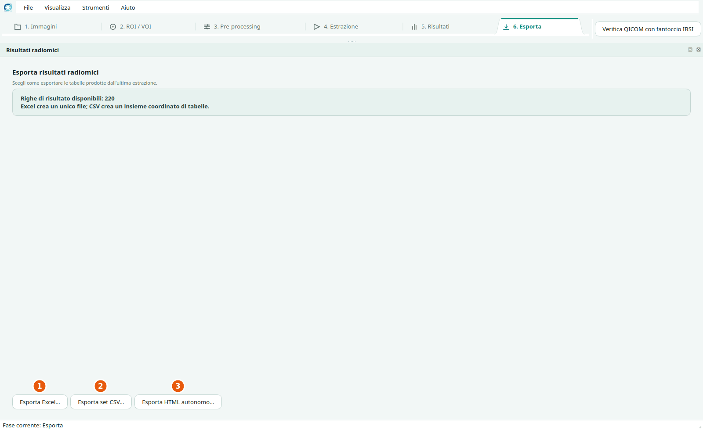

> Statistiche come l'ICC richiedono almeno **tre soggetti indipendenti**. Usa
> **Strumenti → Aggrega coorte radiomica...** su più progetti radiomici salvati.
> Niente modelli predittivi, niente soglie cliniche: sono fuori dallo scopo.

### Autoverifica IBSI

- Confronta QICOM con il fantoccio digitale ufficiale IBSI (104 feature).
- **Esegui verifica IBSI** scarica i file ufficiali **solo dopo il tuo consenso**,
  li verifica e li conserva per l'uso offline.
- **PASS** = ogni feature richiesta è entro la tolleranza. **INCOMPLETE** = ne mancano alcune.
- È un controllo delle formule, non una certificazione.

---

## 7. Strumenti di utilità

Si aprono dalla schermata iniziale (**Strumenti di utilità**) o da **Strumenti** in ogni finestra.
L'elenco è a sinistra, lo strumento a destra.

**Ogni strumento segue le stesse regole:**

- ✓ Non modifica mai i file originali. Scrive **copie**, in una cartella **nuova**.
- ✓ Un risultato compare tutto insieme, o per niente — mai scritto a metà.
- ✓ Un pulsante colorato indica sempre il passo successivo.
- ✓ Stessi comandi del mouse ovunque (rotellina = slice, trascina con il sinistro = contrasto).

| Strumento | Serve a... |
|---|---|
| Segmentazione semi-automatica | costruire una mappa di etichette, una regione alla volta |
| Operazioni e confronto tra maschere | unione, intersezione, differenza; Dice, Jaccard, volumi, Hausdorff |
| Converti immagini | DICOM / NIfTI / stack di bitmap → NIfTI, slice PNG o slice TIFF |
| Ricampiona | cambiare la dimensione dei voxel, o adattarsi alla griglia di un'altra immagine |
| Aritmetica tra immagini | differenza, differenza assoluta, somma, media, rapporto |
| Degradazione controllata | aggiungere rumore, sfocatura, perdita di risoluzione, JPEG — ripetibile da un seed |
| Ispeziona e modifica tag DICOM | leggere ogni tag; scrivere copie modificate |
| Confronta header DICOM | due header affiancati; solo le differenze |
| Controlla e organizza cartelle DICOM | trovare slice mancanti o mescolate; copiare in un albero ordinato |
| Decomprimi DICOM | riscrivere DICOM compressi senza compressione, per software più vecchi |
| Anonimizza immagini | copia de-identificata di un'intera cartella |

### Segmentazione semi-automatica

- Separa **classi di intensità** (aria, grasso, tessuti molli, osso), non organi.
- I preset CT danno intervalli HU come **punto di partenza**. Regolali.
- **Applica** può: togliere dall'immagine, tenere solo questo, o assegnare a un'etichetta.
- Salva una mappa di etichette NIfTI + una tabella JSON di nomi e colori. Annulla/ripeti a ogni passo.

### Operazioni e confronto tra maschere

Apri la maschera **A**, poi la maschera **B** (stessa griglia). Combinale, riempi le slice vuote,
oppure **Confronta A e B** → Dice, Jaccard, volumi, Hausdorff (mm). Esporta in CSV.

### Converti immagini

Apri un file o una cartella → scegli **Volume NIfTI**, **Slice PNG** (come a schermo, 8 o 16 bit)
o **Slice TIFF** (valori reali) → **Converti...** Viene creata una nuova cartella `<nome>_<formato>`.

### Ricampiona

**A una spaziatura dei voxel** (scrivi i mm, o clicca **Isotropa**) oppure
**sulla griglia di un'immagine di riferimento**. Posiziona le immagini in base alle loro coordinate —
**non** le registra (non le allinea).

### Aritmetica tra immagini

Apri due o più immagini sulla stessa griglia (A, B, ...) → scegli un'operazione → **Calcola** →
**Salva il risultato...**

### Degradazione controllata

1. Scegli un effetto (rumore gaussiano/di Poisson, sfocatura gaussiana, perdita di risoluzione, JPEG).
2. Imposta l'intensità e il **seed** → **Applica**. Aggiungi altri effetti; toglili dall'elenco quando vuoi.
3. **Salva immagine degradata...** La ricetta viene salvata insieme, così chiunque può rifare la stessa immagine.

Utile per vedere quale metrica nota quale tipo di danno.

### Ispeziona e modifica tag DICOM

- Apri un file o una cartella. Scegli la serie e il file.
- **Cerca** qualsiasi tag. **Nascondi tag privati**. **Esporta CSV**.
- Doppio clic su **Nuovo valore** per modificare. I tag dei pixel sono bloccati; quelli che cambiano
  le misure chiedono conferma.
- **Scrivi le copie in una cartella...** Gli originali non vengono mai toccati.

> I valori sono mostrati così come sono salvati, dati del paziente compresi. Anche un export CSV li contiene.

### Confronta header DICOM

Apri due file. Spunta **Solo differenze** e **Nascondi UID** per vedere cosa è cambiato davvero
tra due acquisizioni.

### Controlla e organizza cartelle DICOM

**Scegli cartella...** → una riga per studio e serie, con i problemi trovati
(slice mancanti, spaziatura irregolare, orientamento misto). **Esporta il report (CSV)** oppure
**Copia organizzata in una cartella...** (cartelle con il nome di studio e serie, mai del paziente).

### Decomprimi DICOM

Apri un DICOM compresso (JPEG lossless, JPEG-LS, JPEG 2000, RLE...) → viene riscritto senza
compressione, un file per frame, in una cartella nuova.

### Anonimizza immagini

1. **Scegli file...** o **Scegli cartella...** (spunta **Includi le sottocartelle** se serve).
2. Leggi l'elenco: **cosa succede** a ogni file. I file che non si possono verificare sono indicati qui.
3. Facoltativo: **Sostituisci i nomi di cartelle e file con nomi generici.**
4. **Anonimizza.** Le copie vanno in `<cartella>_anonymized`.

> ✗ Il testo **impresso nei pixel** non viene rilevato né rimosso.
> ✓ Apri la copia e controllala prima di condividerla.

---

## 8. Impostazioni

Si aprono dalla schermata iniziale (pulsante impostazioni) o da **Strumenti → Impostazioni**.
Le modifiche si salvano da sole.

| Scheda | Cosa imposti |
|---|---|
| Generale | lingua (8 lingue, cambia subito), tema, formato numeri, decimali |
| Metriche predefinite | quali metriche sono spuntate all'inizio di una nuova analisi; modello di riferimento NSS |
| Identità | il tuo nome, compilato quando esegui una valutazione non anonima |
| Diagnostica | crea una demo sintetica / pacchetto bug report (nessun dato di pazienti) |

**Ripristina predefiniti** rimette tutto com'era.

---

## 9. Privacy e sicurezza

- ✓ Le immagini sono elaborate **solo sul tuo computer**. Nessun upload. Nessuna telemetria.
- ✓ Progetti e pacchetti di valutazione **anonimizzano i DICOM di default**.
  Se un file non può essere anonimizzato in modo sicuro, QICOM **si ferma e te lo dice**. Esportarlo
  comunque richiede il tuo OK esplicito, e quei file vengono segnati come non verificati.
- ✓ I file ZIP importati vengono controllati prima di essere aperti.
- ✓ Il testo che sembra una formula di foglio di calcolo viene neutralizzato negli export Excel/CSV.
- ✗ QICOM non legge né rimuove il testo impresso nei pixel.
- ✗ Gli ZIP dei progetti quantitativi mantengono così come sono gli header NIfTI e i nomi originali dei file.

Tutti i dettagli: [SECURITY.md](../../SECURITY.md) (in inglese).

---

## 10. Quando qualcosa non va

| Problema | Prova così |
|---|---|
| L'app non parte (Windows) | Prima estrai in una cartella vera. Non avviarla da dentro lo zip. |
| macOS dice che l'app è danneggiata / sconosciuta | Controlla il checksum, poi *Privacy e sicurezza → Apri comunque*. |
| "Numero di slice non corrispondente" prima del calcolo | Scegli *Usa solo la slice attualmente visualizzata* o *Usa stack completi (taglia al più corto)* — oppure carica serie corrispondenti. |
| Le immagini hanno dimensioni diverse | **Strumenti → Ricampiona** il confronto sulla griglia del riferimento. |
| Manca una metrica nei risultati | Serve un modello (clicca **Scarica** in Analizza) oppure l'immagine è troppo piccola. Controlla la colonna/registro degli esiti. |
| LPIPS / DISTS non compaiono mai | I loro modelli non sono inclusi. Scaricali una volta in **Analizza** (o Impostazioni → Metriche predefinite). |
| La radiomica rifiuta il mio PNG/JPG | La radiomica richiede DICOM o NIfTI (geometria reale). Converti prima. |
| Un file di risposte è rosso in Aggrega | Appartiene a un questionario diverso. Passa sopra il verdetto per leggere il motivo. |
| "Le risposte non possono essere aggregate" | Leggi il dettaglio, es. in un file manca un commento obbligatorio. |
| Ho dimenticato il codice di accesso | Non si può recuperare. Usa la copia di lavoro non protetta. |
| Lo schermo appare sbagliato / troppo piccolo | Cambia tema in **Visualizza**; sugli schermi piccoli le finestre scorrono. |

### Errori e log

- Un indicatore nella barra di stato segnala errori non letti. Cliccalo, oppure apri
  **Visualizza → Pannelli → Errori**.
- **Aiuto → Segnala un bug...** → **Salva report errori…** (versione, sistema, log recente, nessuna
  immagine) e allegalo alla tua e-mail. Puoi aggiungere anche il pacchetto demo sintetico.

Il file di log:

| Sistema | File di log |
|---|---|
| Windows | `%LOCALAPPDATA%\qicom\Logs\qicom.log` |
| macOS | `~/Library/Logs/qicom/qicom.log` |
| Linux | `~/.local/state/qicom/log/qicom.log` |

**Aiuto → Informazioni su QICOM** mostra la versione, la licenza e come citare QICOM.

---

## 11. Le parole di QICOM

| Parola | In parole semplici |
|---|---|
| **Riferimento (R)** | l'immagine di cui ti fidi |
| **Confronto (C)** | un'immagine che testi rispetto al riferimento |
| **Slice** | un'immagine 2D dentro un volume 3D |
| **ROI / VOI** | una regione che disegni: 2D (ROI) o attraverso le slice (VOI) |
| **Finestra / livello** | contrasto e luminosità della visualizzazione; non cambia mai i dati |
| **Metrica** | una formula che trasforma due immagini (o una) in un numero |
| **Profilo** | un insieme salvato di metriche (es. Core rapido) |
| **Intervallo dati** | l'intervallo dei valori possibili dei pixel, usato da PSNR e SSIM |
| **Mappa di calore** | una mappa colorata di dove due immagini differiscono |
| **SNR / CNR** | rapporto segnale-rumore / contrasto-rumore: quanto risalta un tessuto |
| **HU** | unità Hounsfield, la scala di intensità della CT (aria ≈ −1000, acqua = 0) |
| **In cieco** | i valutatori non sanno quale immagine è quale |
| **Seed** | un numero che rende ripetibili un mescolamento o un rumore "casuali" |
| **Pacchetto** | lo `.zip` che contiene una valutazione (immagini + domande) |
| **Mappa di decodifica** | il file che dice quale etichetta neutra (A, B, C) corrisponde a quale immagine |
| **Feature** | un numero radiomico: forma, intensità o tessitura dentro una regione |
| **Delta (Δ)** | quanto è cambiata una feature da R a C |
| **IBSI** | lo standard internazionale per le definizioni delle feature radiomiche |
| **Ricevuta** | il registro salvato con i risultati: versioni, impostazioni e impronte (hash) di ogni input |
| **Anonimizzare** | togliere da una copia del file i dati che identificano una persona |

---

*Per approfondire (in inglese):* [README](../../README.md) ·
[Metodologia qualitativa](../../QUALITATIVE_METHODOLOGY.md) ·
[Metodologia radiomica](../../RADIOMICS_METHODOLOGY.md) ·
[Sicurezza](../../SECURITY.md)

*Gli screenshot usano un fantoccio sintetico e dati DICOM inventati. Nessuna immagine di pazienti.*
